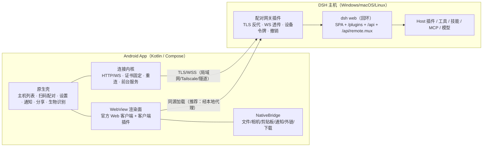
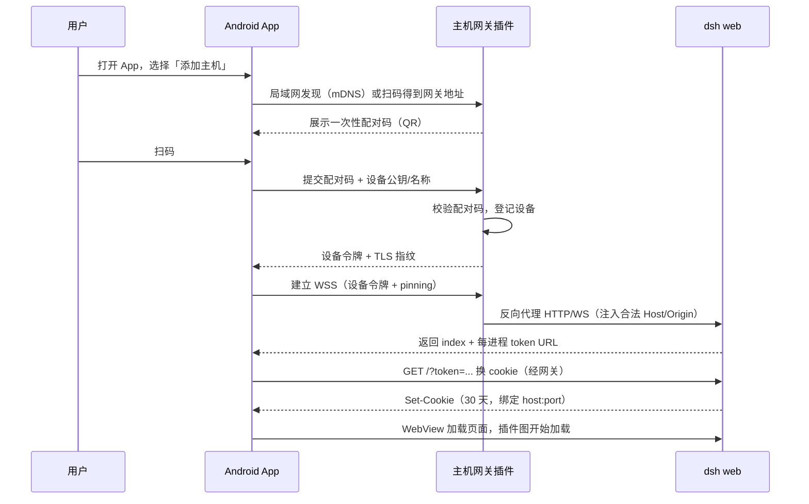

> **实现基线（v2.0）**：最终详细设计与实现路径见 [DSH-Android客户端-详细设计-v2.0.md](DSH-Android客户端-详细设计-v2.0.md)。

# 自研 Android 原生 DSH 客户端可行性报告

**主题：在「兼容 DSH 全部插件」约束下，做一个 Android 原生客户端的可行性、架构选择与实施路径**

- 版本：v1.0（预研稿）
- 日期：2026-10-17
- 调研对象：DeepSeek Harness（DSH）`0.2.0-rc.2` 桌面运行时 + Web 客户端，社区插件注册表（5065 条，2026-10-16 更新），工作区内 5 个现有客户端/网关项目
- 方法：解包 `app.asar` 阅读官方包 README 与源码、拉取官方 GitHub 文档、抓取社区插件注册表做统计、只读审阅现有客户端仓库
- 结论一句话：**可行，但「兼容全部插件」与「每一屏都用原生控件渲染」在 DSH 现架构下互斥。唯一同时满足「全部插件」的产品化路线是：原生 App 壳 + 官方 Web 客户端渲染面（WebView）。官方桌面端就是这么做的。**

> **v1.1 修订（2026-10-17）**：在「UI 可以原生、插件零改动、API 不能有问题」的新约束下，推荐形态调整为「原生核心 + 官方 Web 兼容面」，详见 [`DSH-Android客户端-方案修订-v1.1.md`](DSH-Android客户端-方案修订-v1.1.md)。本文的插件契约分析、约束与评分仍然有效；§0.1 判定表第 1 条（纯原生）依然成立，因为纯原生必然破坏 Client 插件 API，而不只是 UI 不兼容。

---

## 0. 一页结论

### 0.1 四条判定

| # | 需求组合 | 判定 | 说明 |
|---|---|---|---|
| 1 | 纯原生渲染（每屏 Compose/原生控件） + 兼容全部 DSH 插件 | **不可行** | 不是工程量问题，是契约问题：客户端插件是 Web React 模块，依赖 DOM、官方模块表和 slot 树 |
| 2 | 原生 App 壳 + 官方 Web 客户端渲染面 + 兼容全部插件 | **可行（推荐）** | 与 DSH Desktop 同构；原生系统能力 + 完整插件生态 |
| 3 | 纯原生 + 核心 Agent 能力（ACP/SDK/自研协议） | **可行，但不满足「全部插件」** | 插件 UI 全部丢失；Host 侧工具/技能/模型类插件仍可用 |
| 4 | 手机本地跑完整 DSH（DSHA 路线） | **可行，但很重** | 273–345 MB APK、arm64、proot 环境；插件 100% 兼容，但 UI 仍是 Web |

### 0.2 三个硬事实

1. **DSH 插件分两半。** Host 半（Node.js/Cordis 插件）跑在电脑上，加工具、加技能、加模型、加 MCP、加 LLM provider——任何客户端都「自动兼容」，因为它根本不在客户端运行。Client 半（`dsh.client.platform = "web"`）是浏览器里的 React 插件，只能跑在官方 Web 客户端里。
2. **客户端插件 = 浏览器侧 Cordis 应用的一部分。** 插件 `client.js` 以 `window.__ModuleLoader__.load({...})` 注册惰性 factory，从宿主模块表 `require('react')`，再通过 `ctx.slots.register()` 注入 React 组件。原生控件无法承载这套契约。
3. **官方桌面端就是这个架构。** 官方架构文档写明：Electron 启动私有 Desktop Host，「窗口立即加载打包 Web 资源，等待启动注入后在同一文档中激活客户端插件」。把 Electron 换成 Android 的 Kotlin 壳 + WebView，就是本报告推荐的方案。

### 0.3 量化：不兼容原生，会丢多少插件？

| 指标 | 数值 | 口径 |
|---|---|---|
| 社区插件总数 | **5,065** | awesome-dsh-plugin.com 注册表（2026-10-16 更新，2026-10-17 抓取） |
| UI 类插件 | 884（17.5%） | `category = ui` |
| 主题类 | 199（3.9%） | `category = theme` |
| 娱乐/挂件类 | 150（3.0%） | `category = fun` |
| 三类合计（强 UI 依赖） | **1,233（24.3%）** | 下界 |
| 描述中提及 Web UI / 面板 / 悬浮 / 侧边栏 | **2,095（41.4%）** | 上界（文本启发式） |
| 本机已安装的 5 个插件中带 Web 客户端半的 | **5 / 5** | dsh-plugin-hub、dsh-pocket、dsh-context、dshmarket、dsh-purge |

**结论：纯原生自绘至少丢掉 1/4、大概率接近 2/5 的插件。** 这不是「少数装饰插件」，而是设置面板、插件市场、上下文仪表盘、侧边栏工具这些高频入口。

### 0.4 推荐路线与成本

- **架构**：Kotlin/Compose 原生壳 + WebView 承载官方 Web 客户端 + 主机侧配对/网关插件 + 移动端适配插件 + 原生能力桥。
- **工期**：1 名资深 Android + Web 开发，约 **3–4 人月**到「可日用」；2 人并行约 2.5 个月。
- **持续成本**：DSH 处于 `0.2.0-rc.2`、nightly 更新节奏，需要 **每版 20–30% 的兼容维护**（契约探针 + 插件回归）。
- **真正的产品差异点**：一键二维码配对、多主机切换、锁屏审批/通知、分享到 DSH、语音输入、生物识别锁、TLS 固定、离线壳。**不是**「自己重画一遍聊天界面」。

### 0.5 需要你拍板的三件事

1. **「原生」的定义**：是「原生 App 壳 + 系统集成」（可选方案 B），还是「每一屏都必须 Compose 原生控件」？后者必须放弃「全部插件」。
2. **是否接受用户在电脑上装一个自研主机插件**（配对、TLS、局域网、推送）？不装的话，官方 `dsh web` 只监听 127.0.0.1，手机根本连不上。
3. **是否需要脱离电脑**（在手机上跑完整 DSH）？需要则走 DSHA 路线（方案 F），不需要则走方案 B。

---

## 1. 需求解构与「原生」的定义

### 1.1 把需求拆成三条

| 编号 | 需求 | 性质 | 冲突点 |
|---|---|---|---|
| R1 | 兼容 DSH 的**全部**插件 | 功能约束 | 与 R3 直接冲突 |
| R2 | Android 客户端（不是 PWA/浏览器书签） | 交付形态 | 与 R1 无冲突 |
| R3 | 「安卓原生」 | 体验约束 | 若指每屏原生控件，与 R1 冲突 |

### 1.2 「原生」的三档定义

| 档位 | 定义 | 与全插件兼容 |
|---|---|---|
| N1 原生 App 壳 | Kotlin/Compose 工程、原生导航/通知/相机/文件/后台，内容区可含 WebView | ✅ 可同时满足 |
| N2 原生系统集成 | N1 + 通知、小组件、分享目标、生物识别、TLS、后台服务 | ✅ 可同时满足 |
| N3 全原生渲染 | 聊天、设置、插件页等每一屏都是原生控件，不用 WebView | ❌ 与 R1 互斥 |

**本报告的判断标准：如果 R3 = N1/N2，方案 B 可行且推荐；如果 R3 = N3，则必须在 R1 与 R3 之间二选一。**

### 1.3 一个必须接受的现实

即使做方案 B，用户看到的「聊天界面/设置界面」仍然是官方 Web UI 的渲染结果。原生的是**壳、系统能力和连接体验**，不是像素。想清楚这一点，后面的取舍才成立。

---

## 2. DSH 插件体系解剖

### 2.1 三层结构

```
┌──────────────────────────────────────────────────────────────┐
│ Host（电脑上的 Node.js 进程，Cordis 插件树）                  │
│  ├─ Host 插件：工具、技能、模型、MCP、LLM provider、会话存储  │
│  ├─ API Gateway：Typert Remote（/api + /api/remote.mux WS）    │
│  └─ Web Server：静态 SPA、/plugins bundle、认证与信任栅栏      │
├──────────────────────────────────────────────────────────────┤
│ Client（浏览器里的 Cordis 应用，React 18）                    │
│  ├─ dsh-client-* 基础包（62 个，其中 53 个 ui-*）             │
│  ├─ Client 插件：dsh.client.platform = "web"                  │
│  └─ Slots：React 组件注册表（root / 侧栏 / 输入坞 / 覆盖层）   │
├──────────────────────────────────────────────────────────────┤
│ 共享：Typert 生成契约、Session 事件、presentation 数据         │
└──────────────────────────────────────────────────────────────┘
```

### 2.2 Host 插件：与客户端无关，天然全兼容

Host 插件是 Cordis 插件（`export function apply(ctx)`），在电脑上运行。它们通过 `dsh.bundle.patch` 往 Loader 树里插行，贡献工具、命令、技能、模型、MCP 服务等。**换任何客户端都不影响它们**——客户端只是通过协议读结果。

> 这一点很重要：如果你只关心「Agent 能力类插件」（工具/技能/模型/MCP），纯原生客户端也能 100% 兼容。真正丢失的是 **UI 类插件**。

### 2.3 Client 插件：只能活在官方 Web 客户端里

官方随包分发的插件开发文档（`skills/cordis-plugin-development/references/ui-plugin.md`）标题就是 **“UI plugins in the Web page”**。最小契约：

```jsonc
// package.json
{
  "exports": { ".": "./index.js", "./client": "./client.js" },
  "dsh": {
    "bundle": { "patch": "./cordis.patch.yml" },
    "client": {
      "platform": "web",
      "immediately": true,
      "inject": ["@deepseek-ai/dsh-client-ui-conversation"]
    }
  }
}
```

```js
// client.js —— 官方模板
window.__ModuleLoader__.load({
  id: '@local/my-decoration',
  factory(require) {
    const React = require('react')            // 从宿主模块表拿 React
    const h = React.createElement
    function Decoration() { return h('svg', { /* ... */ }) }
    return {
      inject: ['slots'],
      apply(ctx) {
        ctx.slots.inject('conversation.composer.dock', () =>
          ctx.slots.register({ name: 'conversation.composer.dock', id: 'my-decoration' }, Decoration))
      }
    }
  }
})
```

**这套契约要求的东西**：`window.__ModuleLoader__`、`window.__DSH_BOOT__` 启动图、冻结的平台模块表、React 18、Cordis 客户端运行时、slot 注册表、DOM/CSS。原生控件一个都提供不了。

平台模块表（从 Web 前端 bundle 中实测得到）包含：

```
react, react/jsx-runtime, react-dom, react-dom/client,
@deepseek-ai/cordis, @deepseek-ai/dsh-client-store,
@deepseek-ai/dsh-client-ui-slots, @deepseek-ai/dsh-client-ui-primitives,
@deepseek-ai/dsh-client-ui-dockkit
```

官方文档的定性描述（`docs/subsystems/web-client.zh.md`）：

> 「Web Client 是由独立加载插件组装而成的**浏览器侧 Cordis 应用**。」
> 依赖方向：Host 状态 → Remote 传输 → Client model → UI adapter → Conversation/presentation → **Slots → React**。

### 2.4 官方桌面端：原生壳 + Web 渲染面

`docs/architecture.zh.md`「桌面应用」一节：

> 「Electron 使用 Electron Node 模式启动私有 Desktop Host……**窗口立即加载打包 Web 资源，等待启动注入后在同一文档中激活客户端插件**。Web 负责 RPC 与流；**桌面载体将本地页面连接到已认证的 Host**。Node IPC 承载启动注入、就绪、致命错误与关闭。」

`dsh-host-webserver` README：

> 「它只服务浏览器；**Electron 通过 `file://` 加载 dist，并经 IPC 桥接承载 fetch**。」

**这就是方案 B 的官方原型**：桌面端没有重写 UI，而是原生壳（Electron）+ 官方 Web 资源 + 传输桥。Android 上做同样的事，技术上完全成立。

### 2.5 版本与兼容节奏

| 事实 | 证据 |
|---|---|
| 当前版本 `0.2.0-rc.2` | `app.asar/dsh/package.json` |
| 更新通道 `nightly` | `resources/app-update.yml` |
| 仓库 MIT、公开、251k stars | GitHub API（deepseek-ai/deepseek-harness） |
| 插件自带兼容声明（如 dsh-context 声明 `dshReleases`；dshmarket/plugin-hub 有兼容矩阵） | 插件 `package.json` 的 `dsh.compatibility` |
| 插件客户端 bundle 按 DSH 版本构建，无跨版本 ABI 承诺 | `dsh.client` 契约 + 社区插件迭代记录 |

**含义**：这不是「一次开发、长期稳定」的生态。任何客户端都要把「跟版」当成常设成本。

---

## 3. 现有客户端横评：你说的「各家问题」从哪来

> 样本来自工作区已克隆的 5 个项目 + 公开 README。以下只做架构归纳，不评价个人项目优劣。

| 项目 | 形态 | 插件 UI 兼容 | 「原生」程度 | 协议/连接 | 主要结构性问题 |
|---|---|---|---|---|---|
| **Clarklevis `dsh-mobile`** | KMP + Compose/SwiftUI 纯原生双端 | ❌ 完全不支持 | 高 | 自研 WebSocket `dsh-mobile-v1` + 主机侧 gateway 插件 + 可选中继 | 协议随 DSH rc 改版（已 3 次 audit）；插件 UI 只能原生重做；功能逐项适配，永远追不全 |
| **saya-ch `dsh-mobile`** | Kotlin WebView 薄壳 + DSH 双面插件 | ✅ 100% | 低 | 已认证 HTTPS 反代 + WS upgrade 代理（不自造业务协议） | 本质是「带配对/隧道的浏览器」；WebView 内核碎片（华为 WebView 114 未验收）；SSE 无离线补发；皮肤/布局依赖官方类名 |
| **liguobao `ds-harness-remote`** | React Native / Expo 自绘 + 自有服务端 | ❌（插件路由只白名单 `api/bot`） | 中 | REST/JWT → WSS → Noise IK → WebRTC P2P/TURN | 自建协议栈与中继，运维成本高；插件 UI 不可用；需账号体系 |
| **`dsh-pocket`** | 主机插件，把官方 Web UI 远程同屏 | ✅ 100% | 低（手机浏览器） | QR + 局域网/cloudflared + 密码 + WS 全透传 | 依赖电脑常开与隧道；重启后需重输；安全边界靠密码；不是 App |
| **DSHA** | Android 启动器，手机本地跑完整 DSH（proot Ubuntu） | ✅ 100% | 低（WebView/GeckoView） | 本机回环 | APK 273–345 MB、仅 arm64；内核/兼容设备验收慢；发热与内存 |

### 归纳成 5 个结构性问题

1. **原生自绘 ⇒ 插件 UI 归零。** 不是没做，是契约上做不到。所有「原生客户端」最终都要把插件管理页、市场页、仪表盘逐个人工重写——而且只能覆盖自己重写过的插件。
2. **WebView 薄壳 ⇒ 体验不像原生。** 官方 UI 是桌面布局，手机竖屏需要移动适配插件（`dsh-web-mobile`），且壳越薄，系统集成越少（通知、分享、后台）。
3. **自研协议 ⇒ 永久跟版。** DSH 的 Remote/Typert 是内部生成契约，不是公开稳定 API；每个 rc 都可能动。自建协议等于替官方维护一层适配器。
4. **官方只监听回环 ⇒ 所有远程方案都要自带网关/隧道。** `dsh web` 拒绝 `--host 0.0.0.0`；每进程一个 URL token；没有账号体系。手机直连是做不到的。
5. **没有官方移动端/公开 API 文档。** 移动端是社区填空，方案各自为政，没有「标准答案」可以照抄。

**上述问题中，前四条正是方案 B 想同时解决的：保留真 Web 渲染（插件 100%），把网关/配对/系统集成做成原生强项（体验接近原生）。**

---

## 4. 官方可用接口盘点

| 接口 | 能力 | 稳定性 | 能否支撑「全插件客户端」 |
|---|---|---|---|
| **Web Remote**（`/api` HTTP + `/api/remote.mux` WS） | 官方 Web 客户端用的全部能力：会话、工作区、设置、终端、文件、审批、事件流 | 内部生成契约（Typert descriptor/codec），无公开规范；随版本漂移 | 能拿到数据，但**渲染不了插件 UI** |
| **ACP**（`dsh --profile acp`） | 标准 Agent Client Protocol：建/恢复会话、prompt、cancel、工具生命周期、权限、模型选择、MCP | 协议本身是标准；DSH 侧实现随版本迭代 | ❌ 明确不提供 DSH 专用呈现/交互 UI |
| **SDK JSON-RPC**（`dsh --profile sdk`） | `initialize` / `session/prompt` / `shutdown` + 4 种通知 | 预发布，无版本协商、无取消/关闭 | ❌ 极简自动化接口 |
| **静态 SPA + `/plugins`** | 官方 Web 客户端本体 + 全部客户端插件 bundle | 前端资源公开可访问；插件图随版本变化 | ✅ **唯一能承载全部插件 UI 的宿主** |

关键引文：

- ACP README：「它刻意**不提供 DSH 专用呈现数据与交互式 UI 功能**」「当人类需要 DSH 专用呈现卡片、计划、标题、todo、终端视图或 elicitation 时请避开」。
- SDK Protocol README：「**无协议版本协商**」「无取消与会话关闭方法」「处于预发布阶段，无兼容承诺」。
- `docs/subsystems/web-client.zh.md`：Web Client 是「浏览器侧 Cordis 应用」，UI 最终落到 Slots → React。

**结论：任何「纯原生 + 自研协议」的方案，本质上是在重写 Web Client 的数据层与呈现层，且永远拿不到插件 UI。**

---

## 5. 关键工程约束（决定架构的 8 个事实）

| # | 事实 | 证据 | 对设计的影响 |
|---|---|---|---|
| 1 | 官方 Web 服务只允许 `127.0.0.1` 或 `0.0.0.0`，而 `--host 0.0.0.0` 被 CLI 硬拒 | `dsh-web-app/lib/startup.js`：`--host 0.0.0.0 is intentionally not supported yet for safety... use 127.0.0.1` | 手机无法直连；**必须自带主机侧反代/隧道/网关** |
| 2 | 认证 = 每进程随机 token 拼进启动 URL，`GET /?token=` 换签名 cookie；cookie 绑定 host:port、HttpOnly、SameSite=Strict、默认 30 天；静态资源公开 | `dsh-client-connection` README | 原生壳要「代用户完成 token 交换」；cookie 可持久化；**重启换 token 但 cookie 在有效期内仍可用**（签名密钥持久化在 `$DSH_HOME/.credentials.yaml`） |
| 3 | 只接受 cookie，不接受 `Authorization` header token；无 logout | 同上 | 设备撤销只能删凭据记录重启；多设备管理要自己做 |
| 4 | Host/Origin 信任栅栏：Host 必须是 loopback 或 `trustedHosts`，Origin 必须等于 Host，跨站一律拒绝 | 同上 | 反代/网关必须正确改写 Host/Origin；WebView 直连最省事 |
| 5 | SPA **没有 History API pathname 路由**，只从 `/` 或配置 index 进入 | `dsh-host-frontend-static` README | 无法「深链到某个插件设置页」；原生 Tab → WebView 指定插件页需要程序化导航（脆弱） |
| 6 | 官方 CSS 没有按视口宽度的断点（只有 10 处 `prefers-reduced-motion`），桌面布局 | 解包 `dsh-web-frontend/dist` 实测 | 手机竖屏必须叠加移动适配（`dsh-web-mobile` 或自研 CSS） |
| 7 | 插件 bundle 体积可观：dshmarket `client.js` 754 KB、dsh-plugin-hub 941 KB；官方前端 1.37 MB JS | 实测 | 首屏/内存/低端机要测；WebView 进程内存预算要留足 |
| 8 | 官方 Web 面只有浏览器壳：Electron 也复用同一份 Web UI（`file://` + IPC 桥），没有独立的原生 UI | `dsh-host-webserver` README | 证明「原生壳 + 官方 Web 资源」是官方已走通的形态；Android 可复刻 |

补充：WebView 需要较新的 Chromium。社区实测需 shim `Iterator`、`Promise.withResolvers`、`AbortSignal.any` 等 API（saya-ch 已做）；老设备/无 GMS 设备（华为）需要设最低 WebView 版本或内置 GeckoView 兜底（DSHA 的做法）。

---

## 6. 方案对比与评分

### 6.1 六个候选方案

| 代号 | 方案 | 一句话 |
|---|---|---|
| A | 纯 WebView 薄壳 | 把官方 Web UI 装进 App，加配对与隧道（saya-ch 型） |
| **B** | **原生壳 + 官方 Web 渲染面** | Compose 壳负责连接/系统能力，WebView 负责官方 UI 与插件（推荐） |
| C | 原生核心 + WebView 插件面板 | 聊天/会话列表原生，插件相关页面进 WebView |
| D | 纯原生自绘 | 全部界面原生，自研协议（Clarklevis/RN 型） |
| E | 纯原生 + ACP/SDK | 只做 Agent 交互（会话/审批/工具），放弃 DSH UI |
| F | 手机本地跑完整 DSH | proot 环境 + 本地 Web UI（DSHA 型） |

### 6.2 加权评分（兼容 40 / 原生 25 / 成本 20 / 风险 15）

| 方案 | 插件兼容 | 原生体验 | 成本友好 | 风险可控 | 加权分 |
|---|---|---|---|---|---|
| A 薄壳 | 100 | 20 | 90 | 70 | **73.5** |
| **B 原生壳+Web 面** | **100** | **55** | **65** | **65** | **76.5** |
| C 原生核心+Web 面板 | 90 | 70 | 35 | 45 | 67.3 |
| D 纯原生自绘 | 0 | 100 | 25 | 45 | 36.8 |
| E 纯原生+ACP | 0 | 100 | 60 | 70 | 47.5 |
| F 本地跑 DSH | 100 | 25 | 20 | 40 | 56.3 |

**敏感性说明**：若把「原生体验」权重提到 40%，没有任何方案能同时满足兼容与原生——必须二选一。这正是本报告要你先拍板 0.5 节三件事的原因。

### 6.3 为什么推荐 B 而不是 A

- A 只是「浏览器 + 配对」，系统集成弱，用户会问「我为什么不直接用 dsh-pocket / DSHA」。
- B 在 A 的基础上把**连接、通知、分享、语音、多主机、安全**做成原生能力，同时保留 100% 插件兼容——这是现有产品没有占住的空位。
- B 的复杂度主要来自「壳 + 网关」，不来自「重写 UI」，因此可控、可分期、可回退。

---

## 7. 推荐方案 B：原生壳 + 官方 Web 渲染面

### 7.1 总体架构



### 7.2 渲染面的三种实现（按阶段选择）

| 方式 | 做法 | 优点 | 缺点 | 建议 |
|---|---|---|---|---|
| R1 远程 URL | WebView 直接加载网关提供的 `https://host/` | 最简单、同源、cookie 正常、插件图由主机提供 | 依赖网络；首屏慢；离线下白屏 | **M1 先用** |
| R2 App 内本地代理 + 内置 dist | App 内跑一个 loopback HTTP 服务，静态资源来自 APK，`/api`、`/plugins` 反代到主机 | 启动快、可离线壳、同源无 CORS、可注入移动适配 | 需要把 dist 与主机版本对齐；代理要处理 Cookie/Host/WS | **M2 演进** |
| R3 纯远程 + Service Worker | 用 SW 缓存壳 | 无需内置 | WebView 对 SW 支持/清理策略不稳 | 不推荐 |

> 关键点：**只要渲染面的 origin 与 API 同源，官方客户端的 fetch/cookie/WS 逻辑就无需改动**。这是方案 B 能「零改官方前端」的原因。

### 7.3 认证与配对流程（建议）



设计要点：

- **设备令牌 ≠ 官方 token**：网关签发长期设备凭据，官方每进程 token 由网关在内部完成交换，用户无感。
- **Cookie 生命周期**：官方 cookie 默认 30 天且签名密钥持久化，**主机重启后 cookie 仍有效**（只要 host:port 不变）；但端口变化/删凭据会失效——App 要能自动重新走 token 交换。
- **多主机**：每个主机独立 WebView 数据目录（`WebView` 的 `CookieManager` 按 profile 隔离需自行管理），避免 cookie 串台。

### 7.4 原生能力桥（B 相对 A 的核心增量）

| 能力 | 原生实现 | Web 侧接入方式 |
|---|---|---|
| 文件选择/上传 | SAF `ACTION_OPEN_DOCUMENT` | JS Bridge 或 `onShowFileChooser` |
| 拍照/相册 | CameraX / PhotoPicker | `onShowFileChooser` + Bridge |
| 分享到 DSH | `ACTION_SEND` / 分享目标 | 原生入口 + 深链 |
| 从 DSH 分享出去 | 下载/分享 Bridge | `navigator.share` 不可用时回落原生 |
| 通知（回合完成/审批/提问） | 前台服务 + 原生 WS 或主机推送 | 原生监听（不改 Web） |
| 锁屏审批 | 通知 Action → 调用网关审批接口 | 需网关暴露审批 API |
| 语音输入 | 原生录音 + 主机语音插件 Remote | 复用官方 `speech-input-v1`（若网关支持） |
| 生物识别锁 | BiometricPrompt | 原生 |
| 外链/下载 | Custom Tabs / DownloadManager | `shouldOverrideUrlLoading` |
| 深色/安全区/缩放 | 原生容器 + CSS 变量 | 移动适配插件 |
| 多主机/二维码 | 原生 | 原生 |
| TLS 固定 | OkHttp CertificatePinner | 原生 |

### 7.5 移动端布局策略

- **首选**：内置/安装 `dsh-web-mobile`（MIT，社区维护，支持 0.2.0-rc.x）——它用客户端插件的方式给官方 UI 加移动断点、抽屉、底部 sheet、安全区，桌面端 no-op。
- **备选**：自研一个同类的「移动适配」客户端插件（同样是 `dsh.client` 插件），自己控制节奏，避免第三方单点。
- **不建议**：在 WebView 里注入大段 CSS/JS 改布局——官方 DOM/类名随版本变，维护成本高于插件方案。

### 7.6 后台与推送

WebView 进入后台后 JS 定时器/WS 会被系统挂起。三种方案：

1. **前台服务保持 WebView 存活**（简单，耗电，适合「任务进行中」场景）；
2. **原生侧再连一条 WS**（`/api/remote.mux` 的 `$events`），只监听「回合结束/审批/提问」事件发通知——需要实现 Typert 流协议的子集，随版本维护；
3. **主机网关做推送**（自建 ntfy/WebPush/长连接），App 只做通知展示——最省电、最可控，但需要主机插件配合。

建议 M2 用方案 1，M3 演进到 3。

### 7.7 版本兼容与回归（必须从第一天做）

- **锁定基线**：App 声明支持的 DSH 版本区间（如 `0.2.0-rc.2` ~ `0.2.x`），网关插件声明 `peerDependencies` 版本。
- **契约探针**（参考 `dsh-web-mobile` 的 `scripts/probes/`）：检查 `/plugins` 启动图字段、`__DSH_BOOT__` 结构、关键 DOM 锚点、slot 名、CSS 变量。
- **插件回归包**：至少覆盖 `dsh-context`（仪表盘）、`dshmarket`（设置/市场）、`dsh-purge`（面板）、一个 overlay 装饰插件、`dsh-web-mobile`（布局）。
- **灰度**：DSH nightly 更新频繁，App 对新版本先标记「实验支持」，探针失败则提示用户锁定版本。

### 7.8 明确不做的事（防 scope 爆炸）

- 不重写聊天/会话/设置界面；
- 不实现 Typert 全量协议；
- 不做插件 UI 的原生镜像；
- 不在 App 内实现 Agent 运行时；
- 不承诺「未安装任何主机插件也能连」——官方回环限制决定了必须有网关。

---

## 8. 工期与成本

### 8.1 里程碑

| 阶段 | 周期 | 交付物 | 验收标准 |
|---|---|---|---|
| **M0 技术验证** | 1–2 周 | Spike APK + 结论报告 | 官方 SPA 在 WebView 正常加载；token→cookie 通过；安装 5 类插件后均能显示/交互；记录 WebView 最低版本与首屏耗时 |
| **M1 可用 MVP** | 4–6 周 | 可安装 APK + 最小网关插件 | 扫码配对 → 连接 → 聊天/流式/审批可用；3 个客户端插件正常；文件/相机/分享/返回键/安全区/深色可用 |
| **M2 日用体验** | 4–6 周 | 正式内测版 | 多主机、mDNS 发现、TLS 固定、生物识别锁、后台通知、语音、快捷方式、崩溃上报 |
| **M3 稳定与跟版** | 持续 | 兼容矩阵 + 探针 + 回归套件 | 每个 DSH rc 在 1 周内出兼容结论；插件回归全绿 |

### 8.2 人力估算

| 配置 | 到「可日用」 | 说明 |
|---|---|---|
| 1 名资深（Android + Web 全栈） | **3–4 人月** | M0 0.5 + M1 1.2 + M2 1.3 + 缓冲 0.5 |
| 2 人（Android 1 + 主机插件/前端 1） | **~2.5 个月** | 可并行，联调成本上升 |
| 仅做 A（薄壳） | 1–2 人月 | 不做系统集成与网关增强 |
| 做 D（纯原生） | 8–14 人月 + 永久跟版 | 且插件 UI 仍然为 0 |
| 做 F（本地 DSH） | 6–10 人月 + 设备兼容矩阵 | 参考 DSHA 的规模，不是小项目 |

### 8.3 持续成本

- 每个 DSH 版本：0.5–2 人周（探针 + 回归 + 适配）。
- 每个新增 UI 插件：不需要适配（自动兼容），这是方案 B 最大的红利。
- 主机网关：需要跟随 DSH 认证/传输变化（通常小于客户端 UI 的变化）。

---

## 9. 风险登记表

| # | 风险 | 概率 | 影响 | 缓解 |
|---|---|---|---|---|
| 1 | DSH 处于 rc/nightly，插件契约漂移 | 高 | 高 | 锁版本 + 探针 + 兼容矩阵 + 灰度；把「跟版」写进预算 |
| 2 | 官方 UI 移动布局依赖第三方 `dsh-web-mobile` | 中 | 中 | 双轨：先用社区插件，M2 自研同类插件 |
| 3 | 官方只监听回环，必须自建网关 | 高 | 高 | 网关最小化（认证/TLS/透传），不开放任意路由；安全审计 |
| 4 | 网关把「能执行代码的 Host」暴露到网络 | 中 | 极高 | 设备令牌 + TLS 固定 + 限流 + 审计日志 + 默认关闭公网；不监听 0.0.0.0 |
| 5 | WebView 内核碎片（旧机/华为/无 GMS） | 高 | 中 | 最低内核门槛 + 特性检测 + shim；必要时 GeckoView 兜底 |
| 6 | 后台断连、通知不及时 | 高 | 中 | 前台服务 → 原生事件 WS → 主机推送，逐级演进 |
| 7 | 长会话/大插件导致内存与卡顿 | 中 | 中 | 压缩（gzip/brotli）、分页、WebView 内存监控、低端机降级 |
| 8 | 无路径路由，无法深链插件页 | 高 | 低 | 不做「原生 Tab 直达插件页」；统一用「Web 控制台」入口 |
| 9 | 插件供应链安全（任意插件可在 Web 面执行 JS/主机执行代码） | 中 | 高 | 明示风险；安装来源校验；高危能力提示；不静默安装 |
| 10 | 官方未来推出移动端或改变客户端契约 | 中 | 高 | 保持渲染面可替换（内置 dist 与远程模式都支持），不把业务绑死在某版 DOM |
| 11 | 商标/分发/插件许可证 | 中 | 中 | 官方 MIT，但品牌素材需授权；插件许可证混合（如 dsh-pocket 为 GPL-2.0），复用前逐个确认 |

---

## 10. 决策建议

### 10.1 如果你的「原生」= 原生 App + 系统集成（N1/N2）

**选 B。** 这是唯一同时满足 R1/R2/R3(N1) 的路线，且与官方桌面端同构，技术风险最低。

### 10.2 如果你的「原生」= 每一屏都是原生控件（N3）

**必须二选一：**

- **要插件兼容** → 放弃 N3，回到 B；
- **要 N3** → 放弃 R1，选 E（ACP）或 D（自研协议），并明确告诉用户「客户端插件 UI 不可用」。
- 中间态 C（原生核心 + WebView 插件面板）可行，但状态同步复杂、工期 6–9 人月，且「插件面板」仍然只能整页 Web，体验割裂，不推荐作为首选。

### 10.3 如果你要「不依赖电脑」

**选 F（DSHA 路线）**：手机上跑完整 DSH + Web UI。插件 100% 兼容，但 APK 250–350 MB、仅 arm64、发热/内存/设备兼容是长期负担。**建议直接 fork DSHA（MIT）而不是从零做**。

### 10.4 如果你只是想尽快在手机上用 DSH

**先别自研**：`dsh-pocket`（同屏远程）或 DSHA（本地运行）已经可用。自研的价值必须落在它们没做好的地方：配对体验、多主机、通知/审批、安全、分享/语音、稳定性。

### 10.5 产品差异化建议（否则不值得自研）

| 现有痛点 | 方案 B 的解法 |
|---|---|
| 配对/连接麻烦 | 二维码一键配对 + mDNS 自动发现 + 多主机切换 |
| 断线、后台任务看不到 | 原生前台服务 + 断线重连 + 锁屏通知/审批 |
| 手机布局难用 | 移动适配（内置/自研）+ 原生导航与安全区 |
| 安全顾虑（把 RCE 暴露到公网） | 设备令牌 + TLS 固定 + 生物识别锁 + 默认不开公网 |
| 插件装不上/不会装 | WebView 内插件市场直接可用（官方 UI 原生支持） |

---

## 11. 下一步：两周 M0 Spike（建议立即做）

### 11.1 目标

用最小成本回答三个问题：

1. 官方 Web 客户端在目标 Android 设备/WebView 上是否**完整可用**（含插件）？
2. token→cookie 认证能否在原生壳内**无感完成**？
3. 移动适配插件在目标机型上的**实际体验**如何？

### 11.2 任务清单

| # | 任务 | 产出 |
|---|---|---|
| 1 | 解包/构建官方 `dsh-web-frontend/dist`，在 WebView 加载（先远程 URL） | 首屏截图 + 控制台错误 |
| 2 | 在主机装网关最小版：反代 + WS 透传 + token 交换 | 手机能打开官方 UI |
| 3 | 安装 `dsh-web-mobile` + `dsh-context` + `dshmarket` + 一个 overlay 插件 | 插件加载/交互录屏 |
| 4 | 验证聊天流式、审批、文件上传、输入法、复制粘贴、返回键 | 问题清单 |
| 5 | 测 WebView 最低版本、内存、首屏时间、断线重连 | 基线数据 |
| 6 | 出 Go/No-Go 结论与 M1 排期 | 一页报告 |

### 11.3 验收标准（Go 条件）

- 3 个代表性客户端插件全部正常渲染与交互；
- 聊天流式输出在手机上不卡顿、不丢事件；
- 重连后会话状态正确恢复；
- 首屏 ≤ 3 秒（局域网），内存峰值可接受；
- 目标机型（含一台低端/华为设备）无阻断性问题。

---

## 附录 A：证据索引

| 编号 | 证据 | 位置/链接 |
|---|---|---|
| E1 | 官方 Web Client 是浏览器侧 Cordis 应用，UI 落到 Slots → React | `docs/subsystems/web-client.zh.md`（GitHub：deepseek-ai/deepseek-harness） |
| E2 | 客户端插件模板：`window.__ModuleLoader__.load` + `require('react')` + `ctx.slots.register` | `app.asar/…/skills/cordis-plugin-development/references/ui-plugin.md` 与 `templates/decoration/` |
| E3 | 平台模块表（React/Cordis/client-store/ui-slots/ui-primitives/ui-dockkit） | 解包 `dsh-web-frontend/dist/assets/index-*.js` 实测 |
| E4 | 插件 bundle 由 `/plugins` 提供、启动图注入 `window.__DSH_BOOT__`、lazy CJS | `@deepseek-ai/dsh-client-modules` README；`docs/subsystems/client-modules.zh.md` |
| E5 | 桌面端 = Electron 壳 + 本地 Web 资源 + IPC 传输桥 | `docs/architecture.zh.md`「桌面应用」；`dsh-host-webserver` README |
| E6 | 服务只允许 127.0.0.1/0.0.0.0，CLI 拒绝 0.0.0.0 | `dsh-web-app/lib/startup.js`、`dsh-host-webserver` README |
| E7 | token→cookie 认证、30 天、HttpOnly、SameSite=Strict、无 Authorization、无 logout | `dsh-client-connection` README |
| E8 | SPA 无 History API pathname 路由 | `dsh-host-frontend-static` README |
| E9 | 官方 CSS 无宽度断点（10 处 prefers-reduced-motion） | 解包 `dsh-web-frontend/dist/assets/*.css` 实测 |
| E10 | ACP 为 automation-only，不提供 DSH 呈现/交互 UI | `@deepseek-ai/dsh-acp` README |
| E11 | SDK JSON-RPC 预发布、无版本协商、无取消/关闭 | `@deepseek-ai/dsh-sdk-protocol` README |
| E12 | 社区插件注册表 5,065 条及分类统计 | `data/registry-stats.json`（脚本 `tools/registry-stats.mjs`，数据源自 `https://awesome-dsh-plugin.com/plugins.json`，2026-10-16 更新） |
| E13 | 本机 5 个插件均带 `dsh.client` Web 半 | `~/.dsh/profiles/web/node_modules/*/package.json` |
| E14 | 官方仓库 MIT、公开、251k stars、nightly 更新 | GitHub API + `resources/app-update.yml` |
| E15 | Clarklevis 客户端为 KMP 原生双端、自研 `dsh-mobile-v1`、插件 UI 不支持 | `dsh-mobile/README.md`、`clarklevis-mobile-gateway/PROTOCOL.md` |
| E16 | saya-ch 为 Kotlin WebView 薄壳 + 认证反代 | `saya-ch-dsh-mobile/apps/mobile/android/app/build.gradle.kts`（仅 webkit/core-ktx/zxing）、`MainActivity.kt` |
| E17 | liguobao 为 RN/Expo 自绘，插件路由白名单 | `ds-harness-remote/apps/android/package.json`、`docs/protocol.md` |
| E18 | dsh-pocket 同屏远程、内嵌 `dsh-web-mobile`、cloudflared 隧道 | `dsh-pocket/README.md` |
| E19 | DSHA 本地跑完整 DSH、APK 273–345 MB、arm64 | DSHA README（GitHub DSH-APP/DSHA） |
| E20 | `dsh-web-mobile` 支持 0.2.0-rc.x 的移动适配 | GitHub mexiaosqwq/dsh-web-mobile |

## 附录 B：统计方法

- 插件总数/分类：拉取 `plugins.json`（5,065 条，2026-10-16 更新），按 `category` 聚合；「描述提及 UI」为对 `description.en/zh` 做正则匹配（Web UI、web GUI、界面、悬浮、侧边栏、panel、overlay、widget、UI）。可运行 `node tools/registry-stats.mjs data/plugins.json` 复现（结果见 `data/registry-stats.json`）。
- 客户端包数量：解包 `app.asar`，统计 `@deepseek-ai/dsh-client-*` 目录（62 个）与 `dsh-client-ui-*`（53 个）。
- bundle 体积：直接读取文件字节数。
- 结论口径：注册表是社区聚合，不等同官方商店；分类是人工标注，存在误差，因此给出 24.3%–41.4% 区间。

## 附录 C：术语

| 术语 | 含义 |
|---|---|
| Host | 电脑上运行的 DSH 进程（Cordis 插件树） |
| Client | 浏览器里的 DSH Web 客户端（Cordis + React） |
| Client 插件 | `dsh.client.platform = "web"` 的插件，向 Web 客户端注入 UI |
| Slot | Web 客户端里可被插件注册 React 组件的扩展位 |
| Typert Remote | Host↔Client 的类型化 RPC + 流 |
| ACP | Agent Client Protocol，标准自动化协议 |
| 网关插件 | 本项目需要的主机侧插件：配对、TLS、反代、推送 |

---

> **最终结论**：你要的东西**可以存在**，但它的名字应该是「原生 DSH 客户端（原生壳 + 官方 Web 渲染面）」，而不是「原生重写的 DSH」。前者 3–4 人月、插件 100% 兼容、体验可控；后者 8–14 人月、插件 UI 归零、且永远追不上官方版本。
>
> 建议先做两周 M0 Spike，用真实设备验证「官方 Web 客户端 + 移动适配 + 3 个客户端插件」这条最小闭环，再决定是否投入 M1。

