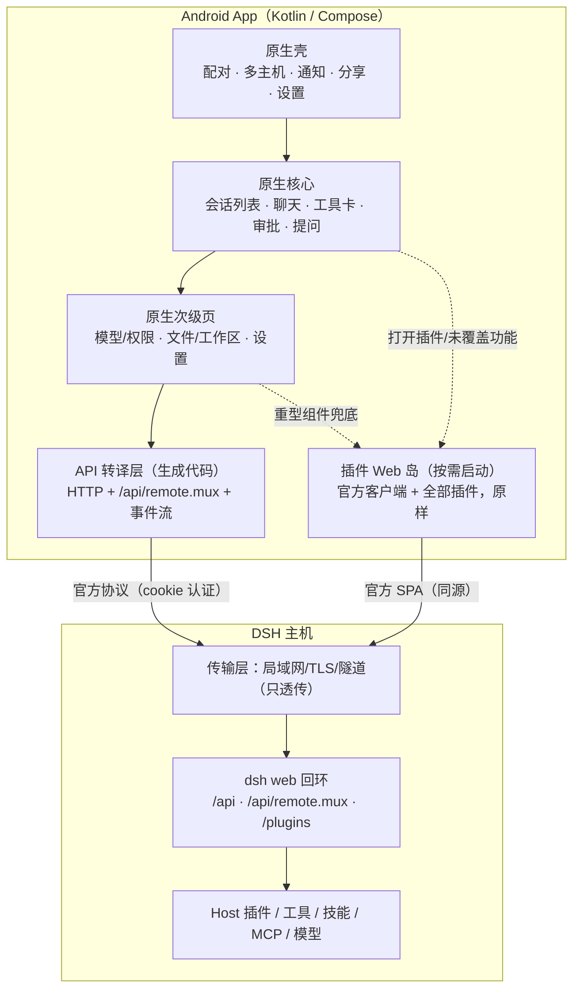

> **实现基线（v2.0）**：最终详细设计与实现路径见 [DSH-Android客户端-详细设计-v2.0.md](DSH-Android客户端-详细设计-v2.0.md)。

# 方案 v1.3 Native-first：核心原生 + API 转译 + 插件 Web 岛

- 日期：2026-10-17
- 新约束：尽量 native、越 native 越好；可以考虑转译 API；**DSH core 不能只是 WebView 套壳**
- 结论：**可行。路线的关键不是"要不要 WebView"，而是"WebView 放在哪"。** 把 WebView 降级为「插件运行时 + 重型组件兜底」，核心流程（连接、会话、聊天、审批、设置）全部原生；API 用官方 schema 生成 Kotlin 绑定，而不是手写/猜协议。

---

## 1. 两个硬边界（先说清楚，避免后面返工）

| 边界 | 事实 | 后果 |
|---|---|---|
| **Client 插件只能在浏览器里跑** | 插件 `client.js` 依赖 `__ModuleLoader__`、React、DOM、slots、client services | 插件 UI 与插件注册的命令/快捷键/面板，只能在一个 Web 运行时里执行；原生不能让它们"跑起来" |
| **原生聊天 = 重写 presention 层** | 官方把 session 事件渲染成消息、工具卡片、diff、审批、todo、终端输出，逻辑在 `dsh-client-ui-*` 里（React） | 原生要用 Compose 重画这套展示；UI 可接受不完美，但这是最大工作量 |

**推论：**
- 核心 80% 的日常流程可以做到不经过 WebView——这就不算「套壳」。
- 插件 UI 与插件专有交互必须有一个 Web 岛；否则丢的是 Client 插件 API（不是 UI）。
- 「转译 API」只能转译 Host Remote 协议，转译不了插件的 React UI。

---

## 2. 架构



**判定标准（是否只是套壳）：**
1. 启动后的首屏、会话列表、聊天、审批、设置，是否原生渲染；
2. 不打开插件时，WebView 是否不存在/不占资源；
3. 插件崩溃/断网时，原生核心是否仍可用；
4. 断点/回归时，核心流程是否不依赖 WebView。

四条都满足，就不是套壳。

---

## 3. API 转译：从「猜协议」变成「代码生成」

### 3.1 转译对象

| 协议面 | 内容 | 转译方式 |
|---|---|---|
| 一元 RPC | `POST /api`，JSON + multipart 附件 | 生成 endpoint 常量 + 参数 data class + 编解码 |
| 流式 RPC | `/api/remote.mux` WebSocket，`open/item/end/cancel` 帧 | 生成 `Flow<Event>` 封装 + 生命周期 |
| 事件流 | `$events`（connect 后先收到 `ready` 帧） | 生成事件 sealed class + 重连状态机 |
| 认证 | token → 签名 cookie；Host/Origin 栅栏 | 复用官方语义，传输层透传 |

### 3.2 生成链路（核心工程量）

```
官方 DSH 源码 / 运行中的 Host
   └─ 导出 ctx.typert.local 的 InvocationDescriptor（严格模式描述符）
        └─ 结合 TS 类型 + source map
             └─ 代码生成器（Kotlin）
                  ├─ endpoint 常量与参数模型
                  ├─ JSON/multipart 编解码
                  ├─ Flow 流封装
                  └─ 契约快照（descriptor digest）
```

> 依据：官方 API Gateway README 明确「严格模式从 `ctx.typert.local` 读取生成的调用描述符」；生成物随 DSH 版本变化，因此用**导出 + 生成**，不要手写。

### 3.3 契约验证（保证「API 正确」）

1. **黄金流量**：用官方 Web 客户端录一次完整会话（HTTP + WS 帧），存为夹具。
2. **回放**：原生客户端在 CI 里对同一 Host 回放关键请求，比较语义结果。
3. **差分**：DSH 升级后先跑夹具，diff 出端点/字段变化，再决定重新生成或降级。
4. **版本闸门**：descriptor digest + server 版本不匹配 → 相关屏强制走 Web 岛。

### 3.4 只转译核心子集（第一版）

会话列表/历史/搜索、发送 prompt/取消/排队、会话事件流、审批/提问、模型/推理强度/权限、附件上传。
其余（终端、diff、文件树、插件市场、插件面板）先留给 Web 岛，按使用频率逐步原生化。

---

## 4. 原生覆盖阶梯（按优先级）

| 级别 | 模块 | 原生？ | 工期（单人） | 说明 |
|---|---|---|---|---|
| **N0** | 配对、连接、多主机、通知、分享、相机/文件、生物识别 | ✅ 原生 | 2–3 周 | 纯系统能力，无协议风险 |
| **N1** | 会话列表、聊天流、工具卡片、审批、提问、输入坞 | ✅ 原生（MVP 核心） | 6–10 周 | 工作量最大的是 presentation |
| **N2** | 模型/权限、设置、文件/工作区、会话搜索 | ✅ 原生（第二批） | 3–5 周 | 数据接口稳定后做 |
| **N3** | 终端、diff、文档预览、插件市场、插件面板 | ⚠️ Web 岛 | 2–3 周接入 | 重型组件，先别重写 |
| **P** | 所有 Client 插件的 UI 与专有交互 | ⚠️ Web 岛（必须） | 1–2 周 | 插件零改动；岛按需启动 |

**MVP = N0 + N1 + N3(岛) + P**，约 4–6 人月。
**完整 = N0–N3 + P**，约 6.5–8.5 人月；N3 里除了终端/diff，其余可以长期留在 Web 岛。

---

## 5. 插件 Web 岛怎么放（不污染核心）

| 设计点 | 做法 |
|---|---|
| 启动 | 默认不创建；用户打开「插件」或某个未覆盖功能时懒加载 |
| 呈现 | 全屏 sheet / 独立 Tab；顶部有「返回原生」 |
| 内容 | 官方 Web 客户端原样加载（含全部插件），不做 API 改造 |
| 认证 | 复用同一 Host 的 cookie；与原生核心共用登录态 |
| 桥接（可选） | 岛内注入一个 bridge client 插件，把插件注册的命令/事件暴露给原生命令面板；只在岛已加载时可用 |
| 数据一致性 | Host 是唯一真相；原生与岛各自订阅，不做双端状态同步 |
| 崩溃隔离 | 岛单独 WebView 进程；崩溃只影响岛，核心不受影响 |

---

## 5.5 插件写法不变：移动布局声明层

> **v1.4 补充**：如果要让插件**自己声明 mobile UI** 并由客户端原生渲染，需要把移动 UI 定义成数据（JSON schema）而不是 React 代码，见 [`DSH-Android客户端-方案-v1.4-插件声明MobileUI.md`](DSH-Android客户端-方案-v1.4-插件声明MobileUI.md)。本节是「客户端侧声明」的兜底方案；v1.4 是「插件侧声明」的增量方案，两者可以并存（插件未声明时用本节默认容器）。

**原则：插件契约冻结。** `dsh.client`、slots、client services 一行不加；移动布局不写进插件包，而是写进客户端的一份声明表。插件保持桌面写法，在手机上被「容器化」。

三层声明：

1. **全局**：断点、安全区、手势、字体缩放；
2. **表面（surface）**：DSH slot 名 / 原生 screen id → presentation（`full` / `sheet` / `drawer` / `overlay` / `inline` / `overflow` / `zoom` / `web-only`）；
3. **特例**：按插件包名覆盖（可选，客户端维护，不写进插件代码）。

```yaml
# mobile-layout.yaml —— 属于客户端，不属于任何插件
version: 1
breakpoints: { phone: 767, tablet: 1023 }
defaults:
  conversation: full
  conversation.composer.dock: inline
  settings.page: sheet
  sidebar.right: drawer
  shell.overlay: overlay
surfaces:
  settings.page: { presentation: sheet, height: 90% }
  sidebar.right: { presentation: drawer, side: right, width: 92% }
  shell.overlay: { presentation: overlay, dismissible: true }
  conversation.message.actions: { presentation: overflow }
  tool.detail: { presentation: sheet, allowZoom: true }
plugins:                 # 可选：按包名兜底；插件代码不变
  dsh-context: { page: fullscreen }
  dshmarket: { page: fullscreen }
```

**两个渲染器消费同一份声明：**

| 渲染器 | 消费方式 |
|---|---|
| Web 岛 | 客户端插件（布局宿主）按声明把 slot 内容包进 sheet/drawer/overlay，注入断点与安全区 CSS |
| 原生 | Compose 导航宿主按 surface 选择全屏 / 底部 sheet / 抽屉 |

**插件作者视角**：什么都不用做。以后要优化某个插件的手机体验，只改声明表（或加一条按包名的覆盖），不动插件代码。

**要接受的限制：**

- 声明只能决定「容器/呈现」，**改不了插件内部固定宽度**；内部很宽的插件仍然要 zoom / 横滚 / 桌面模式兜底。
- 按包名覆盖依赖插件 DOM 稳定性；插件大改版要复验。
- 若未来希望插件自己声明移动布局，最稳的是给 `dsh.client` 加一个**可选**字段（向后兼容）——但那是插件契约变更，和「写法不变」有冲突。第一版建议保持客户端侧声明，插件侧零改动。

---

## 6. 原生 presentation 层（最大成本，也是「越 native」的代价）

必须用 Compose 重画的东西：

| 内容 | 第一版策略 | 后续 |
|---|---|---|
| Markdown / 代码高亮 | 成熟库 + 主题 | 精修 |
| 工具调用卡片 | 通用卡：工具名 + 参数 + 结果折叠 | 高频工具做专用卡 |
| 审批 / 提问 | 原生对话框 + 队列 | 复刻官方交互 |
| 计划 / todo / 子代理 | 简单列表 | 对齐官方 |
| diff / 终端输出 | 通用等宽文本 + 折叠；复杂时跳 Web 岛 | 专用组件 |
| 图片/附件 | 原生查看器 | 对齐官方 |

**原则**：UI 问题可接受，但「数据语义必须对」——工具名、参数、结果、状态、审批选项不能错。这是「API 正确」在 UI 侧的延伸。

---

## 7. 工期汇总

| 模块 | 时间 |
|---|---|
| API 转译（导出/生成/契约/文档） | 3–4 周 |
| N0 原生壳 | 2–3 周 |
| N1 原生会话/聊天/审批 | 6–10 周 |
| N2 设置/文件/工作区 | 3–5 周 |
| Web 岛 + 桥接 | 2–3 周 |
| 联调/崩溃/发布 | 2–3 周 |
| **MVP 合计（N0+N1+岛）** | **约 4–6 人月** |
| **完整合计（N0–N2+岛）** | **约 6.5–8.5 人月** |
| 持续跟版 | 每版 1–2 人周（契约夹具 + 重新生成 + 回归） |

---

## 8. 风险与对策

| 风险 | 概率/影响 | 对策 |
|---|---|---|
| Remote 协议随 rc 漂移 | 高/高 | 代码生成 + 黄金流量 + 版本闸门 + 单屏降级 Web 岛 |
| presentation 重写超预算 | 高/中 | 第一版通用渲染，高频工具再精修；复杂组件跳岛 |
| 原生与岛体验割裂 | 中/中 | 明确边界：核心原生、插件/重型 Web；统一下载/分享/通知由原生接管 |
| 插件专有交互在原生缺失 | 中/中 | 岛兜底 + 可选 bridge（命令/事件） |
| 开发者忍不住把功能做进 WebView | 中/高 | 用第 2 节的四条「非套壳」标准做每次评审门禁 |
| WebView 内核/后台 | 中/中 | 最低内核门槛 + 前台服务 + 推送 |
| 官方 UI 变动影响岛 | 中/低 | 岛用官方原版，跟版即可；不修改岛内前端 |

---

## 9. 决策问题

1. **原生覆盖目标**：N0+N1（核心体验）就够，还是必须做到 N2（设置/文件）？
2. **插件交互**：接受「插件命令/快捷键只在 Web 岛里可用」，还是要求桥接到原生命令面板？
3. **API 转译来源**：允许在构建机/开发 Host 上跑一个 dev 脚本导出 descriptor（不是运行时插件）？还是必须纯静态从 MIT 源码生成？

> 回答这三个问题，就能把工期从 4 人月收敛到 6.5–8.5 人月之间的一个确定值。


