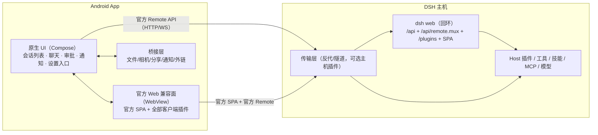

> **实现基线（v2.0）**：最终详细设计与实现路径见 [DSH-Android客户端-详细设计-v2.0.md](DSH-Android客户端-详细设计-v2.0.md)。

# 方案修订 v1.1：原生 UI + 官方 API，插件零改动

- 日期：2026-10-17
- 触发：把约束收敛为「UI 可以原生、可以有 UI 问题；插件不能改、API 不能有问题」
- 关系：v1.0 的架构分析仍然成立，但结论要改写。本文只讲修订后的最小方案，替代 v1.0 的「推荐方案 B」。

> **v1.2 进一步收敛（2026-10-17）**：若目标是「插件 API 全对、UI 问题可接受、只做移动适配」，则连 S2 的原生 API 都不需要，直接采用「官方客户端原样跑 + 移动适配层」，见 [`DSH-Android客户端-方案-v1.2-只做移动UI适配.md`](DSH-Android客户端-方案-v1.2-只做移动UI适配.md)。本文的 S2/S3 仅在「必须原生聊天界面」时才需要。

---

## 0. 一句话

**你这个约束把问题简化成一句：API 必须走官方，UI 可以自己画。**
那么唯一不能省的是：**官方 Web 客户端必须跑起来**——它是插件 Client 半（`apply(ctx)`、slots、client services、插件自定义 HTTP/WS）的唯一运行时。原生 UI 可以叠在它旁边，做核心高频屏；插件 UI 不好看、进 WebView，都算可接受的 UI 问题。

---

## 1. 三条约束 → 三条设计规则

| 约束 | 设计规则 |
|---|---|
| 不改 DSH 插件 | 不给插件打补丁、不要求插件提供原生版；Host 半原样跑在主机，Client 半原样加载 |
| UI 可以原生、可以有 UI 问题 | 原生只做核心屏；插件 UI、市场、终端等重 UI 页面放 WebView；不追求像素级还原 |
| API 不能有问题 | 不自造业务协议；只用官方 `/api` + `/api/remote.mux` + 官方 SPA；插件自定义路由只在官方前端里跑 |

---

## 2. 关键结论：API 兼容分三层，「UI 问题」盖不住 Client 半

| 层 | 具体内容 | 不改插件能否兼容 | 说明 |
|---|---|---|---|
| **Host 插件 API** | Cordis 服务、工具、技能、命令、模型、MCP、hooks | ✅ 天然兼容 | 跑在电脑上，客户端只读结果 |
| **Client 插件 API** | `dsh.client` 的 `apply(ctx)`：注册 slots、命令、快捷键、事件、设置、样式、client service | ✅ 仅当官方 Web 客户端在跑 | **这部分不是 UI，是 API**；不跑它 = 插件功能缺失，不是「UI 不好看」 |
| **插件自定义网络 API** | 插件自己注册的 HTTP 路由、WebSocket | ✅ 仅当官方前端在跑 | 原生客户端不知道这些路由，也不该去猜 |

**结论：**
- 「插件零改动」+「API 无问题」⇒ **官方 Web 客户端是不可省略的兼容面**。
- 原生 UI 只能在「不接管插件 API」的前提下做：核心会话/聊天/审批用官方 Remote API；插件相关一律走官方前端。
- 反过来，如果为了「更原生」而不跑官方前端，丢的是 Client 插件 API（命令、快捷键、面板、插件路由），**这恰恰是你说的不能有的 API 问题**。

---

## 3. 推荐形态 S2：原生核心 + 官方 Web 兼容面

### 3.1 原生屏 vs Web 屏分工

| 能力 | 原生 | WebView | 理由 |
|---|---|---|---|
| 主机配对/连接/多主机 | ✅ | — | 系统能力，纯原生最合适 |
| 会话列表/历史 | ✅ | 兜底 | 高频、数据简单（官方 Remote） |
| 聊天（流式、工具调用、审批、提问） | ✅ | 兜底 | 核心体验；API 变化风险由降级开关兜住 |
| 模型/权限选择 | ✅ | 兜底 | 高频小控件 |
| 通知/锁屏审批/分享/语音/相机 | ✅ | — | 系统集成 |
| 插件设置页/插件市场/插件面板 | — | ✅ | 插件 UI 原样跑，零改动 |
| 终端/文件/预览/浏览器侧栏 | 可后置 | ✅ | 重 UI，Web 现成 |
| 插件自定义路由/WS | — | ✅ | 原生不猜路由 |
| 任何原生未覆盖的功能 | — | ✅ | Web 面兜底 |

### 3.2 数据流：Host 是唯一真相

- 原生屏与 Web 屏**各自连同一个 Host**，不共享客户端状态；Host 的 session/事件是唯一真相。
- 原生屏收到的事件来自官方 `$events`/Remote stream；Web 屏由官方客户端自己维护。
- 两边可以同时打开；互不依赖。**不做双端状态同步**，这是把复杂度压下来的关键。

---

## 4. 三种最小变体（按「API 风险」排序）

| 变体 | 做法 | 原生度 | API 风险 | 工期（单人） | 适用 |
|---|---|---|---|---|---|
| **S1 官方渲染为主** | 原生只做壳（配对/通知/分享），聊天插件全在 WebView | 低 | **零**（官方客户端原样跑） | 1.5–2.5 人月 | 最稳、最快上线 |
| **S2 原生核心 + Web 兼容面（推荐）** | 原生做会话/聊天/审批等核心屏，插件与重 UI 走 WebView | 中 | 低（只碰官方 Remote，且有降级） | 2.5–3.5 人月 | 兼顾体验与兼容 |
| **S3 官方客户端做数据引擎** | 隐藏/常驻官方客户端，原生 UI 通过 JS Bridge 读它的 client model | 高 | **零**（数据来自官方客户端） | 4–6 人月 | 追求「零协议风险 + 全原生 UI」 |

**推荐 S2。** 如果「API 一点风险都不能有」是硬指标，选 S3：它把原生 UI 架在官方客户端之上，数据/事件全部来自官方实现，代价是必须常驻一个 WebView 引擎、内存与桥接复杂度上升。

---

## 5. 原生核心要接的最小 API 集（S2）

只做这些，不做全量 Typert：

| 能力 | 方向 | 对应官方面 |
|---|---|---|
| 会话列表/历史分页/搜索 | 一元 + 分页 | `api-session-controller` |
| 发送 prompt / 排队 / 取消 | 一元 | `api-session-controller` |
| 会话事件流（assistant 增量、工具生命周期、审批、提问） | WS stream | `/api/remote.mux` + `$events` |
| 模型/推理强度/权限选择 | 一元 | `api-settings-controller` / `api-remote` |
| 文件/图片上传 | 精确 Fetch 路由（multipart） | `client-file-upload` 对应 Host 路由 |
| 工作区/文件浏览（可后置） | 一元 | `api-workspace-controller` |

实现要点：
- 只实现「官方 Web 客户端实际用到的子集」，用抓包/契约测试对齐；
- 任何端点/帧格式不匹配 → 该屏整体切 WebView（降级开关）；
- 不实现插件自定义路由；需要时直接开 WebView。

---

## 6. 如何证明「没有 API 问题」（验收标准）

| # | 验收项 | 方法 |
|---|---|---|
| 1 | 5 类插件零改动可用 | 安装 dsh-context、dshmarket、dsh-purge、一个 overlay 装饰插件、dsh-web-mobile；WebView 面全部正常 |
| 2 | Host 工具/技能/MCP 在原生聊天中正常 | 原生发 prompt，观察工具调用/结果/审批 |
| 3 | 插件自定义 HTTP/WS 正常 | 在 WebView 面打开该插件功能，抓包确认路由可达 |
| 4 | 协议漂移可发现 | 黄金流量回放：录制官方客户端一次完整会话，DSH 升级后重放对比 |
| 5 | 失败可降级 | 人为改一个端点名，原生屏自动切 WebView，功能不中断 |
| 6 | 客户端插件命令/快捷键不丢 | 在 WebView 面验证插件注册的命令与快捷键 |

> 第 1、3、6 条是「插件零改动 + API 无问题」的硬门槛；第 4、5 条是「跟版不死」的工程保障。

---

## 7. 工期（S2，单人）

| 阶段 | 周期 | 交付 |
|---|---|---|
| M0 技术验证 | 1–2 周 | WebView 跑官方 SPA + dsh-web-mobile + 3 个插件；token→cookie 打通；录屏/结论 |
| M1 原生核心 | 5–7 周 | 配对/连接/会话列表/聊天/审批/通知；WebView 兼容面；降级开关 |
| M2 打磨 | 3–4 周 | 多主机、TLS、文件/相机/分享、契约测试、崩溃上报 |
| **合计** | **约 2.5–3.5 人月（含缓冲）** | 可日用 |

对比：S1 约 1.5–2.5 人月；S3 约 4–6 人月；纯原生自绘（v1.0 方案 D）8–14 人月且 Client 插件 API 仍为 0。

---

## 8. 风险与对策（只列与本次约束相关的）

| 风险 | 影响 | 对策 |
|---|---|---|
| 原生 Remote API 跟版漂移 | 原生屏不可用（**API 问题**） | 只做子集 + 黄金流量契约测试 + 版本闸门 + 一键切 WebView |
| 双面状态看起来不一致 | 体验问题 | Host 为唯一真相；Web 面独立刷新；不做双向同步 |
| WebView 后台休眠 | 通知不及时 | 前台服务 / 原生事件 WS / 主机推送（v1.0 §7.6） |
| 移动布局 | UI 问题（可接受） | dsh-web-mobile 或自研移动适配插件 |
| 插件 UI 在原生屏缺失 | UI 问题（可接受） | 明确「插件功能进 WebView 面」；原生屏不承诺插件 UI |
| 隐藏 WebView 常驻（仅 S3） | 内存/耗电 | 仅在 S3 采用；S2 不需要 |

---

## 9. 决策问题（回答后即可开工）

1. **原生屏范围**：只做「会话列表 + 聊天 + 审批 + 通知」够不够？还是设置/文件/终端也要原生？
2. **API 风险容忍度**：接受 S2（原生直接调官方 Remote，有跟版成本、有降级）还是必须 S3（官方客户端做引擎，零协议风险、工期 +2–3 人月）？
3. **主机侧**：是否允许装一个只做传输的网关插件（配对/TLS/反代，不改任何现有插件）？不装的话官方只监听 127.0.0.1，手机连不上。

