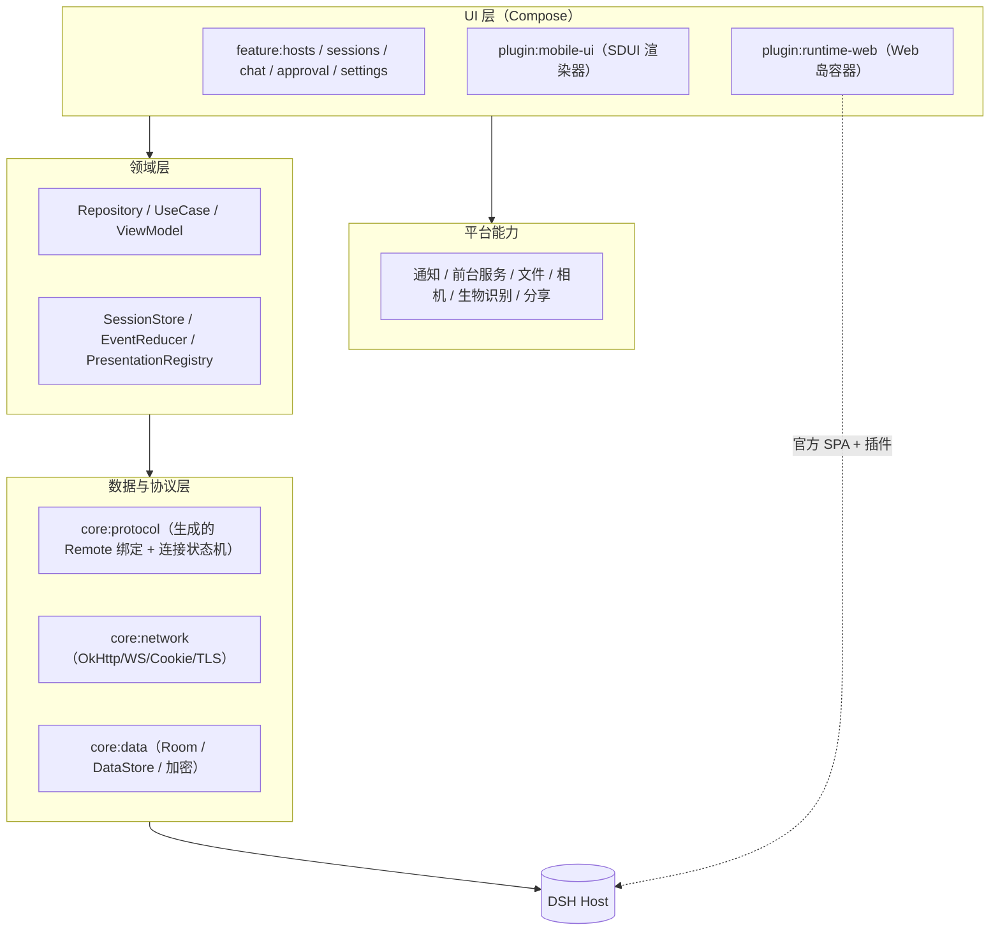
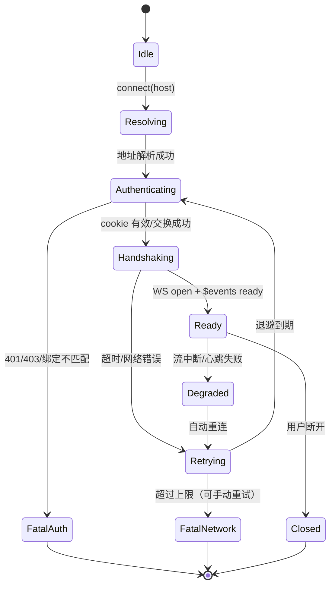
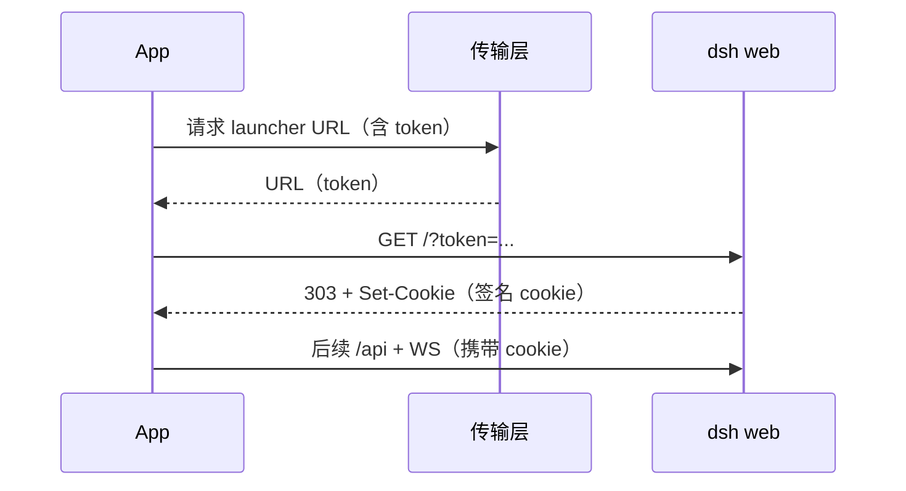
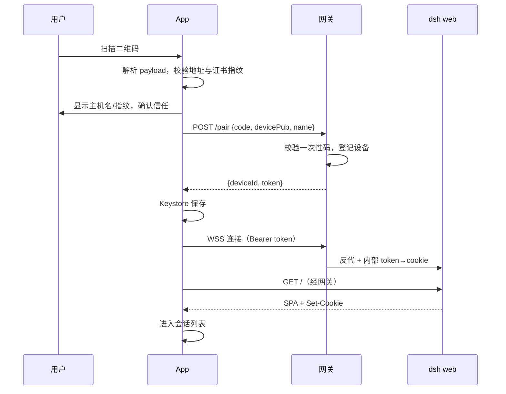
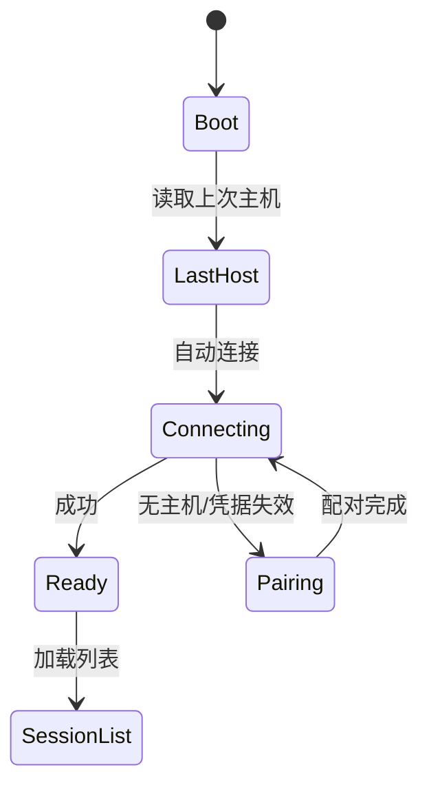
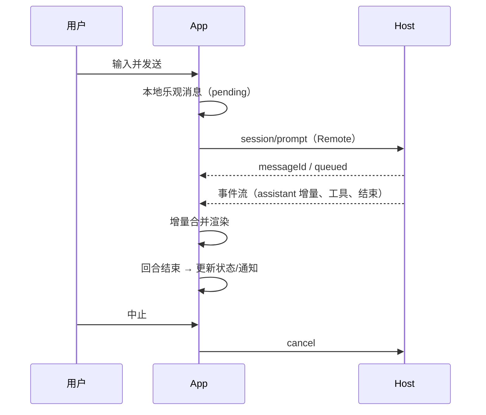

# DSH Android 原生客户端 · 详细设计文档

> **v3.0 修订（2026-10-17）**：产品定位修正为「完整 DSH 手机端」——Host（Agent 运行时）也运行在手机上，远程连接只是可选功能。v2.0 的客户端侧设计（§4 协议转译、§5 原生核心、§6 Web 岛、§7 SDUI、§8 布局、§10 安全、§13–17 工程）继续有效；**§3 部署架构、§9 传输配对、§18 工期、§19 风险已被 v3.0 替换**。见 [`DSH-手机端-详细设计-v3.0-本地Agent.md`](DSH-手机端-详细设计-v3.0-本地Agent.md)。

| 项 | 内容 |
|---|---|
| 文档版本 | v2.0（评审稿） |
| 日期 | 2026-10-17 |
| 状态 | 设计基线，待评审 |
| 适用范围 | Android 原生客户端（Kotlin / Jetpack Compose），对接 DSH `0.2.0-rc.2` 起步 |
| 取代 | v1.0–v1.4 方案讨论稿；本文是唯一实现基线，旧稿仅作决策背景 |
| 读者 | 客户端开发、Host 插件开发、测试、发布 |

---

## 0. 文档说明

### 0.1 术语

| 术语 | 含义 |
|---|---|
| Host | 电脑上运行的 DSH 进程（Node.js + Cordis 插件树） |
| Client | 本 Android App |
| Host 插件 | 在 Host 上运行的 Cordis 插件：工具、技能、模型、MCP、provider |
| Client 插件 | `dsh.client.platform = "web"` 的插件，向官方 Web 客户端注入 React UI 与服务 |
| Web 岛 | App 内懒加载的 WebView，原样运行官方 Web 客户端与全部 Client 插件 |
| Remote | Host 暴露给客户端的类型化 RPC + 流（`/api`、`/api/remote.mux`、`$events`） |
| SDUI | Server/Plugin-Driven UI：插件以 JSON 声明 mobile UI，客户端渲染 |
| descriptor | 官方生成的 Remote 调用描述符（端点、参数、codec） |
| generation | 一次物理连接的生命周期；重连即新 generation |
| fallback | 原生路径不可用时整屏切到 Web 岛 |

### 0.2 设计基线（来自前序调研）

1. Client 插件 = 浏览器 React 模块，依赖 `__ModuleLoader__`、React、DOM、slots、client services。**原生无法执行**，只能 Web 岛运行。
2. Host Remote 协议是客户端仅有的数据通道，未公开稳定规范，随 DSH 版本变化；**必须生成 + 契约验证，不能手写**。
3. 官方 Web 服务只监听回环，`--host 0.0.0.0` 被拒；认证为「每进程 token → 签名 cookie」。手机直连需要主机侧传输层。
4. 官方桌面端已采用「原生壳 + 官方 Web 资源 + 传输桥」，本设计同构，只把 Electron 换成 Kotlin 壳。
5. 插件生态约 5,065 个，UI/主题/娱乐类占 24.3%–41.4%；插件若不自带 mobile 声明，只能 Web 渲染。

---

## 1. 目标与约束

### 1.1 产品目标

| # | 目标 | 说明 |
|---|---|---|
| G1 | **核心原生** | 连接、会话列表、聊天、工具卡、审批/提问、设置全部 Compose 原生渲染 |
| G2 | **插件 API 零改动** | 现有插件代码一行不改；Host 半原样运行；Client 半在 Web 岛原样运行 |
| G3 | **插件可声明 mobile UI** | 可选 `dsh.mobile`（JSON SDUI），声明后客户端原生渲染；未声明走 Web 岛 |
| G4 | **插件不因客户端而不可用** | 任何插件在 Web 岛都能完整使用；原生只做增强 |
| G5 | **非套壳** | 不打开插件时 WebView 不存在；插件崩溃/断网不影响核心 |
| G6 | **跟版可控** | 每个 DSH 版本 1–2 人周完成兼容验证 |

### 1.2 硬约束

- **C1**：不允许修改 DSH 官方包、不允许要求插件作者改代码（`dsh.mobile` 是可选增量，不是强制）。
- **C2**：不允许自造业务协议；数据只走官方 Remote（可加透明传输层）。
- **C3**：不允许为「更原生」而跳过 Client 插件运行时（否则丢 Client 插件 API）。
- **C4**：认证、Host/Origin 栅栏、插件 bundle 语义必须与官方客户端一致。

### 1.3 非目标

- 不实现 Agent 运行时（推理、工具执行都在 Host）。
- 不实现全量 Typert Remote（只做核心子集，其余走 Web 岛）。
- 不做 iOS / 桌面端（架构可复用，但不在本期）。
- 不做插件市场、插件编辑器。
- 不做 DSH 的替代服务端。

### 1.4 验收指标

| 类别 | 指标 | 目标 |
|---|---|---|
| 功能 | `dsh-context`、`dshmarket`、`dsh-purge`、overlay 装饰插件、`dsh-web-mobile` 零改动可用 | 5/5 |
| API | 模块图完整、命令/快捷键可用、插件自定义 HTTP/WS 可达、设置持久化、工具/MCP 正常、payload 不变 | 6/6 |
| 非套壳 | 首屏/会话/聊天/审批/设置原生；未打开插件时无 WebView；插件崩溃不影响核心；核心流程不依赖 WebView | 4/4 |
| 性能 | 冷启动到会话列表、首屏、内存、滚动帧率 | 见 §14 |
| SDUI | 示例插件声明 → 原生渲染 → 数据刷新 → fallback | 全链路通过 |

---

## 2. 需求与用例

### 2.1 用户故事

| # | 角色 | 故事 | 优先级 |
|---|---|---|---|
| U1 | 用户 | 扫码/粘贴地址连接电脑上的 DSH，之后自动重连 | P0 |
| U2 | 用户 | 查看会话列表、历史消息、流式回复 | P0 |
| U3 | 用户 | 发送消息、中止回合、切换模型/推理强度 | P0 |
| U4 | 用户 | 在手机上处理审批与提问（含锁屏通知） | P0 |
| U5 | 用户 | 打开任意插件并使用（含插件自定义路由） | P0 |
| U6 | 用户 | 管理多台主机、切换、删除、查看状态 | P1 |
| U7 | 用户 | 插件声明了 mobile UI 时，原生渲染其页面 | P1 |
| U8 | 用户 | 上传图片/文件、拍照、分享 | P1 |
| U9 | 用户 | 收到回合完成/审批通知并直接操作 | P1 |
| U10 | 用户 | 断网/主机休眠后自动恢复，不丢会话状态 | P0 |

### 2.2 功能清单

| 模块 | P0 | P1 | P2 |
|---|---|---|---|
| 连接 | 配对、token→cookie、WS、重连 | 多主机、mDNS | 二维码分享 |
| 会话 | 列表、历史分页、搜索 | 归档/置顶/重命名 | 时间线视图 |
| 聊天 | 流式、Markdown、代码、工具卡、中止 | diff、todo/plan、子代理 | 消息反馈 |
| 审批 | 审批/提问、队列 | 锁屏动作、通知 | 批量 |
| 插件 | Web 岛、fallback | SDUI 渲染器、bridge | 插件管理 |
| 设置 | 模型、推理强度、权限 | 通用设置 | 账号 |
| 系统 | 深色、安全区、返回键、下载、分享 | 语音、小组件、PiP | 多窗口 |

### 2.3 验收清单（发布门禁）

见 §15.4。

---

## 3. 总体架构

### 3.1 分层



依赖方向严格单向：**UI → 领域 → 数据/协议**。`core:protocol` 不依赖任何 UI；SDUI 渲染器只依赖设计系统与 `ActionDispatcher` 接口；Web 岛只依赖 `WebIslandController` 接口。

### 3.2 模块清单

| Gradle 模块 | 职责 | 关键产物 |
|---|---|---|
| `:app` | 组装、导航、DI、Application | `DshApplication`、`AppNavHost` |
| `:core:model` | 纯数据模型、值对象 | `HostId`、`SessionId`、`RemoteError` |
| `:core:protocol` | 连接状态机、RPC、流、事件、认证；**生成代码** | `HostConnection`、`DshEndpoints`、`DescriptorSet` |
| `:core:network` | OkHttp、WebSocket、CookieJar、证书固定、重试 | `NetworkClient`、`DshCookieJar` |
| `:core:data` | Room、DataStore、仓库实现、加密存储 | `HostRepository`、`SessionRepository`、`SecureStore` |
| `:core:designsystem` | 主题、颜色、排版、通用组件 | `DshTheme`、`DshScaffold` |
| `:core:ui` | 通用 UI 组件、状态容器、错误页 | `DshErrorView`、`DshLoading` |
| `:feature:hosts` | 配对、主机列表、连接管理 | `HostsScreen`、`PairingSheet` |
| `:feature:sessions` | 会话列表、搜索、归档 | `SessionsScreen` |
| `:feature:chat` | 聊天、输入、流式、工具卡、presentation | `ChatScreen`、`MessageList` |
| `:feature:approval` | 审批/提问队列与通知动作 | `ApprovalController` |
| `:feature:settings` | 模型/权限/通用设置 | `SettingsScreen` |
| `:plugin:runtime-web` | WebView 容器、认证共享、桥、就绪检测 | `WebIslandHost` |
| `:plugin:mobile-ui` | SDUI schema、校验、绑定引擎、原生渲染器 | `MobileUiHost`、`NodeRenderer` |
| `:tooling:codegen` | descriptor → Kotlin 代码生成（JVM） | `CodegenMain` |
| `:tooling:contract` | 契约夹具、回放、mock host | `ContractRunner` |

### 3.3 进程与线程模型

- 主进程：UI、ViewModel、协议协程。
- Web 岛：`android:process=":island"` 独立进程（P1 起），崩溃不带走主进程。
- 线程：
  - 主线程：Compose 渲染。
  - `Dispatchers.IO`：Room、文件、OkHttp。
  - `Dispatchers.Default`：JSON 解析、事件投影中的重计算。
  - 协议：单一 `SupervisorJob` + `connectionScope`；所有流绑定到 generation。
- 所有跨层数据用 `StateFlow`/`Flow`，禁止在 Composable 中直接调用网络。

### 3.4 关键架构决策（ADR）

| ADR | 决策 | 理由 | 代价 |
|---|---|---|---|
| ADR-01 | Native-first，Web 岛只做插件与重型组件 | 满足「不套壳」与体验 | presentation 需重写 |
| ADR-02 | Remote 协议用「descriptor 导出 + 代码生成」，不手写 | 跟版成本最低、可回归 | 需维护生成器 |
| ADR-03 | Client 插件原样跑在 Web 岛 | 插件零改动、Client API 不丢 | 需要 WebView 与 fallback |
| ADR-04 | 插件 mobile UI 用 SDUI（数据），不用 React | 原生与 Web 双渲染 | 词表表达力有限 |
| ADR-05 | Host 是唯一真相，原生与岛不做状态同步 | 复杂度最低 | 两边可能短暂不一致 |
| ADR-06 | 一切失败优先降级 Web 岛 | 保证「插件永远可用」 | 需要降级开关与埋点 |

---

## 4. API 转译层（`core:protocol`）

### 4.1 协议面

| 协议面 | 传输 | 用途 |
|---|---|---|
| 一元 RPC | `POST /api`，JSON；附件用 multipart | 会话列表/历史、发送 prompt、审批、设置 |
| 流式 RPC | `WS /api/remote.mux`，帧 `open/item/end/cancel` | 会话事件流、follow、子代理 |
| 全局事件 | `$events` 逻辑流（同一 WS），首帧 `ready` | 会话/工作区增量、审批/提问 |
| 精确 Fetch | `GET/POST` 具名路由（文件上传、日志下载等） | 附件、导出 |
| 认证 | `GET /?token=...` → `Set-Cookie` | 会话建立 |

> 所有帧/字段以官方客户端录制流量为准；本层只做**语义映射**，不改写 payload。

### 4.2 descriptor 导出与代码生成

**输入**（构建机执行，非运行时插件）：

1. 官方 `ctx.typert.local` 中的 `InvocationDescriptor`（严格模式描述符）；
2. 对应 TS 类型与 source map；
3. 官方客户端版本号与构建标识。

**管线**：

```
extract-descriptors（Node 脚本，跑在开发 Host 上）
   → normalize（端点名、参数、返回、流、附件、取消）
   → IR（JSON，提交到仓库）
   → codegen（KotlinPoet）
   → 生成物 + descriptor.json（含 digest）
   → 契约测试
```

**生成物**：

| 文件 | 内容 |
|---|---|
| `DshEndpoints.kt` | 端点常量、方法签名、流方法 |
| `DshModels.kt` | 参数/返回/事件 data class（`@Serializable`） |
| `DshCodecs.kt` | JSON/multipart 编解码、信封、附件表 |
| `DescriptorSet.kt` | 版本、digest、端点清单 |
| `descriptor.json` | 原始 IR + digest（运行时版本闸门用） |

**规则**：

- 生成的代码不手改；文件头写 `@generated` 与来源 digest。
- 端点名/参数缺失时生成器直接失败，不允许「猜」。
- 生成器支持白名单：只生成核心子集（§4.4–§4.7 覆盖的端点），其余端点不生成但保留在 digest 中。

### 4.3 连接状态机



- **generation**：每次 `Handshaking` 成功递增；事件、流、回调都带 generation；旧 generation 的迟到帧丢弃。
- **重试**：500ms → 1s → 2s → 4s → 8s → 10s 上限，50%–100% 抖动；前台/后台策略不同（后台退避更慢）。
- **心跳**：复用官方 WS ping 语义（服务端 2s 级心跳）；客户端检测 Pong 超时即判定断线。
- **状态对外**：`StateFlow<ConnectionState>`，UI 只消费状态，不直接重连。

### 4.4 一元 RPC

```kotlin
interface RemoteCaller {
    suspend fun <T> call(endpoint: Endpoint<T>, args: Any, signal: CancellationToken? = null): RemoteResult<T>
}
```

- 请求体：官方信封（`rpcId`、端点、具名参数）；附件按官方 multipart 表编码。
- 响应：`{ ok: true, value }` / `{ ok: false, error }`；错误码原样保留（不吞）。
- 取消：`CancellationToken` 映射客户端取消；Host 端为 AbortSignal。
- 超时：默认 30s，上传/下载单独配置；超时归类为可重试。
- 幂等：只对只读端点自动重试；写操作不自动重试，交给上层确认。

### 4.5 流式 RPC

- 帧：`open`（含端点/参数）→ `item`（可空值）→ `end`（半关闭）→ `cancel`（客户端取消）。
- 客户端 API：

```kotlin
interface RemoteStreams {
    fun <Out> open(stream: StreamEndpoint<Out>, args: Any): Flow<RemoteEvent<Out>>
}
sealed interface RemoteEvent<out T> {
    data class Item<T>(val value: T) : RemoteEvent<T>
    data object End : RemoteEvent<Nothing>
    data class Failed(val error: RemoteError) : RemoteEvent<Nothing>
}
```

- 单流单消费；`Flow` 取消即发送 `cancel`；`end` 后忽略迟到 item。
- 背压：上游帧速率不可控，客户端用 `buffer(64)` + 合并策略；超过阈值丢弃中间 delta（保留最终态）。
- 上行（若需要）：`send(item)`/`end()`，只对支持上行的端点开放。

### 4.6 事件流 `$events`

- 打开后首帧必须是 `ready`（`clientId`、`host.home`）；否则判协议错误。
- 事件按 seq 有序；客户端维护 `lastSeq`，发现缺口 → 触发对应领域分页/重同步（gap repair）。
- 通知类事件不重放：重连后以 baseline 重新拉取；已展示的 UI 状态由领域层按 id 合并。
- 事件分发：`EventBus` 按类型分发到 `SessionStore`、`ApprovalStore`、`WorkspaceStore`。

### 4.7 认证



- Cookie 由 `DshCookieJar` 持久化：key = `host:port`；值加密存 Keystore 包装的 DataStore。
- 官方 cookie 默认 30 天、HttpOnly、SameSite=Strict、不带 Secure；客户端不改语义。
- 主机重启：token 变，但 cookie 若在有效期内仍可用；若 401 → 重新走 launcher URL 交换。
- 无 Authorization header 认证；不做「长期 API key」自造方案。
- 多主机：每个 host 独立 CookieJar 实例。

### 4.8 契约验证

| 层 | 内容 |
|---|---|
| 夹具 | 录制官方客户端一次完整会话：HTTP 请求/响应、WS 帧序列（脱敏） |
| 回放 | 对真实 Host 回放关键请求，比较语义字段；对 mock host 回放全量 |
| digest 门禁 | `descriptor.json` digest 与 Host 上报不一致 → 标记「实验支持」 |
| CI | 每次 DSH 升级 PR 必须通过契约套件；失败即阻断发布 |
| 差分 | 生成器输出 human-readable diff（端点增删、字段变化） |

### 4.9 降级

| 触发 | 范围 | 行为 |
|---|---|---|
| digest 不匹配 | 全局 | 启动时提示「实验版本」，核心屏仍可用；写操作前二次确认 |
| 单端点失败 | 单屏 | 该屏切 Web 岛对应页面（无法定位页面时打开插件首页） |
| 流不可用 | 会话 | 降级为「手动刷新历史」，输入仍可发送 |
| 认证失败 | 全局 | 引导重新配对，不清空本地会话缓存 |

---

## 5. 原生核心

### 5.1 领域模型

```kotlin
data class Host(val id: HostId, val name: String, val baseUrl: String, val tlsFingerprint: String?)
data class SessionSummary(val id: SessionId, val title: String, val updatedAt: Instant, val status: SessionStatus)
data class SessionDetail(val id: SessionId, val workspaceId: String?, val projection: JsonObject?)
sealed interface SessionEvent {
    data class AssistantDelta(val messageId: String, val text: String, val seq: Long) : SessionEvent
    data class ToolStart(val callId: String, val name: String, val input: JsonObject) : SessionEvent
    data class ToolEnd(val callId: String, val output: JsonElement?, val isError: Boolean) : SessionEvent
    data class ApprovalRequested(val approval: Approval) : SessionEvent
    data class QuestionAsked(val question: Question) : SessionEvent
    data class TurnEnded(val status: TurnStatus) : SessionEvent
    data class Unknown(val type: String, val payload: JsonObject) : SessionEvent
}
```

原则：`Unknown` 必须存在且原样保留；新事件类型不能导致崩溃，只影响展示（可能降级为「未知事件」折叠项）。

### 5.2 数据流

```
Remote/WS → ConnectionEngine → EventBus → Reducer → Store(StateFlow) → ViewModel → Compose
                              ↘ Persistence（Room，异步、批量）
```

- Reducer 纯函数，便于单测；时间、随机数通过注入。
- Store 按 session 分片；消息列表用 `ImmutableList` + diff。
- 持久化与 UI 解耦：先更新内存，再异步落库；崩溃恢复以 Host 为准。

### 5.3 事件投影

| 事件 | 原生处理 |
|---|---|
| assistant delta | 按 messageId 聚合，节流 16–50ms 合并；最终消息以 end/commit 为准 |
| tool start/update/end | 按 callId 聚合为工具卡状态机：`Pending → Running → Success/Failed/Cancelled` |
| approval/question | 入队 + 通知；回答走 Remote 并标记本地状态；以 Host 事件确认 |
| plan/todo | 渲染为列表；变更增量更新 |
| subagent | 子会话引用；可跳转完整会话 |
| error | 顶部条 + 可重试；保留原始错误码用于诊断 |
| unknown | 折叠显示原始 JSON（debug 构建展开） |

### 5.4 Presentation 渲染器

```kotlin
interface MessageRenderer { fun render(node: MessageNode): Boolean }
class PresentationRegistry(private val renderers: List<MessageRenderer>)
```

- 注册顺序：专用卡片（高频工具）→ 通用工具卡 → Markdown → 未知。
- v1 组件：Markdown（标题/列表/表格/链接/行内代码）、代码块（高亮+复制）、图片/附件、工具卡（通用/终端/文件/搜索）、diff、审批、提问、todo/plan、错误。
- **数据语义优先**：工具名、参数、结果、状态、审批选项必须正确；样式可后续精修。
- 复杂组件（终端全屏、PDF 预览、插件市场）不在原生重写，跳 Web 岛。

### 5.5 分页、历史与重连

- 首屏：最近 50 条或 256 KiB（取先到者），渲染后再补全。
- 向上分页：cursor 基于 seq；并发去重；列表锚点保持。
- 重连：新 generation 到达后，用最新 baseline 替换窗口；保留用户滚动位置。
- 缺口修复：`lastSeq` 与事件 seq 不一致时先拉分页补齐，再继续 apply。

### 5.6 审批与提问

- 状态机：`Pending → (Approve | Deny | Answer) → Submitting → Confirmed/Failed`。
- 幂等：本地生成 `actionId`，重复提交只保留一次；以 Host 事件为准。
- 通知：`NotificationCompat` + `PendingIntent`；锁屏动作只在认证通过后可用。
- 超时：按 Host 的等待超时提示；不本地自动拒绝。

### 5.7 设置、模型与权限

- 模型/推理强度列表来自官方设置 Remote；写入后以 Host 回执为准。
- 权限预设切换复用官方语义；高风险变更二次确认。
- 设置页优先原生；插件设置页走 Web 岛。

### 5.8 输入、附件与草稿

- 草稿按 `(hostId, sessionId)` 持久化；发送成功清空。
- 附件：先上传到官方附件路由，得到引用后再发送；上传进度原生展示。
- 语音输入（P2）：原生录音 → Host 语音插件 Remote；失败回退键盘。

### 5.9 通知、前台服务与深链

- **通知渠道**：`session_done`（低优先级）、`approval`（高）、`question`（高）、`connection`（低）、`plugin`（低）。
- **事件来源**：前台由 WS 事件直接触发；后台优先「前台服务保持连接」（仅在任务进行中或用户开启时），P1 起可增加原生事件通道/主机推送。
- **去重**：按 `(sessionId, turnId/approvalId)` 幂等；同一回合只发一次完成通知。
- **动作**：审批允许/拒绝、打开会话、快速回复（P2）；动作走 `PendingIntent` → 认证校验 → 执行，冷启动失败则只打开 App。
- **锁屏隐私**：默认隐藏消息正文，可在设置中开启显示。
- **前台服务**：声明 `dataSync` 类型（Android 14+）；只在「有进行中任务且用户可见」时运行；任务结束/用户退出后停止并清理通知。
- **深链**：`dsh://session/{id}`、`dsh://approval/{id}`、`dsh://host/{id}`；未连接时跳配对页。
- **通知权限**：Android 13+ 运行时申请；拒绝后只保留应用内提示，不影响核心功能。

---

## 6. 插件 Web 岛（`plugin:runtime-web`）

### 6.1 边界

- **只**承载：Client 插件 UI、插件专有交互、重型组件（终端、diff 全屏、文档预览、插件市场）。
- **不**承载：连接、会话列表、聊天、审批、设置等核心流程。
- 默认不创建；打开即用，关闭可销毁或缓存（见 6.3）。

### 6.2 WebView 配置

| 项 | 取值 | 说明 |
|---|---|---|
| JavaScript | 开 | 插件运行时必需 |
| DOM Storage | 开 | 官方客户端依赖 |
| File/Content Access | 关 | 安全 |
| Mixed Content | NEVER_ALLOW | 只允许 HTTPS/本地 |
| 第三方 Cookie | 允许（仅 host 域） | 官方 cookie 语义 |
| 证书校验 | 原生传输层固定指纹；WebView 由 NSC + 本机反代兜底 | WebView 自身不保证 pinning，必须由传输层承担 |
| UA | 官方 UA + 应用标识后缀 | 便于 Host 识别 |
| 多窗口/弹窗 | 拦截，交原生 | 防钓鱼 |
| 下载 | 交原生 DownloadManager | |
| 长按/选择 | 原生默认 | |
| 调试 | 仅 debug 开启 `setWebContentsDebuggingEnabled` | |

**加载方式（按阶段）**：

1. **R1 远程 URL**：`https://<gateway>/`（P3）。同源、cookie 正常、插件图由 Host 提供。
2. **R2 内置 dist + 本地反代**（P5，可选）：App 内 loopback 服务提供静态资源，`/api`、`/plugins` 透传到 Host；启动快、可离线壳。
3. **R3 桌面模式**：同一进程内强制桌面布局，用于插件面板兜底。

### 6.3 生命周期

| 状态 | 行为 |
|---|---|
| 未创建 | 不占内存；入口显示「插件」 |
| 创建 | 仅在用户进入插件页/打开 SDUI 不支持的插件时 |
| 前台 | 正常渲染 |
| 后台 | 暂停 JS 定时器风险；需要保活时用前台服务（仅在任务进行中） |
| 关闭 | `destroy()`；默认不缓存，P1 可做 LRU 缓存 1 个实例 |
| 崩溃 | 独立进程，主进程收到 `onRenderProcessGone` → 重建并提示 |

### 6.4 认证共享

- 主进程与岛共享 cookie：`CookieManager` 同步（`flush()` + 手动注入）；或岛直接加载同一 Host，cookie 由 WebView 自己维护。
- token 交换由主进程完成，岛只负责后续请求（url 带 cookie 即可）。
- 多主机：每个 host 独立 WebView 数据目录（P1；M1 限制单主机同时打开岛）。

### 6.5 就绪检测

- 监听 `window.__DSH_BOOT_READY__`（官方启动完成信号）+ DOM 根节点出现。
- 超时 15s → 显示错误与「重试 / 用浏览器打开」。
- 白屏检测：连续 2 次 `onPageFinished` 后根节点仍空 → 判定失败。
- 失败埋点：URL、阶段、WebView 版本、Host 版本、控制台错误（脱敏）。

### 6.6 原生桥（P1，默认关闭）

| 方法 | 方向 | 说明 |
|---|---|---|
| `native.pickFile()` | JS→Kotlin | 文件选择，返回 content URI |
| `native.capture()` | JS→Kotlin | 拍照，返回 URI |
| `native.share(payload)` | JS→Kotlin | 分享 |
| `native.notify(payload)` | JS→Kotlin | 发通知 |
| `native.clipboard.write/read` | 双向 | 剪贴板 |
| `native.openExternal(url)` | JS→Kotlin | 白名单外链 |
| `native.onBack()` | Kotlin→JS | 返回键交给页面处理 |

安全：仅对 white-listed origin 注入；JS 接口方法白名单；参数类型校验；无反射/无任意调用。

### 6.7 与原生导航协作

- 岛入口：底部导航「插件」或具体插件卡片。
- 返回键：先问页面能否返回（`onBack`），否则关闭岛。
- 深链：打开官方根，不尝试深链到插件子页（官方 SPA 无 pathname 路由）。
- 标注：岛顶栏显示「网页模式 · 返回原生」，避免用户误以为原生。

### 6.8 fallback 决策矩阵

| 场景 | 决策 |
|---|---|
| 插件有 `dsh.mobile` 且 schema/组件支持 | 原生渲染 |
| 插件有声明但组件不支持 | 整屏 Web 岛 |
| 插件无声明 | Web 岛（默认容器） |
| 原生端点失败 | 该屏 Web 岛 |
| 插件崩溃 | 岛重建；核心不受影响 |
| 网络断开 | 核心显示离线；岛显示错误页 + 重试 |

## 7. 插件声明式 Mobile UI（SDUI，`plugin:mobile-ui`）

### 7.1 定位

- **可选增量**：插件不声明 `dsh.mobile` 时行为不变，走 Web 岛。
- **纯数据**：声明是 JSON，不含 JS/HTML；客户端负责渲染。
- **双渲染器**：原生 Compose 与 Web（复用 GenUI 词表）消费同一份 spec。
- **整屏降级**：任何不支持 → 整屏回 Web 岛，不做半原生混排。

### 7.2 manifest 契约（`package.json` 的 `dsh.mobile`）

```jsonc
{
  "dsh": {
    "client": { "platform": "web", "inject": ["..."] },   // 原样，不动
    "mobile": {
      "schema": 1,
      "entry": "./mobile/ui.json",
      "endpoint": "mypkg/mobile-render",   // 可选：动态 spec，优先级高于 entry
      "data": {
        "snapshot": { "remote": "mypkg/status", "refresh": "onOpen" }
      },
      "actions": {
        "refresh": { "remote": "mypkg/status", "into": "snapshot" },
        "openSettings": { "navigate": "settings" }
      },
      "fallback": { "web": true }
    }
  }
}
```

| 字段 | 必填 | 说明 |
|---|---|---|
| `schema` | 是 | 整数，客户端按范围支持 |
| `entry` | 与 endpoint 二选一 | 静态 JSON 路径（包内） |
| `endpoint` | 与 entry 二选一 | 动态 spec 的 Remote 端点（Host 返回 UI 树 + 数据） |
| `data` | 否 | 命名数据源，供绑定使用 |
| `actions` | 否 | 命名动作，供按钮/表单引用 |
| `fallback.web` | 否 | 默认 true；显式 false 表示无 Web 兜底（不推荐） |

校验：未知顶层字段 → 警告并忽略；`schema` 超范围 → 整插件走 Web 岛；`entry` 缺失且无 `endpoint` → 视为未声明。

### 7.3 UI Schema v1

**结构**：

```jsonc
{
  "type": "page",
  "title": "上下文",
  "children": [
    { "type": "chart", "kind": "donut", "data": "{{snapshot.breakdown}}", "title": "上下文构成" },
    { "type": "keyvalue", "pairs": "{{snapshot.stats}}" },
    { "type": "row", "children": [
      { "type": "button", "label": "刷新", "action": "refresh" },
      { "type": "button", "label": "设置", "action": "openSettings", "tone": "ghost" }
    ]}
  ]
}
```

**绑定语法**：

| 写法 | 含义 |
|---|---|
| `"{{path.to.value}}"` | 从数据上下文取路径值；整个字符串只有一个绑定 → 保留原类型；混合文本 → 转字符串 |
| `"{{#list}}"` + `forEach` | 列表渲染（作用于子节点） |
| `visibleWhen` | `{"path":"status","equals":"ok"}` / `{"path":"count","gt":0}`，仅比较，不执行表达式 |
| `$env` | 客户端环境：`platform`、`theme`、`width`、`locale`、`safeArea` |

**约束**：无函数调用、无运算、无脚本。需要计算时由 Host 端点返回结果。

**动作**：

| 动作 | 含义 |
|---|---|
| `{"action":"name"}` | 引用 manifest `actions.name` |
| `{"navigate":"settings"}` | 客户端内部导航 |
| `{"openUrl":"https://..."}` | 白名单外链 |
| `{"copy":"{{text}}"}` | 复制文本 |
| `{"refresh":"name"}` | 刷新命名数据源 |
| `{"close":true}` | 关闭当前页 |

所有动作先进入 `ActionDispatcher` 做**白名单 + 参数校验 + 权限检查**，再执行。

**组件词表 v1**（与 GenUI 对齐，原生实现子集）：

| 组件 | 关键属性 | 说明 |
|---|---|---|
| `page` / `section` | `title`、`children` | 页面/分组 |
| `row` / `col` | `children`、`gap` | 水平/垂直布局 |
| `text` | `content`、`size` | 行内富文本（加粗/代码/链接/高亮） |
| `list` | `items`、`title`、`desc` | 列表，可嵌节点 |
| `table` | `columns`、`rows`、`types` | 表格；`types` 支持 num/badge/bar |
| `keyvalue` | `pairs` | 键值 |
| `stat` / `badge` / `progress` | `label`、`value`、`delta` | 指标/状态 |
| `chart` | `kind`(bars/line/donut)、`data`、`series` | 轻量图表 |
| `callout` | `tone`、`title`、`content` | 提示块 |
| `tabs` / `accordion` | `tabs`/`items` | 分组 |
| `image` | `src`（https/相对）、`alt` | 图片 |
| `divider` / `spacer` | — | 布局 |
| `button` | `label`、`action`、`tone` | 动作 |
| `input` / `select` / `switch` | `label`、`value`、`action` | 表单；值为本地状态 |
| `code` | `lang`、`code` | 只读代码 |
| `steps` / `timeline` | `steps`/`items` | 过程展示 |

未列入的组件在 v1 一律视为「不支持」→ 整屏 fallback。

**预算**：节点 ≤200、嵌套 ≤8、单 spec ≤256 KiB、文本字段 ≤16 KiB；超限拒绝加载。

### 7.4 数据源

| 类型 | 声明 | 客户端行为 |
|---|---|---|
| `remote` | `{"remote":"pkg/method","refresh":"onOpen"}` | 调用官方 Remote，结果入数据上下文 |
| `stream` | `{"stream":"pkg/events"}` | 订阅 Remote 流，增量合并 |
| `static` | `{"value":{...}}` | 直接使用 |
| 动态 spec | `endpoint` 返回 `{screen, data}` | 一次请求同时拿 UI 与数据；后续刷新走 `actions` |

- 刷新策略：`onOpen`（默认）、`interval`（最小 5s）、`manual`。
- 状态：`Idle / Loading / Ready / Error`；Error 显示可重试错误页，不崩原生。
- 并发：同一数据源单飞；页面销毁取消所有请求。

### 7.5 原生渲染器

```kotlin
@Composable
fun MobileUiScreen(spec: MobileUiSpec, host: MobileUiHostState)

class MobileUiHostState(
    val data: StateFlow<Map<String, JsonElement>>,
    val status: StateFlow<LoadStatus>,
    val dispatch: (Action) -> Unit,
)

interface NodeRenderer {
    val type: String
    @Composable fun Render(node: UiNode, scope: RenderScope)
}
```

- `NodeRendererRegistry`：按 `type` 注册；缺失即 `Unsupported`。
- `BindingResolver`：路径解析 + 类型保留 + 缺失值处理（null → 组件空态）。
- `ActionDispatcher`：见 §7.7；网络动作经 `RemoteCaller`，UI 不直接触网。
- 状态：`MobileUiViewModel` 管理数据源、订阅、刷新；Compose 只渲染。
- 无障碍：每个组件映射 `contentDescription`/role；表格有表头语义。
- 错误边界：单个组件渲染异常 → 用错误占位，不崩整页；连续 3 个异常 → 整屏 fallback。

### 7.6 Web 渲染器

- 复用 `@changfenhuang/dsh-genui`（MIT）的组件词表与 React 渲染器。
- 适配层：`dsh.mobile` spec → GenUI spec；`{{}}` 绑定由适配层求值后传入。
- 动作：GenUI action 回传 → 桥接层 → 原生 `ActionDispatcher`（保证两端语义一致）。
- 非 Web 岛场景（如浏览器调试）可直接用 GenUI 预览。

### 7.7 校验与安全

| 检查 | 规则 |
|---|---|
| Schema | JSON Schema 校验，拒绝未知必需字段、类型错误 |
| 规模 | 节点/深度/字节预算（§7.3） |
| 文本 | 不允许 HTML；渲染时按纯文本 + 行内标记 |
| URL | 仅 `https`、`mailto`、白名单 http |
| 动作 | 必须在 manifest `actions` 或内建动作表中；写操作二次确认 |
| 数据 | 只读绑定；不执行表达式；不读取客户端敏感上下文 |
| 权限 | 动作声明所需 scope；不满足 → 禁用并提示 |

### 7.8 一致性测试

- 维护 **golden spec 集**（≥20 份）：基础组件、列表、表格、图表、表单、错误态、超限。
- 双渲染器截图对比（像素容差 + 结构树对比）；交互脚本对比动作序列。
- 纳入 CI；词表变更必须同步更新 golden。

### 7.9 兼容与降级

| 情况 | 行为 |
|---|---|
| `schema` 不支持 | Web 岛 |
| 组件不支持 | 整屏 Web 岛 |
| 数据源失败 | 原生错误页 + 重试；不自动跳岛 |
| 页面渲染异常 | 错误占位；连续异常 → 整屏岛 |
| manifest 非法 | 视为未声明，Web 岛 |

---

## 8. 客户端侧移动布局层（兜底）

用于**没有** `dsh.mobile` 声明的插件与未原生化的页面。

### 8.1 `mobile-layout.yaml`

```yaml
version: 1
breakpoints: { phone: 767, tablet: 1023 }
defaults:
  conversation: full
  settings.page: sheet
  sidebar.right: drawer
  shell.overlay: overlay
surfaces:
  settings.page: { presentation: sheet, height: 90% }
  sidebar.right: { presentation: drawer, side: right, width: 92% }
  shell.overlay: { presentation: overlay, dismissible: true }
  conversation.message.actions: { presentation: overflow }
  tool.detail: { presentation: sheet, allowZoom: true }
plugins:
  dsh-context: { page: fullscreen }
  dshmarket: { page: fullscreen }
```

### 8.2 应用方式

| 端 | 实现 |
|---|---|
| Web 岛 | 布局宿主（客户端插件）按 surface 把 slot 内容包进 sheet/drawer/overlay；注入断点与安全区 CSS |
| 原生 | Compose 导航宿主按 surface 选择 `full / sheet / drawer` |

### 8.3 优先级

```
插件 SDUI 声明 → 客户端布局声明 → 默认容器 → 桌面模式（缩放/横滚）
```

- 插件 SDUI 只覆盖它自己声明的页面；其余页面仍受布局声明控制。
- 布局声明变更不需要发版（可随 Host 下发的配置更新，P2）。

---

## 9. 传输、配对与多主机

### 9.1 网络拓扑

| 方案 | 适用 | 优点 | 缺点 |
|---|---|---|---|
| **局域网 + 网关 TLS**（推荐） | 同一 WiFi | 简单、低延迟 | 需要主机侧网关 |
| Tailscale / WireGuard | 异地 | 端到端加密、无需公网 | 依赖第三方组网 |
| SSH 端口转发 | 开发/极客 | 无需额外服务 | 手机配置复杂 |
| Cloudflare Tunnel | 临时远程 | 免公网 IP | 依赖第三方、延迟高 |

官方 `dsh web` 只监听回环，因此**必须有传输层**；传输层只做透明代理，不改业务语义。

### 9.2 配对

**二维码 payload**：

```json
{
  "v": 1,
  "name": "书房台式机",
  "url": "https://192.168.1.20:7443",
  "fp": "sha256:AbCd...",
  "pair": "one-time-code",
  "exp": 1780000000
}
```

**流程**：

1. App 扫码/粘贴 → 解析 → 校验证书指纹（首次信任）。
2. `POST /pair`（网关）提交配对码 + 设备公钥/名称 + 设备信息。
3. 网关校验一次性码（短 TTL、单次使用）→ 签发设备令牌（长期）+ 设备 ID。
4. App 存令牌（Keystore 包装）→ 后续请求带 `Authorization: Bearer <device-token>` 到**网关**（不是官方 Host）。
5. 网关校验设备 → 反向代理到官方 Host，自动完成官方 token→cookie 交换。

### 9.3 主机侧最小网关（可选组件，不改现有插件）

| 职责 | 说明 |
|---|---|
| TLS 终结 | 自签证书 + 指纹固定；或复用用户证书 |
| 配对 | `/pair`、`/revoke`、设备列表 |
| 认证 | 设备令牌校验、限流、审计 |
| 反代 | HTTP + WS upgrade 透传；正确改写 Host/Origin |
| 官方认证桥 | 内部完成 token→cookie；不把官方 token 暴露给客户端 |
| 安全 | 默认只监听局域网；公网需显式开启 + 强令牌；不开放任意路由 |

**不做**：业务转换、payload 改写、插件路由猜测、账号体系。

### 9.4 多主机

- `hosts` 表持久化；每个 host 独立 cookie/令牌/证书指纹。
- 切换主机：断开旧连接（保留缓存）→ 新连接 → 各自 generation。
- 上限：默认 5 台；超出提示删除。
- 状态：在线/离线/认证失效/版本不兼容，分别有 UI 与操作。

### 9.5 网络状态与重连

- 监听 `ConnectivityManager`；离线 → 暂停重试；恢复 → 立即重试一次。
- 前台/后台策略：后台退避上限 5 分钟；前台 10s 上限。
- 电池优化白名单提示（仅任务进行中）。
- WS 连接失败 → 降级为「一元轮询 + 手动刷新」并提示。

---

## 10. 安全设计

### 10.1 威胁模型

| 威胁 | 场景 | 对策 |
|---|---|---|
| 令牌窃取 | 设备丢失/备份泄露 | Keystore + 生物识别 + 禁止备份 |
| 中间人 | 局域网/公网 | TLS + 证书固定 |
| 恶意插件 | 插件执行任意 JS / Host 代码 | 来源提示、权限展示、不静默安装、Web 岛隔离 |
| WebView 注入 | 插件页调用原生桥 | origin 白名单 + 方法白名单 + 参数校验 |
| SDUI 滥用 | 恶意 spec 诱导操作 | 无代码、动作白名单、写操作确认、URL 白名单 |
| 本地数据泄露 | 会话内容/截图 | 敏感页 `FLAG_SECURE`（可选）、DB 加密（P1） |
| 重放 | 配对/审批请求 | 一次性码、actionId 幂等、时间窗 |
| DNS rebinding | 局域网 Host 栅栏 | 保留官方 Host/Origin 校验，网关不放松 |
| 供应链 | 第三方网关/插件 | 官方 MIT 源码审计、固定版本、签名 |

### 10.2 凭据与密钥

- 设备令牌、cookie：`EncryptedSharedPreferences` + Keystore AES-GCM；主密钥不出 TEE（可用 StrongBox 时启用）。
- 证书指纹：存本地，首次信任 TOFU；变更时强提示。
- 生物识别：解锁 App / 审批动作可选；失败回退 PIN/系统锁。
- 备份：`android:allowBackup="false"`；导出功能单独加密。

### 10.3 WebView 加固

- 禁用 File/Content Access、混合内容、任意 JS 接口。
- `shouldOverrideUrlLoading`：只允许 host 域与白名单；外链交 Custom Tabs。
- `onReceivedSslError`：绝不 `proceed()`。
- 严格固定：WebView 只连 App 内本机反代（R2），反代在上游用 OkHttp 做证书固定；WebView 自身不承担 pinning。
- `WebViewClient` 拦截 `intent://`、`market://` 等，交原生处理。
- 调试开关仅 debug；release 移除。
- 岛独立进程 + `onRenderProcessGone` 恢复。

### 10.4 日志与隐私

- 默认不记录消息正文、附件内容、cookie、令牌。
- 诊断日志：端点名、状态码、耗时、错误码；正文哈希可选。
- 崩溃上报需用户同意；HTTP 上报走 TLS。
- 隐私政策声明：连接主机地址、设备标识、崩溃数据。

---

## 11. 数据与存储

### 11.1 Room schema（v1）

```sql
CREATE TABLE hosts (
  id TEXT PRIMARY KEY, name TEXT NOT NULL, base_url TEXT NOT NULL,
  tls_fingerprint TEXT, device_id TEXT, auth_mode TEXT NOT NULL,
  last_seen_at INTEGER, status TEXT NOT NULL, sort_order INTEGER NOT NULL
);

CREATE TABLE sessions (
  host_id TEXT NOT NULL, session_id TEXT NOT NULL, title TEXT,
  workspace_id TEXT, status TEXT, updated_at INTEGER,
  last_seq INTEGER, archived INTEGER NOT NULL DEFAULT 0, pinned INTEGER NOT NULL DEFAULT 0,
  PRIMARY KEY (host_id, session_id)
);

CREATE TABLE messages (
  host_id TEXT NOT NULL, session_id TEXT NOT NULL, message_id TEXT NOT NULL,
  role TEXT NOT NULL, seq INTEGER, content_json TEXT NOT NULL,
  created_at INTEGER, status TEXT, PRIMARY KEY (host_id, session_id, message_id)
);

CREATE TABLE drafts (
  host_id TEXT NOT NULL, session_id TEXT NOT NULL, text TEXT NOT NULL,
  attachments_json TEXT, updated_at INTEGER,
  PRIMARY KEY (host_id, session_id)
);

CREATE TABLE approvals (
  host_id TEXT NOT NULL, approval_id TEXT NOT NULL, session_id TEXT,
  payload_json TEXT NOT NULL, state TEXT NOT NULL, created_at INTEGER,
  PRIMARY KEY (host_id, approval_id)
);

CREATE TABLE plugin_ui_cache (
  plugin_id TEXT NOT NULL, schema_version INTEGER NOT NULL,
  spec_json TEXT NOT NULL, fetched_at INTEGER,
  PRIMARY KEY (plugin_id, schema_version)
);
```

### 11.2 DataStore

| key | 内容 |
|---|---|
| `settings.theme` | 跟随系统/深/浅 |
| `settings.locale` | 语言 |
| `settings.notifications` | 通知开关/免打扰 |
| `settings.last_host` | 上次主机 |
| `settings.layout_overrides` | 布局声明覆盖（可选） |
| `diagnostics.log_level` | 日志级别 |

### 11.3 加密、保留与清理

- v1：凭据加密（Keystore），会话数据明文 Room；P1 引入 SQLCipher。
- 删除主机 → 级联删除 sessions/messages/drafts/approvals/缓存；凭据安全擦除。
- 会话缓存上限：每会话最近 500 条 / 每主机 200 会话；LRU 清理。
- 版本迁移：Room migration + 破坏性变更需显式测试。

---

## 12. 关键流程

### 12.1 首次配对



### 12.2 启动与连接



### 12.3 打开会话与历史

1. 点击会话 → 本地缓存立即渲染（若有）。
2. 并行：拉取 header/projection + 最近 50 条。
3. 打开 follow 流；收到 baseline 后替换窗口。
4. 用户上滑 → 分页；到达顶后显示「已到最早」。
5. 收到新事件 → reducer 合并；滚动位置在底部时自动跟随。

### 12.4 发送消息与流式回复



### 12.5 审批

1. 收到审批事件 → 入队 + 通知。
2. 用户点通知/列表 → 原生审批页。
3. 提交 → `actionId` 幂等请求 → 按钮禁用。
4. Host 事件确认 → 从队列移除；失败 → 显示错误码与重试。

### 12.6 打开插件 SDUI 页面

1. 读插件 manifest 的 `dsh.mobile`。
2. 客户端 schema 支持 + 组件全支持？
   - 是 → 加载 spec（entry 或 endpoint）→ 解析 → 校验 → 绑定数据 → 原生渲染。
   - 否 → 打开 Web 岛。
3. 数据失败 → 原生错误页 + 重试；不自动跳岛。

### 12.7 降级到 Web 岛

| 触发 | 入口 | 体验 |
|---|---|---|
| 无 mobile 声明 | 插件列表/导航 | 全屏岛，顶栏「网页模式」 |
| 组件不支持 | 插件页面 | 同上，不保留原生碎片 |
| 原生端点失败 | 当前页 | 按钮「切换到网页模式」+ 自动重试 |
| 岛崩溃 | 岛入口 | 自动重建一次；再次失败提示 |

### 12.8 断线重连

1. 心跳超时/网络切换 → `Degraded`，UI 顶部条提示。
2. 指数退避重连；成功后新 generation。
3. 会话窗口以新 baseline 替换；保留滚动位置与草稿。
4. 重连 30s 未成功 → 提供「切到 Web 模式/检查主机」。

## 13. 错误处理与可观测性

### 13.1 错误分类

| 类型 | 例子 | 可重试 | UI |
|---|---|---|---|
| `AuthError` | 401/403、cookie 失效、令牌撤销 | 否（需重新配对） | 引导页 |
| `TrustError` | 证书指纹不符、Host 栅栏拒绝 | 否 | 安全警告，阻断 |
| `TransportError` | 超时、DNS、连接重置 | 是（退避） | 顶部条 + 自动重连 |
| `ProtocolError` | 帧格式、descriptor 不匹配、未知事件 | 视情况 | 降级 + 诊断入口 |
| `RemoteError` | Host 业务错误码（带 code/message） | 视 code | 行内错误 + 重试 |
| `PluginError` | 插件加载失败、SDUI 非法 | 否/重试一次 | 整屏 fallback |
| `RendererError` | 单组件异常 | 否 | 错误占位 |

统一模型：

```kotlin
sealed interface DshError {
    val code: String
    val retryable: Boolean
    val cause: Throwable?
}
```

### 13.2 降级矩阵

| 失败点 | 一级降级 | 二级降级 |
|---|---|---|
| 一元 RPC 超时 | 重试 2 次（只读） | 页面错误 + 手动重试 |
| 事件流断开 | 重连（退避） | 手动刷新 + 轮询 |
| 会话历史失败 | 本地缓存 | 打开 Web 岛该会话 |
| 插件 SDUI 不支持 | 整屏 Web 岛 | 浏览器打开 |
| Web 岛加载失败 | 重试一次 | 外链浏览器 |
| 认证失败 | 重新走 launcher URL | 重新配对 |
| descriptor 不匹配 | 提示实验版 | 全局 Web 模式 |

### 13.3 日志与指标

- 日志分级：`ERROR/WARN/INFO/DEBUG`；release 默认 `WARN`，可在诊断页临时提升。
- 结构化字段：`hostId`（哈希）、`endpoint`、`generation`、`phase`、`code`、`durationMs`。
- 指标（本地聚合，可选上报）：连接成功率、重连次数、首屏耗时、SDUI 渲染成功率、fallback 率、插件崩溃率、WS 延迟。
- 不上报：消息正文、附件内容、cookie、令牌、主机路径。

### 13.4 崩溃恢复

- 主进程崩溃：系统恢复；启动时读取「上次会话」，进入只读恢复态，不自动重放未完成操作。
- 岛进程崩溃：`onRenderProcessGone` → 重建一次；记录并提示。
- 数据库损坏：Room 检测 → 备份损坏库 → 重建缓存；凭据不受影响。

---

## 14. 性能设计

### 14.1 预算

| 指标 | 目标 |
|---|---|
| 冷启动到会话列表 | ≤ 2.5 s（中端机，热缓存） |
| 打开会话首屏 | ≤ 1.5 s |
| 流式增量渲染 | 50 ms 合并窗口，60 fps |
| WS 重连 | ≤ 3 s（前台） |
| 内存（岛未打开） | ≤ 300 MB |
| 内存（岛打开） | ≤ 450 MB |
| APK（不含岛内置 dist） | ≤ 30 MB |
| 长会话（1,000 条）滚动 | 不掉帧 |

### 14.2 启动

- 启动路径只做：读上次主机 → 展示缓存列表 → 后台连接。
- 不做同步网络请求；协议初始化延迟到首帧之后。
- 生成代码/JSON 解析在 IO 线程；大 JSON 用流式解析（若需要）。

### 14.3 长会话

- 窗口化：仅保留最近 500 条在内存；更早分页。
- 列表使用 `LazyColumn` + key；消息内容不可变，增量只替换变化项。
- 富文本/代码块异步解析，占位骨架；图片懒加载 + 磁盘缓存。
- 增量事件合并：同一 messageId 的 delta 50ms 合并一次。

### 14.4 Web 岛

- 懒加载；关闭即销毁（P1 可缓存 1 个实例）。
- 独立进程，OOM 不影响主进程。
- 内置 dist 模式（P5 可选）可减少首屏网络等待。
- 后台不保留活跃 WebView；需要通知时用原生事件通道。

### 14.5 附件

- 上传前压缩图片（长边 ≤2048，JPEG 质量 85），保留原图可选。
- 分块上传进度；失败可续传（若 Host 支持）。
- 下载走系统 DownloadManager 或原生流式保存。

### 14.6 测量

- Macrobenchmark：冷启动/温启动。
- Compose 性能：`Layout Inspector` + 帧率跟踪。
- 协议：自建埋点统计 RTT、重连、首帧。
- 每版回归，阈值超标阻断发布（P1）。

---

## 15. 兼容性设计

### 15.1 版本矩阵

| App 版本 | 支持 DSH 版本 | descriptor digest | 说明 |
|---|---|---|---|
| 1.x | `0.2.0-rc.2` – `0.2.x` | 随构建生成 | 每个 minor 需复验 |
| 2.x | 后续 | 重新生成 | 破坏性变更升大版本 |

- App 内置 `DescriptorSet`；连接后与 Host 上报的版本/摘要比对。
- 匹配 → 正常；不匹配 → 「实验支持」：核心只读可用，写操作前提示。
- 完全不兼容 → 全局 Web 岛（仍可完整使用插件）。

### 15.2 插件兼容分级

| 级别 | 条件 | 行为 |
|---|---|---|
| A 原生 SDUI | 有 `dsh.mobile`，schema/组件支持 | 原生渲染 |
| B Web 岛 | 无声明或组件不支持 | 岛内完整可用 |
| C 不兼容 | 插件依赖新 Web 特性/内核 | 提示升级 WebView；外链浏览器 |

界面上明确标注 A/B/C，避免用户误判。

### 15.3 跟版流程

1. DSH 新版本发布 → CI 跑契约夹具 → 生成 descriptor diff。
2. 无变化：直接标记兼容。
3. 有变化：重新生成 → 修适配 → 回归插件矩阵 → 灰度。
4. 每周检查 nightly；每 rc 出兼容结论。

### 15.4 发布门禁

- 契约套件全绿；
- 5 类插件零改动可用；
- 6 条 API 验收 + 4 条非套壳验收；
- 性能预算达标；
- 无 P0/P1 崩溃；
- 隐私/安全清单通过。

### 15.5 上游协作

- 向 DSH 社区提交 `dsh.mobile` 提案（可选增量字段），争取官方采纳。
- 适配层遇到官方 bug 时提 issue/PR；不 fork 官方前端。
- 跟踪官方移动端动向；若官方推出，本设计可退化为插件/壳层。

---

## 16. 工程实现

### 16.1 仓库结构

```
dsh-android/
├─ app/
├─ core/{model,protocol,network,data,designsystem,ui}/
├─ feature/{hosts,sessions,chat,approval,settings}/
├─ plugin/{runtime-web,mobile-ui}/
├─ tooling/{codegen,contract}/
├─ fixtures/            # 契约录制、golden spec
├─ docs/                # 本文档与 ADR
└─ build-logic/         # convention plugins
```

### 16.2 构建

- Kotlin 2.x + Compose BOM；minSdk 26（WebView 统一由系统更新）。
- 版本目录（`libs.versions.toml`）统一依赖。
- 模块化 + convention plugins；CI 增量构建。
- 生成代码在 `core:protocol/build/generated`，不提交（descriptor.json 提交）。

### 16.3 代码生成

- `:tooling:codegen` 为 JVM 应用，输入 `descriptor.json`，输出 Kotlin。
- CI 校验：生成物可复现（相同输入 → 相同输出）；生成物与 IR digest 绑定。
- 生成器单测 + golden 输出对比。

### 16.4 CI 流水线

| 阶段 | 内容 |
|---|---|
| lint | ktlint/detekt |
| unit | 纯逻辑、codec、binding、reducer |
| contract | 夹具回放（mock host） |
| integration | 模块间 + Room 迁移 |
| UI | Compose 测试 + golden 截图 |
| e2e | 真实 Host（可选 runner） |
| perf | 启动/滚动基准 |
| release | 签名、混淆、加固检查 |

### 16.5 测试策略

| 层 | 重点 |
|---|---|
| 单测 | 绑定求值、schema 校验、事件 reducer、错误映射 |
| 契约 | 官方流量夹具、descriptor digest、帧序列 |
| 集成 | 连接状态机、重连、cookie、分页 |
| UI | 聊天渲染、审批、SDUI 组件、fallback |
| E2E | 配对 → 聊天 → 插件 → SDUI → 断线恢复 |
| 安全 | WebView 配置、桥白名单、URL 校验、日志脱敏 |

### 16.6 Mock Host

- 基于 Ktor 的本地 mock：实现录制的 `/api`、WS 帧、`/plugins`、SPA 静态资源。
- 支持故障注入：超时、断连、401、畸形帧、慢流。
- 供单测/集成/UI 测试与开发联调使用。

### 16.7 开发环境

- Android Studio + JDK 17；设备/模拟器（API 26+）。
- 本地 Host：Windows/macOS/Linux 跑 `dsh --profile web` + 网关开发模式。
- 调试开关：协议日志、帧查看器、SDUI spec 检查器、Web 岛远程调试。

---

## 17. 发布与运维

### 17.1 发布

- 渠道：内测（GitHub Releases）→ 公测 → 稳定。
- 签名：独立 keystore；升级校验。
- 更新：应用内检查 + 商店（若上架）；不热更原生代码。
- 版本号：`major.minor.patch`；DSH 兼容范围写入 release notes。

### 17.2 灰度与回滚

- 按主机版本/设备型号灰度；崩溃率/降级率超阈值暂停。
- 回滚：保留上一版 APK；服务端开关控制「全局 Web 模式」。
- 兼容性事故：一键切 Web 岛 + 发布修复。

### 17.3 遥测与隐私

- 默认关闭非必要遥测；首次启动征得同意。
- 只上报聚合指标与崩溃栈（脱敏）。
- 提供「清除本地数据」「导出诊断」入口。

---

## 18. WBS 与里程碑

### 18.1 阶段

| 阶段 | 周期 | 内容 | 出口标准 |
|---|---|---|---|
| P0 基建 | 2 周 | 仓库/模块/CI、codegen 骨架、mock host、录制工具 | 生成器可跑通一个端点 |
| P1 连接 | 4 周 | 网络、认证、配对、多主机、状态机、重连 | 真机连上真实 Host，稳定 10 分钟 |
| P2 会话与聊天 | 6 周 | 列表、历史、流式、工具卡、审批、通知 | 完成一次端到端任务并使用审批 |
| P3 Web 岛 | 3 周 | WebView、认证共享、就绪检测、fallback、桥基础 | 5 类插件零改动可用 |
| P4 SDUI | 3 周 | schema、校验、原生渲染器 v1、Web 适配、golden | 示例插件原生渲染 + 数据刷新 |
| P5 打磨发布 | 2 周 | 设置/文件、性能、崩溃、安全、发布 | 发布门禁全绿 |

**合计约 20 周（1 人）≈ 4.5–5 人月；2 人并行约 12–14 周。**

> 说明：P4 的 schema 设计/校验器在 P0 就启动，原生渲染器组件在 P2/P3 期间按组件并行开发；表中 P4 只计集成、Web 适配与 golden 收尾。若严格串行，SDUI 独立需要约 10–14 周（与 v1.4 估算一致）。

### 18.2 任务依赖

```
P0 → P1 → P2 → P3 → P5
        └────────→ P4 → P5
```

- P3 可在 P2 后半段并行（Mock 岛 + 认证）。
- P4 依赖 P1（Remote 数据源）与 P3（fallback 入口）。

### 18.3 里程碑

| 里程碑 | 内容 |
|---|---|
| M1 | 可连接、可看会话、可发消息（原生） |
| M2 | 审批/通知/插件岛，达到「可日用」 |
| M3 | SDUI 示例插件原生渲染，golden 通过 |
| M4 | 发布门禁全绿，内测版 |

---

## 19. 风险与开放问题

### 19.1 风险

| # | 风险 | 概率/影响 | 对策 |
|---|---|---|---|
| R1 | descriptor/WS 帧细节与预期不符 | 中/高 | P0 先做录制 + 生成 spike，失败则退化到「桥接官方客户端」 |
| R2 | presentation 重写超预算 | 高/中 | 通用渲染先行；复杂组件留岛 |
| R3 | DSH rc 频繁变更 | 高/中 | 契约 CI + digest + 全局 Web 模式开关 |
| R4 | 插件 SDUI 采用率低 | 中/中 | 不强制；示例插件 + 文档；旧插件不受影响 |
| R5 | WebView 内核差异 | 中/中 | 最低版本门槛 + 特性检测 + shim |
| R6 | 网关安全暴露 | 中/高 | 默认局域网、设备令牌、TLS 固定、审计 |
| R7 | 双端体验割裂 | 中/低 | 明确边界、统一错误/导航/通知 |
| R8 | 法务/商标/分发 | 低/中 | 官方 MIT；品牌素材授权确认；插件许可审计 |

### 19.2 开放问题（需 spike 回答）

1. `ctx.typert.local` 导出 descriptors 的稳定格式与完整性。
2. `/api/remote.mux` 帧字段与错误帧细节（以录制为准）。
3. 官方 cookie 在 Host 重启后的实际有效期与端口变更行为。
4. `dsh.mobile` 是否推动上游采纳；是否与 GenUI 词表完全对齐。
5. 网关的交付形态（独立插件 / 桌面 App 内置 / 用户自建）。
6. 是否内置 Web 岛 dist（包体 + 版本对齐成本）还是远程加载。
7. Android 最低 WebView 版本与目标机型清单。

---

## 20. 附录

### A. `dsh.mobile` JSON Schema（草案）

```json
{
  "$schema": "https://json-schema.org/draft/2020-12/schema",
  "$id": "https://dsh.dev/schemas/dsh.mobile.v1.json",
  "type": "object",
  "additionalProperties": false,
  "required": ["schema"],
  "properties": {
    "schema": { "type": "integer", "minimum": 1 },
    "entry": { "type": "string", "pattern": "^\\./" },
    "endpoint": { "type": "string", "pattern": "^[a-z0-9-]+/[a-z0-9/-]+$" },
    "data": {
      "type": "object",
      "additionalProperties": {
        "type": "object",
        "properties": {
          "remote": { "type": "string" },
          "stream": { "type": "string" },
          "value": {},
          "refresh": { "enum": ["onOpen", "manual", "interval"] },
          "intervalMs": { "type": "integer", "minimum": 5000 }
        }
      }
    },
    "actions": {
      "type": "object",
      "additionalProperties": {
        "type": "object",
        "properties": {
          "remote": { "type": "string" },
          "into": { "type": "string" },
          "navigate": { "type": "string" },
          "openUrl": { "type": "string" },
          "confirm": { "type": "boolean" }
        }
      }
    },
    "fallback": {
      "type": "object",
      "properties": { "web": { "type": "boolean", "default": true } }
    }
  },
  "oneOf": [{ "required": ["entry"] }, { "required": ["endpoint"] }]
}
```

### B. 错误码映射（客户端）

| 客户端码 | 来源 | 处理 |
|---|---|---|
| `dsh/auth/failed` | 401/403 | 重新配对 |
| `dsh/trust/rejected` | Host/Origin/证书 | 阻断 + 提示 |
| `dsh/net/timeout` | OkHttp | 退避重试 |
| `dsh/net/offline` | Connectivity | 暂停 + 恢复重试 |
| `dsh/proto/version` | descriptor/digest | 实验支持/降级 |
| `dsh/proto/frame` | WS 帧 | 重连；连续失败降级 |
| `dsh/remote/<code>` | Host RemoteError | 原样展示 + 重试策略 |
| `dsh/plugin/load` | 岛加载失败 | 重试一次 → 外链 |
| `dsh/sdui/invalid` | spec 校验失败 | 整屏 fallback |
| `dsh/sdui/unsupported` | 组件不支持 | 整屏 fallback |
| `dsh/render/unknown` | 未知事件/组件 | 占位 + 诊断 |

### C. 核心组件与文件索引

| 组件 | 文件 |
|---|---|
| 连接状态机 | `core/protocol/HostConnection.kt` |
| 生成端点 | `core/protocol/generated/DshEndpoints.kt` |
| Cookie | `core/network/DshCookieJar.kt` |
| 事件总线 | `core/protocol/EventBus.kt` |
| 会话 reducer | `core/data/SessionReducer.kt` |
| 聊天渲染 | `feature/chat/MessageList.kt` |
| 工具卡 | `feature/chat/tool/ToolCardRegistry.kt` |
| Web 岛 | `plugin/runtime-web/WebIslandHost.kt` |
| SDUI 宿主 | `plugin/mobile-ui/MobileUiHost.kt` |
| SDUI 渲染器 | `plugin/mobile-ui/render/NodeRendererRegistry.kt` |
| 布局声明 | `plugin/mobile-ui/layout/MobileLayout.kt` |
| 网关（Host 侧） | 独立仓库/插件，见 §9.3 |

### D. 参考资料

| 资料 | 位置 |
|---|---|
| Web Client 架构 | `docs/subsystems/web-client.zh.md`（deepseek-ai/deepseek-harness） |
| Client 模块 | `docs/subsystems/client-modules.zh.md` |
| Slots | `docs/subsystems/slots.zh.md` |
| Web Server | `docs/subsystems/web-server.zh.md` |
| API Gateway | `docs/api-gateway.zh.md` |
| 桌面架构 | `docs/architecture.zh.md`「桌面应用」 |
| ACP（备选） | `@deepseek-ai/dsh-acp` README |
| SDK 协议（备选） | `@deepseek-ai/dsh-sdk-protocol` README |
| 插件开发文档 | `skills/cordis-plugin-development/`（随包分发） |
| GenUI 词表 | `@changfenhuang/dsh-genui`（MIT） |
| 插件生态统计 | `_feasibility/data/registry-stats.json` |

### E. 评审检查表

- [ ] 架构分层与依赖方向无环
- [ ] 每个 P0 功能有对应流程与时序
- [ ] 每个失败点有降级路径
- [ ] 协议生成与契约验证可执行
- [ ] SDUI schema 与安全规则可执行
- [ ] 性能预算可测量
- [ ] 兼容矩阵与发布门禁明确
- [ ] 开放问题有 spike 计划

---

> **实现原则（放在最后，评审时先看）**
>
> 1. 核心流程不经过 WebView；WebView 只在插件/重型组件时出现。
> 2. 协议只转译、不改写；生成 + 契约验证，不手写。
> 3. 插件零改动；`dsh.mobile` 是可选增量，不是强制迁移。
> 4. 任何失败先降级到 Web 岛，保证「插件永远可用」。
> 5. 跟版是一等公民：契约夹具、digest 闸门、一键全局 Web 模式。


