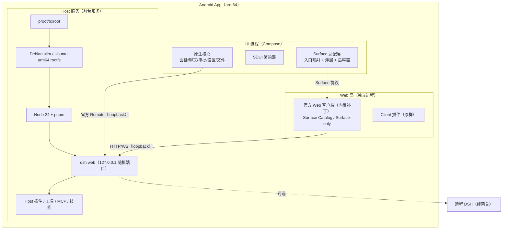
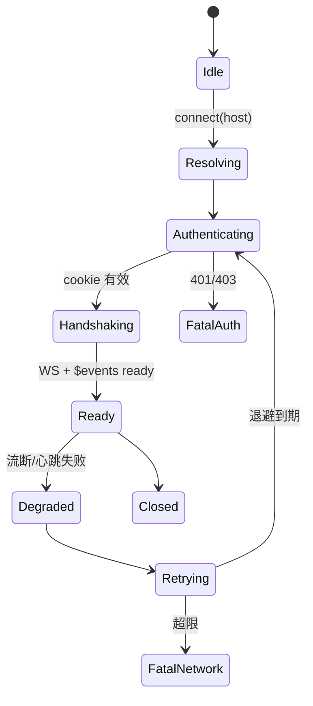
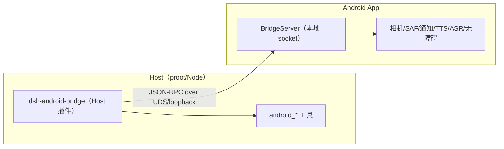

# DSH 手机端 · 最终设计文档 v4.0

| 项 | 内容 |
|---|---|
| 版本 | v4.0（最终基线，取代 v1.0–v3.5 的所有方案稿） |
| 日期 | 2026-10-17 |
| 产品定义 | **完整 DSH 手机端**：Agent、工具、插件、会话全部运行在手机上；远程连接是可选功能 |
| 技术路线 | 本地 Linux 运行时（proot/bxroot + Debian slim/Ubuntu arm64 + Node + 真实 DSH）+ 原生 Compose UI + Web 岛 + 内置 Surface 适配层 + SDUI |
| 关键约束 | 插件零改动；API 正确；核心不套壳；工作区是手机真实目录；插件 UI 有原生入口与容器 |
| 体量 | APK 250–330 MB（完整工具链，compact 基线）；单人约 12–16 人月；3 人并行约 6–8 个月 |

> **已定的关键决策**
> 1. Host 跑在手机本地 Linux 用户空间（唯一能保持 Host 插件零改动的完整方案）。
> 2. 核心 UI 原生；WebView 只做插件与重型组件（Web 岛）。
> 3. 工作区 = 手机上的真实目录（bind 到 Linux `/workspace`），不是 App 私有沙箱。
> 4. 插件 UI 采用「内置 Surface 适配层」：不引入伴生插件，直接内置到前端/壳；现有插件入口 native 化、内容由岛承载；未来插件声明 layout/surfaces 后完全原生。
> 5. 桌面浮层类插件统一进「插件浮层」（可悬浮、可收起），不静默隐藏。
> 6. 远程模式只是一个 Host 类型，复用网关/配对设计。
> 7. rootfs 采用 **compact 方案**：Debian slim + 完整工具链（Python/git/编译工具全保留）；只压缩 base 与去冗余，不裁功能；目标 APK 250–330 MB。

---

## 0. 术语与阅读指南

| 术语 | 含义 |
|---|---|
| Host | 手机内 Linux 环境中的 DSH 进程（Node + Cordis 插件树） |
| Runtime | 本地 Host 运行时：rootfs、proot、Node、dsh、生命周期管理 |
| Web 岛 | App 内按需加载的 WebView，运行官方 Web 客户端与 Client 插件 |
| Web 岛实例 | 一个 WebView + 官方客户端；分为全屏/Sheet/Surface-only/浮层四种形态 |
| Surface | 插件在客户端 UI 中的扩展位置（设置页、侧栏入口、输入区、浮层、消息动作等） |
| Surface 适配层 | 内置的「入口映射 + 内容容器 + 隔离渲染」机制（§7） |
| SDUI | 插件以 JSON 声明 mobile UI，客户端原生渲染（§7.8） |
| 伴生插件 | 作为 DSH 插件运行、负责桥接的第三方插件。**本设计明确不使用** |
| descriptor | DSH 生成的 Remote 调用描述符（端点/参数/codec） |
| generation | 一次物理连接的生命周期；重连即新 generation |

**阅读顺序**：决策者看 §0–§3、§18；开发看 §4–§8；测试看 §15；运维看 §16–§17。

---

## 1. 产品定义与目标

### 1.1 一句话

把整套 DSH 装进手机：本机跑 Agent、工具与插件；原生 UI 负责体验；Web 岛负责插件兼容；远程连接只是可选项。

### 1.2 目标

| # | 目标 | 验收 |
|---|---|---|
| G1 | 完整 DSH | Agent/工具/技能/MCP/会话/插件在设备本地运行 |
| G2 | 插件零改动 | 现有 Host/Client 插件代码一行不改 |
| G3 | API 正确 | Host Remote、插件 API、插件自定义 HTTP/WS 全部可用 |
| G4 | Native-first | 会话/聊天/审批/设置/文件原生；不打开插件时无 WebView |
| G5 | 插件 UI 有位置 | 现有插件入口 native 化、内容可打开；浮层插件可悬浮 |
| G6 | 工作区真实 | 工作区是手机目录，系统文件 App 可见，产物无需导出 |
| G7 | 跟版可控 | 每个 DSH 版本 1–2 人周完成兼容验证 |

### 1.3 非目标

- 不做 iOS/桌面端（架构可复用）。
- 不重写 Agent 运行时（保留 Host 插件生态）。
- 不做云端账号体系（远程模式用网关设备令牌）。
- 不追求每个插件的像素级原生还原（UI 问题可接受）。

---

## 2. 需求与硬约束

| 约束 | 含义 | 影响 |
|---|---|---|
| C1 | 插件代码不改 | Host 插件跑 Linux Node；Client 插件跑 Web 岛；SDUI 是可选增量 |
| C2 | API 正确 | 协议只转译不改写；插件自定义路由靠官方前端运行 |
| C3 | 核心不套壳 | 核心流程不经过 WebView；WebView 只在插件/重型组件出现 |
| C4 | 工作区真实 | 工作区 bind 手机目录；不暴露容器路径 |
| C5 | 插件 UI 可用 | 内置 Surface 适配层，不依赖伴生插件 |
| C6 | 后台不割裂 | 统一状态机、通知、文件、错误、可见开关 |

### 2.1 用户故事（摘要）

| # | 故事 | 优先级 |
|---|---|---|
| U1 | 安装后在本机启动 Agent，完成一次带工具的对话 | P0 |
| U2 | 工作区选手机目录，Agent 直接读写；系统文件 App 能看到产物 | P0 |
| U3 | 打开任意插件并使用（含设置页、侧栏、浮层） | P0 |
| U4 | 后台执行任务，锁屏审批/通知 | P0 |
| U5 | 断网/杀进程/重启后恢复会话 | P0 |
| U6 | 多主机（本机 + 远程）切换 | P1 |
| U7 | 插件声明 layout 后原生渲染 | P1 |
| U8 | 更新 DSH/插件/rootfs 不丢数据、不打断任务 | P1 |

---

## 3. 总体架构

### 3.1 分层



### 3.2 模块清单

| 模块 | 职责 |
|---|---|
| `:app` | 组装、导航、DI、Application |
| `:core:model` | 领域模型、错误、ID |
| `:core:protocol` | descriptor 生成代码、连接状态机、RPC/流/事件、认证 |
| `:core:network` | OkHttp/WS/Cookie/TLS/重试 |
| `:core:data` | Room、DataStore、加密、仓库 |
| `:core:designsystem` / `:core:ui` | 主题、通用组件、状态容器 |
| `:feature:runtime` | 运行时管理（安装/启动/停止/更新/日志） |
| `:feature:hosts` | 本机 + 远程 Host 列表、远程配对 |
| `:feature:sessions` / `:feature:chat` / `:feature:approval` / `:feature:settings` | 原生核心屏 |
| `:feature:files` | 文件浏览器、SAF、工作区 |
| `:plugin:runtime-web` | Web 岛容器（全屏/Sheet/Surface-only/浮层） |
| `:plugin:surface` | Surface 目录、放置策略、导航桥、浮层管理 |
| `:plugin:mobile-ui` | SDUI schema、校验、渲染器 |
| `:runtime:host` | rootfs/Node/dsh 生命周期、前台服务、更新、备份 |
| `:runtime:bridge` | 设备能力桥（相机/文件/通知/TTS/ASR/调度） |
| `:tooling:codegen` | descriptor → Kotlin |
| `:tooling:contract` | 契约夹具、mock host、前端补丁构建 |

### 3.3 进程与线程

- 主进程：Compose、ViewModel、协议协程、通知。
- Web 岛：`:island` 独立进程；崩溃不影响核心。
- Host：前台服务 + proot 子进程树；Node/dsh 在 Linux 内。
- 线程：主线程渲染；IO 线程 Room/网络；Default 线程 JSON/事件投影；协议单 `SupervisorJob` + generation 作用域。

### 3.4 关键决策（ADR）

| ADR | 决策 | 理由 |
|---|---|---|
| ADR-01 | 本地 Linux 运行时 | 唯一保持 Host 插件零改动的完整方案 |
| ADR-02 | Native-first + Web 岛 | 体验与生态兼得；核心不套壳 |
| ADR-03 | Remote 协议生成 + 契约验证 | 跟版成本最低、可回归 |
| ADR-04 | 工作区 = 手机真实目录 | 用户预期；产物系统可见 |
| ADR-05 | 内置 Surface 适配层（无伴生插件） | 不依赖插件加载顺序/生命周期；升级可控 |
| ADR-06 | 插件 UI：入口 native、内容岛、未来 SDUI | 现有插件零改动，未来可全原生 |
| ADR-07 | 一切失败优先降级岛 | 插件永远可用 |

---

## 4. 本地 Host 运行时（`:runtime:host`）

### 4.1 组成

```
files/
├─ rootfs/                 # Debian slim（默认候选）/ Ubuntu 24.04（备选）
│  ├─ opt/dsh/             # Node、pnpm、dsh
│  └─ root/.dsh/           # DSH_HOME：配置/会话/插件/凭据
├─ runtime/                # 版本清单、补丁、校验和
├─ workspace-link/         # 工作区绑定信息
├─ cache/                  # 依赖/构建缓存（/cache）
├─ saf/                    # SAF 镜像根
├─ logs/                   # 运行时日志
└─ backups/                # 用户数据快照
```

### 4.2 打包与首次安装

| 项 | 方案 |
|---|---|
| rootfs | zstd/gzip 压缩资产（约 220–320 MB，完整工具链），首次解压 |
| proot/bxroot | 作为 `jniLibs` 原生库；16 KB 页对齐；exec 限制用 nativeLibraryDir 规避 |
| Node/pnpm/dsh | 预置或首次安装；受管版本 |
| 校验 | 每资产 SHA-256；安装后自检；失败可重试 |
| 流水线 | 解压 → 基础工具 → Node → pnpm → dsh → 补丁 → 自检（可断点续装） |
| 耗时 | 中端机 1–3 分钟；可后台、可取消 |

### 4.3 启动与就绪

```text
proot -0 -r <rootfs> -b /proc -b /dev -b /sys \
  -b /storage/emulated/0:/mnt/phone \
  -b <user-workspace>:/workspace \
  -b <appfiles>/cache:/cache \
  -b <appfiles>/saf:/saf \
  --link2symlink <rootfs>/usr/bin/env -i HOME=/root DSH_HOME=/root/.dsh ... \
  <rootfs>/opt/dsh/bin/dsh --profile web --no-open --port <随机>
```

- 端口随机回环；解析 stdout 的 `dsh web:` URL 与 token。
- 就绪：HTTP 探活 + 一次 `/` + WS 握手；超时 60s（首次更久）。
- 失败：日志落盘 + 错误码 + 修复动作；连续失败进安全模式。
- 重启：指数退避（1s/2s/5s/10s，上限 3 次）。

### 4.4 生命周期与后台

| App 状态 | 有任务 | Runtime |
|---|---|---|
| 前台 | 否 | 保持（温启动） |
| 前台 | 是 | 保持 |
| 后台 | 是 | 前台服务 `specialUse` + WakeLock + 常驻通知 |
| 后台 | 否 | 默认 5 分钟后停止（可配 15/30/常驻） |
| 划掉任务 | 是 | 按设置继续/停止 |
| 划掉任务 | 否 | 停止 |
| 重启手机 | — | 仅用户开启「开机恢复」或有 schedule 时启动 |

- 单例锁防重复；停止 = SIGTERM → 5s → SIGKILL → 校验进程组；幂等。
- 任务中断：以 Host 会话状态为准，标记「可能中断」，不自动重发 prompt。
- 空闲时无 CPU 轮询；WakeLock 仅任务期。

### 4.5 更新与回滚

| 组件 | 方式 | 回滚 |
|---|---|---|
| App | APK 覆盖 | 保留上一版 |
| rootfs | 受管镜像，原子切换 | 保留上一代 |
| Node/dsh | 候选版本 → 切换 | 保留上一版 |
| 插件 | `dsh plugin add/rm` 事务化 | 安装日志 + 原件 |
| 用户数据 | 升级前快照 | 从快照恢复 |

原则：升级不动用户数据；失败回切；支持离线；任务中不更新。

### 4.6 日志与诊断

- 采集：stdout/stderr、启动耗时、端口/token 状态、rootfs 校验、插件加载失败、ELK 对齐。
- 脱敏：token/cookie/API key/消息正文。
- 导出：诊断 zip；崩溃保留最近 N 天；安全模式只做诊断/重装/备份。

### 4.7 rootfs 选型与轻量化

**先说结论：重不在「Ubuntu」，在 Node、dsh 依赖、Python/工具链和缓存。** DSHA 的 273 MB APK 里，Ubuntu base 压缩后只有约 30 MB 量级，大头是 Node、node_modules、Python/wheels、ADB/工具与资源。

| 方案 | libc | 插件/原生模块兼容 | 压缩体积（base，约） | 结论 |
|---|---|---|---|---|
| **Debian 12/13 slim** | glibc | 高（与 Ubuntu 同 ABI 族） | ~25–35 MB | **默认（已定）**；compact 基线 |
| **Ubuntu 24.04 minimal** | glibc | 最高（DSHA 已验证） | ~30–40 MB | 兼容备选；R0 实测后定版 |
| Alpine | musl | **低**：glibc `.node` 不能加载，需 musl 重编译 | ~3–8 MB | 不推荐（破坏插件零改动） |
| Distroless | glibc | 低：无 shell/工具，Agent 无法正常用 | ~20 MB | 不适用 |
| 自建 Buildroot | glibc | 中：需自己维护包与 ABI | 可更小 | 工作量大，后期再考虑 |

> 注意：这不是 Docker 容器，而是 proot/bxroot 下的 rootfs；「换发行版」只影响用户空间与 libc，不改变 Host/插件协议。

**本版决定：compact = 更小的 base + 去冗余，不是裁剪工具链。**

- 基线：**Debian 12/13 slim arm64（glibc）**；Ubuntu minimal 只作兼容回退。
- **工具链全保留**：Python 3 + pip、git、gcc/g++/make、常用 CLI 全部预置；插件与 Agent 不会因缺工具失败。
- 只删「非功能文件」：docs/man/locale、apt/npm/pnpm 缓存、x64/Windows/macOS 二进制、示例工程、调试符号。
- 超大可选引擎（LibreOffice、浏览器自动化 runtime）不属于基础工具链，单独处理（体积过大，按需安装）。
- 分发：内置完整 rootfs（离线）；可选「首启下载」模式减小 APK。
- R0 只验证 Debian slim；只有 native 模块/ABI 不兼容时才回退 Ubuntu minimal（仍保持 compact）。

**真正的体积构成（估算，含完整工具链）**：

| 组件 | 未压缩 | 压缩后（约） |
|---|---|---|
| rootfs base（Debian/Ubuntu） | 80–120 MB | 25–40 MB |
| Node 24 arm64 | 100–130 MB | 25–35 MB |
| dsh + node_modules | 300–500 MB | 60–100 MB |
| Python 3 + pip + wheels | 100–180 MB | 30–60 MB |
| git + gcc/g++/make + 常用 CLI | 80–150 MB | 25–50 MB |
| 文档/locale/缓存（删除） | 50–150 MB | 0（剔除） |
| **合计（完整工具链）** | — | **250–330 MB** |

**减重清单（只去冗余，不裁功能）**：

1. **发行版**：Debian slim（默认）或 Ubuntu minimal；不选 Alpine（musl 破坏 `.node` 兼容）。
2. **删非功能文件**：docs/man/locale、apt cache、npm/pnpm cache、x64/Windows/macOS 二进制、示例工程、调试符号。
3. **Node**：单二进制 + 必要 npm；不预置 npm cache；pnpm store prune。
4. **压缩**：zstd 最高压缩；首次解压；可断点续装。
5. **分发策略**：内置完整 rootfs（离线、大包）vs 首次下载（APK <60 MB、依赖网络）vs 混合。
6. **工具链完整性门禁**：镜像构建后自动验证 `python3/pip/git/cc/make` 等可执行，纳入 CI；缺一个即构建失败。

**目标**：

| 形态 | APK |
|---|---|
| 完整工具链（默认，离线） | **250–330 MB** |
| 首启下载模式 | < 60 MB（下载完整 rootfs） |

**R0 必须实测**：Debian slim 在 DSH + 10 个代表性插件上的兼容性、启动耗时、rootfs 解压时间、native 模块（node-pty/better-sqlite3）可用性，以及 Python/git/编译工具链可用。**默认 Debian slim compact；只有不兼容才回退 Ubuntu minimal。**

---

## 5. 客户端协议层（`:core:protocol`）

### 5.1 协议面

| 面 | 传输 | 用途 |
|---|---|---|
| 一元 RPC | `POST /api`（JSON；附件 multipart） | 会话/历史/发送/审批/设置 |
| 流式 RPC | `WS /api/remote.mux`（open/item/end/cancel） | 会话事件、follow、子代理 |
| 全局事件 | `$events`（ready 首帧） | 会话/工作区增量、审批/提问 |
| 精确 Fetch | 具名路由 | 文件上传、日志下载 |
| 认证 | `GET /?token=` → cookie | 本地/远程统一 |

### 5.2 生成管线

```
ctx.typert.local 导出 InvocationDescriptor（开发 Host 脚本）
  → normalize → IR（提交仓库）
  → KotlinPoet 生成 Endpoints/Models/Codecs/DescriptorSet
  → 契约夹具 + digest
```

- 生成代码不手改；输入 digest 绑定；缺失端点生成失败而非猜测。
- 只生成核心子集；其余端点保留在 digest 中用于版本判断。

### 5.3 连接状态机



- generation 递增；旧帧丢弃。
- 重试：500ms→10s 上限，50–100% 抖动；前后台策略不同。
- 心跳：服务端 2s ping；Pong 超时判定断线。

### 5.4 一元 / 流 / 事件

- 一元：`RemoteResult`（ok/value 或 error），取消映射 AbortSignal；只读自动重试。
- 流：`Flow<RemoteEvent>`；单流单消费；取消发 cancel；背压 buffer 64 + delta 合并。
- 事件：seq 有序；缺口触发分页补齐；通知不重放，重连以 baseline 替换。
- 事件分发到 Session/Approval/Workspace store。

### 5.5 认证

- 本地：Runtime 启动产出 launcher URL（含 token）→ `GET /?token=` → 签名 cookie（30 天，host:port 绑定）。
- 远程：网关设备令牌 + TLS 固定（§11）。
- Cookie 存加密 DataStore；每 Host 独立 CookieJar；401 触发重新交换。

### 5.6 契约验证与降级

| 层 | 内容 |
|---|---|
| 夹具 | 官方客户端完整会话流量（HTTP+WS，脱敏） |
| 回放 | mock host 全量 + 真实 Host 关键路径 |
| digest | 不匹配 → 「实验支持」；写操作前提示 |
| 降级 | 端点失败 → 单屏岛；流失败 → 手动刷新；认证失败 → 重新配对 |

## 6. 原生核心 UI

### 6.1 屏幕与状态

| 屏 | 内容 | 数据来源 |
|---|---|---|
| 主机/运行时 | 本机状态、远程 Host、启动/停止 | Runtime + Host 列表 |
| 会话列表 | 列表、搜索、归档、置顶 | Remote + 本地缓存 |
| 聊天 | 消息流、工具卡、diff、审批、提问、输入 | Remote 事件流 |
| 审批中心 | 队列、锁屏动作 | 事件 + 通知 |
| 文件 | 工作区/内部存储/SAF | 文件系统 |
| 设置 | 模型/推理/权限/通知/运行时/文件访问 | 设置 Remote + 本地 |
| 插件 | 插件列表、入口、浮层 | Surface Catalog + Host inventory |

### 6.2 数据流

```
Remote/WS → ConnectionEngine → EventBus → Reducer → Store(StateFlow) → ViewModel → Compose
                              ↘ Room（异步批量）
```

- Reducer 纯函数；`Unknown` 事件保留原样，渲染降级。
- 消息窗口：最近 500 条内存 + 分页；增量 50ms 合并。
- 持久化先内存后异步落库；崩溃恢复以 Host 为准。

### 6.3 Presentation

| 内容 | v1 策略 |
|---|---|
| Markdown/代码 | 成熟库 + 主题 + 复制 |
| 工具卡 | 通用卡（名称/参数/结果折叠）→ 高频工具专用卡 |
| 审批/提问 | 原生对话框 + 队列 + 通知动作 |
| diff/终端/预览 | 通用等宽文本；复杂时跳岛 |
| 图片/附件 | 原生查看器 + 分享 |
| plan/todo/子代理 | 列表/卡片，跳转完整会话 |

原则：**数据语义必须正确，样式可迭代；复杂组件不硬写。**

### 6.4 会话、分页与重连

- 首屏 50 条/256 KiB；上滑分页；锚点保持。
- 重连：新 generation baseline 替换窗口；保留滚动与草稿。
- 缺口：先补分页再 apply；未知事件折叠。

### 6.5 审批与通知

- 状态机 `Pending → Approve/Deny/Answer → Submitting → Confirmed/Failed`。
- actionId 幂等；以 Host 事件确认。
- 通知动作冷启动：恢复运行时 → 认证 → 执行；失败只打开 App。
- 通知单一管道（§9.4）。

### 6.6 输入、附件、草稿与语音

- 草稿按 `(hostId, sessionId)`；发送成功清空。
- 附件上传先走官方附件路由，得到引用再发送；进度原生。
- 语音（P2）：原生录音 → Host 语音插件 Remote；失败回退键盘。

---

## 7. 插件 UI 适配层（内置 Surface 适配，无伴生插件）

### 7.1 三层结构

| 层 | 做什么 | 实现位置 |
|---|---|---|
| **Surface Catalog** | 记录每个插件注册了哪些 surface（设置页/侧栏/输入区/浮层/消息动作） | 前端**内置补丁**（非插件） |
| **Surface Isolation** | 只渲染某个 surface 的「隔离模式」，供 Sheet/浮层使用 | 前端内置补丁（query 参数） |
| **Native Placement** | 把 surface 映射到原生位置与打开方式；浮层管理 | App `:plugin:surface` |
| **SDUI（未来）** | 插件声明 layout/surfaces → 原生渲染 | `:plugin:mobile-ui` |

### 7.2 为什么不用伴生插件（本设计的决定）

| 问题 | 伴生插件 | 内置补丁 |
|---|---|---|
| 加载顺序 | 依赖 `immediately` 与插件排序，可能晚于其他插件 | 在客户端启动前注入，顺序确定 |
| 生命周期 | 可被用户禁用/卸载/升级失败 | 随 App 构建，不可被禁用 |
| 版本耦合 | 插件与 DSH 版本矩阵又加一层 | 与前端补丁一起版本化 |
| 可见性 | 出现在插件列表/管理器，增加用户困惑 | 不出现在插件生态里 |
| 权限 | 作为普通插件运行，边界模糊 | 属于 App 自身 |

**结论：Surface 能力属于「客户端自身能力」，直接内置；不引入伴生插件。**

### 7.3 内置方式

#### A. 本地模式（主）

App 管理 rootfs 内的官方前端 dist，构建时注入 `native-surface` 模块（不是 DSH 插件）：

1. 在 `index.html` 的启动脚本前插入 `native-surface.js`；
2. 包装模块加载/`ctx.slots.register`，记录 `(pluginId, slotName, order)`；
3. 暴露 `window.__DSH_NATIVE_SURFACE__ = { ready, catalog, openSurface, setSurfaceMode }`；
4. 通过 JS Bridge 把 catalog 发给 App；
5. 支持 `?__dsh_surface=<slot>&__dsh_plugin=<id>` 隔离模式。

前端补丁随 App 版本化，带补丁清单与回滚；DSH 升级时重新生成补丁（按版本）。

#### B. 远程模式（降级）

远程 Host 的前端不受我们控制，无法打补丁。改用：

- `WebViewCompat.addDocumentStartJavaScript` 在文档开始注入轻量探针（同样记录 slot、暴露 bridge）；
- 导航能力降级：优先尝试内部服务，失败回退整岛 + 手动导航；
- 明确标注「远程模式插件导航可能不完整」。

#### C. 补丁内容（最小集）

| 能力 | 说明 |
|---|---|
| catalog | 记录注册信息，去重、按 slot 排序 |
| openSurface | 打开设置页/侧栏面板/浮层；优先客户端服务，其次语义化 DOM，最后回退根页 |
| surface-only | 隐藏非目标区域，透明背景，上报尺寸/ready |
| resize/close | 与原生浮动层协作 |
| error | 结构化错误给 native 展示 |

### 7.4 Catalog 数据模型

```jsonc
{
  "clientId": "…",
  "dshVersion": "0.2.0-rc.2",
  "surfaces": [
    { "pluginId": "dsh-context", "slot": "settings.page", "order": 10,
      "title": "上下文", "kind": "page", "capabilities": ["open"] },
    { "pluginId": "dsh-meme", "slot": "conversation.composer.dock", "order": 5,
      "title": "表情", "kind": "dock" }
  ]
}
```

- `kind`：`page / sidebar / dock / overlay / message-action / theme / unknown`
- 无标题时用插件名；无图标用默认图标。

### 7.5 Surface 类型 → Native 放置

| Surface | Native 位置 | 打开方式 | 降级 |
|---|---|---|---|
| `settings.page` / 插件设置 | 设置 → 插件 → 条目 | Island Sheet（surface-only 优先） | 整岛设置页 |
| `sidebar.*` | 侧栏「插件」区 / 更多菜单 | Island 页面 | 整岛 |
| `conversation.composer.dock` | 输入框「+」菜单 | Sheet | 整岛 |
| `shell.overlay` | **插件浮层**（可悬浮/收起） | 浮层 WebView | Sheet |
| `conversation.message.*` | 消息长按菜单 | Sheet | 整岛 |
| 工具卡 renderer | 通用卡 + 「查看原始」 | Sheet | 整岛 |
| 主题/全局 CSS | 仅岛生效 | 设置说明 | — |
| 桌面专属/hover | 标注「桌面专属」 | 浮层或禁用 | — |

### 7.6 Surface Isolation（隔离渲染）

- URL：`?__dsh_surface=settings.page&__dsh_plugin=dsh-context&__dsh_shell=none`
- 流程：客户端正常启动 → boot ready → 定位目标 slot → 隐藏其余 UI → 透明背景 → 上报 `ready` 与内容尺寸。
- 优点：Sheet/浮层里只显示插件内容，不是整站；更接近「原生面板」。
- 失败：3 秒内未定位 → 回退整岛页面；记录失败插件。
- 局限：插件若依赖整页布局/路由，可能异常；这是「UI 问题」，可接受，回退整岛。

### 7.7 插件浮层（Overlay/Float Layer）

- 形态：App 内顶层容器（可在页面上悬浮、拖动、收起为气泡）；默认不全屏。
- 内容：Web 岛 instance + surface-only（`shell.overlay` / 插件浮层 slot）。
- 约束：
  - 同时只允许 1 个浮层 instance（内存）；
  - 浮层在 App 后台时暂停/收起；
  - 浮层大小、位置、透明度可调；尊重安全区；
  - 不做「跨 App 悬浮」（`SYSTEM_ALERT_WINDOW` 不在首版；后续可选）。
- 桌面专属插件（桌宠/音乐播放器）：进浮层，标注「桌面布局，可能显示不全」。

### 7.8 SDUI（未来插件）

插件在 `package.json` 声明：

```jsonc
"dsh": {
  "mobile": {
    "schema": 1,
    "layout": { "entry": "./mobile/ui.json" },
    "surfaces": [
      { "slot": "settings.page", "title": "上下文" },
      { "slot": "sidebar.footer.action", "title": "上下文" }
    ],
    "fallback": { "web": true }
  }
}
```

- 有 layout + surfaces → 入口与内容都原生（`dsh.mobile` 渲染器，见 §7.8.1）。
- 只有 layout → 入口放「插件」页，内容原生。
- 都没有 → Web 岛（现有插件）。
- 任何不支持 → 整屏回岛，不做半原生混排。

#### 7.8.1 SDUI 规格（摘要）

- **词表**：page/section/row/col/text/list/table/keyvalue/stat/badge/progress/chart/callout/tabs/accordion/image/divider/button/input/select/switch/code/steps/timeline。
- **绑定**：`{{path}}` 路径取值；`visibleWhen` 比较；`forEach` 列表。
- **数据**：`remote`（一元）、`stream`、`static`；刷新 `onOpen/manual/interval`。
- **动作**：`remote`/`navigate`/`openUrl`/`copy`/`refresh`/`close`，白名单 + 确认。
- **预算**：节点 ≤200、深度 ≤8、spec ≤256 KiB；超限拒绝。
- **安全**：无 HTML/JS；URL/动作白名单；写操作确认。

### 7.9 Native ↔ 前端桥协议

| 方向 | 消息 | 说明 |
|---|---|---|
| 前端→Native | `catalog` | 插件 surface 列表 |
| 前端→Native | `surfaceReady` / `surfaceSize` | 隔离模式就绪与尺寸 |
| 前端→Native | `error` | 打开/渲染失败 |
| Native→前端 | `openSurface` | 打开指定 surface |
| Native→前端 | `setMode` | `surface-only` / `full` |
| Native→前端 | `close` | 关闭浮层/Sheet |

- 传输：`addJavascriptInterface`（仅白名单 origin）+ `evaluateJavascript` 回调。
- 所有参数 JSON 校验；错误可观测。

### 7.10 安全

- 岛只加载本机/受信 Host 的 origin；外链走 Custom Tabs。
- JS Bridge 只对固定 origin 注入，方法白名单，参数校验。
- 插件内容视为不可信：顶栏显示插件名 + 「网页模式」。
- 浮层不允许遮挡系统关键 UI；权限弹窗由原生处理。

### 7.11 风险

| 风险 | 对策 |
|---|---|
| 前端补丁随 DSH 版本失效 | 按版本构建补丁 + 契约探针 + 回退整岛 |
| slot 注册表/内部服务变化 | 只依赖公开 slot 名与语义；导航失败回退 |
| 隔离模式对部分插件失效 | 3 秒回退整岛；记录清单 |
| 补丁完全不可用（远程/失败） | **降级目录**：Host 插件清单 + 已知插件映射表；入口仍可见，内容整岛；不影响插件可用性 |
| 浮层内存 | 单实例 + 后台暂停 + 低端机禁用 |
| 远程模式导航不完整 | 明确标注；优先本地模式 |

---

## 8. 系统文件系统与工作区

### 8.1 工作区 = 手机真实目录

| 模式 | 权限 | 位置 | 系统可见 |
|---|---|---|---|
| 真实目录（默认） | `MANAGE_EXTERNAL_STORAGE` | 默认 `内部存储/DSH`，用户可选 | ✅ |
| SAF 镜像（受限） | SAF 目录授权 | App 私有镜像 | ⚠️ 同步模式 |
| 高性能工作区（可选） | 无 | App 私有 | ❌ |
| SD 卡工作区 | All files | `/storage/<UUID>/...` | ✅（exFAT 限制） |

- 工作区 bind 到 Linux `/workspace`；DSH workspace/cwd 即它。
- UI 显示真实路径 + 「在系统文件中打开」；不显示 `/mnt`、`/root`。
- 多工作区：`/workspaces/<name>` 各自 bind。
- 无 All files → SAF 镜像/高性能模式，UI 明确标注。

### 8.2 挂载与路径

| 用户看到 | Linux | 说明 |
|---|---|---|
| 内部存储 | `/mnt/phone` | bind `/storage/emulated/0` |
| SD 卡 | `/mnt/sdcard` | bind UUID 路径 |
| 工作区 | `/workspace` | bind 用户目录 |
| 缓存 | `/cache` | App 私有（依赖/构建） |
| SAF | `/saf/<treeId>` | 镜像 |
| 导入 | `/workspace/inbox` | 分享/选择 |

排除 `Android/data`、`Android/obb`（系统禁止）；文档说明。

### 8.3 FUSE 限制与高性能模式

- 共享存储不支持符号链接/硬链接/Unix 权限；`git`/`pnpm`/`node_modules` 可能异常。
- 依赖与构建缓存放 `/cache`，用环境变量重定向（npm/pnpm/gradle）。
- 检测构建失败 → 建议切换「高性能工作区」；SD 卡限制更多。
- 工作区切模式不丢数据：提示复制/移动。

### 8.4 文件 UI

- 根：内部存储/下载/文档/图片/视频/SD 卡/工作区/已授权文件夹。
- 操作：打开/预览/分享/复制到工作区/在 DSH 打开/删除（回收站）/重命名。
- 产物默认 `/workspace/output`（真实目录），系统文件 App 可见，无需导出。
- 分享到 DSH：`ACTION_SEND` → inbox；从 DSH 分享：FileProvider。
- 媒体：MediaStore/相册扫描；下载器通知。

### 8.5 安全

- All files 首次说明；可撤销；越界写操作确认；回收站。
- SAF 只同步用户选中的目录；镜像容量上限。
- 插件文件操作走 Host 权限；审计。

---

## 9. 无缝化（状态机、启动、后台、通知、更新、错误、透明）

### 9.1 一个状态机

```kotlin
sealed interface LocalEngineState {
    data object NotInstalled : LocalEngineState
    data class Installing(val stage: InstallStage, val progress: Float) : LocalEngineState
    data class Starting(val stage: StartStage) : LocalEngineState
    data object Ready : LocalEngineState
    data class Busy(val tasks: Int) : LocalEngineState
    data object Stopping : LocalEngineState
    data object Stopped : LocalEngineState
    data class Failed(val code: EngineError, val recoverable: Boolean) : LocalEngineState
}
```

- 所有页面从同一状态派生；不暴露半启动态。
- ConnectionState 叠加在 Ready 上；UI 不直接看 proot 进程。

### 9.2 启动体验

| 耗时 | 呈现 |
|---|---|
| <1.5s | 不显示加载态 |
| 1.5–5s | 顶部细进度条 |
| >5s | 分阶段进度 + 取消 + 修复 |
| 首次 | 独立安装页，可后台、可断点 |

- 先渲染缓存（会话/草稿/设置），并行启动引擎；就绪后刷新。
- 温启动只重连，目标 ≤800ms；空闲停止后再启动 2–5s。

### 9.3 后台策略

- 前台服务 `specialUse` + 常驻通知（状态/任务数/停止）。
- WakeLock 仅任务期；精确闹钟用于 schedule；电池优化白名单引导。
- 划掉任务/重启手机策略见 §4.4；不做隐形守护进程。
- 用户可设：空闲停止时长、后台继续任务、开机恢复。

### 9.4 通知与深链

| 通知 | 渠道 | 动作 |
|---|---|---|
| 前台服务 | engine（低） | 停止/打开 |
| 任务完成 | session_done（低） | 打开会话 |
| 审批/提问 | approval（高） | 允许/拒绝/打开 |
| 错误 | engine_error（中） | 修复 |

- 关闭岛内网页通知，原生统一；去重键 `(sessionId, turnId)`、`approvalId`。
- 深链 `dsh://session/{id}`、`dsh://approval/{id}`、`dsh://plugin/{id}`、`dsh://engine`。
- 锁屏默认隐藏正文。

### 9.5 更新不打断

- 后台检查/下载（Wi-Fi+充电）→ 校验 → 空闲时原子切换 → 失败回滚；数据目录不动；任务中提示「空闲时生效」。

### 9.6 错误与修复

| 错误 | 文案 | 修复 |
|---|---|---|
| rootfs 缺失/损坏 | 本地环境不完整 | 重装（保留数据） |
| Node/dsh 缺失 | 运行时组件缺失 | 补装 |
| 端口占用 | 端口冲突 | 自动换端口 |
| 权限/SELinux/exec | 系统限制 | 引导/换安装方式 |
| 存储不足 | 空间不足 | 清理 |
| 启动超时 | 启动超时 | 重试/安全模式/日志 |
| 崩溃循环 | 引擎反复退出 | 安全模式+备份/重装 |

- 不直接展示 stderr；错误码集中管理；安全模式提供备份/日志/重装/恢复。

### 9.7 透明度

- 设置 → 本地引擎：版本、DSH 版本、运行时长、CPU/内存/磁盘、最近启动耗时、停止/重启、日志导出。
- 首次使用说明：本机 Linux 环境、存储/电量开销、Agent 可执行工具。

### 9.8 反模式

- 每次启动重装 rootfs；启动页阻塞；隐形常驻；双份通知；暴露 Linux 路径；WorkManager 保活；任务中更新；只报「启动失败」；核心聊天放 WebView。

## 10. Agent 执行的原生边界与设备桥

### 10.1 原则

**插件可观察/可扩展的运行时留在 Host；原生只做「插件看不见的地方」和「扩展点后面」。**

| 组件 | 归属 | 说明 |
|---|---|---|
| Agent Loop / Prompt / LLM 传输 / 重试 / Compaction | Host | 插件 hook 面，原生化 = 生态断裂 |
| 工具注册表 / 工具执行 / MCP / Skills / Hooks / Subagent / Workflow | Host | 插件扩展面 |
| Session 格式 / 投影 / 查询 / 迁移 | Host | 原生只做只读缓存 |
| 权限策略 / 审批执行 / 沙箱策略 | Host | 原生只做 UI 与通知 |
| 消息/工具卡/审批/设置的呈现 | Native | 客户端侧 |
| 设备能力（相机/文件/分享/通知/剪贴板/TTS/ASR/无障碍/截图） | Native + 桥 | Host 拿不到的能力 |
| 生命周期 / 调度触发 / OS 安全 | Native | 系统能力 |

### 10.2 设备桥（App 预装 Host 组件，非第三方伴生）

App 预装一个 **Host 侧组件 `dsh-android-bridge`**（以 Cordis 插件形态运行，但属于 App 自带、随 App 版本化、不可单独卸载/禁用、不出现在插件市场；不是第三方伴生插件）：



- 工具：`android_camera`、`android_pick_file`、`android_save_file`、`android_share`、`android_notify`、`android_clipboard`、`android_device_info`、`android_tts`、`android_asr`、`android_apps`、`android_sensors`、`android_ui_*`（无障碍，高风险）、`android_screenshot`（MediaProjection，高风险）。
- 权限：Android 运行时权限 + 桥 capability 声明 + 用户逐项授权 + 审计。
- 失败：`bridge_unavailable` / `permission_denied` / `timeout`，模型可改用其他工具。
- 安全：能力白名单、无任意 Intent、调用审计、高风险默认关闭。

### 10.3 原生调度

- Host 保留 schedule 语义；到点由原生 `AlarmManager`/`WorkManager` 唤醒运行时，再触发 Host 执行。
- 幂等键 `(scheduleId, scheduledAt)`；开机重登记；精确闹钟权限被拒则降级并提示。
- 长任务前台服务；系统强制停止后不保证续跑。

---

## 11. 远程模式（可选功能）

### 11.1 Host 抽象

```kotlin
sealed interface HostDescriptor {
    val id: HostId
    data class Local(val runtime: RuntimeHandle) : HostDescriptor
    data class Remote(val baseUrl: String, val auth: RemoteAuth) : HostDescriptor
}
```

- 本地：`127.0.0.1:<port>` + token/cookie；无需网关/TLS。
- 远程：网关设备令牌 + TLS 固定；复用官方 Remote 语义。
- 两者共用 `HostConnection`、Repository、UI。

### 11.2 远程网关（最小职责）

| 职责 | 说明 |
|---|---|
| TLS 终结 | 自签 + 指纹固定，或用户证书 |
| 配对 | `/pair`、`/revoke`、设备列表 |
| 认证 | 设备令牌、限流、审计 |
| 反代 | HTTP + WS upgrade 透传；正确改写 Host/Origin |
| 官方认证桥 | 内部完成 token→cookie，不暴露给客户端 |

不做业务转换、不改 payload、不猜插件路由。

### 11.3 配对与多主机

- 二维码 payload：`{v, name, url, fp, pair, exp}`。
- App 校验指纹 → `POST /pair` → 设备令牌（Keystore 保存）→ WSS。
- 多主机：每 Host 独立 cookie/令牌/证书；上限默认 5。
- 状态：在线/离线/认证失效/版本不兼容，分别有 UI 与操作。

---

## 12. 安全设计

### 12.1 威胁模型（摘要）

| 威胁 | 场景 | 对策 |
|---|---|---|
| 令牌窃取 | 设备丢失/备份 | Keystore + 生物识别 + 禁备份 |
| 中间人 | 局域网/公网 | TLS + 证书固定 |
| 本地 Agent 执行任意代码 | 工具有 shell 权限 | App UID + 最小 bind + 高危确认 |
| proot 不是沙箱 | 可读写 App 私有 | 不挂 `/sdcard` 全盘；敏感数据加密；明示 |
| 恶意插件 | 插件 JS/Host 代码 | 能力提示、不静默安装、审计、岛隔离 |
| WebView 注入 | 插件页调用桥 | origin + 方法白名单 + 参数校验 |
| Surface 补丁被利用 | 前端桥 | 固定 origin、只暴露语义 API、无任意求值 |
| SDUI 滥用 | 恶意 spec | 无代码、动作/URL 白名单、写操作确认 |
| 文件越界 | Agent 误删/覆盖 | 回收站、写确认、工作区/允许目录 |
| 远程网关暴露 | Host RCE | 设备令牌 + TLS 固定 + 默认局域网 + 限流 |
| 供应链 | rootfs/插件/网关 | 固定版本、校验和、来源声明、许可审计 |

### 12.2 凭据与数据

- 设备令牌、cookie、API key：Keystore/EncryptedSharedPreferences；不备份；可生物识别解锁。
- DSH 凭据在 rootfs 的 `.dsh`；设备加密 + App 私有；可选 App 层加密。
- 证书指纹 TOFU；变更强提示。

### 12.3 WebView 加固

- JS 开、File/Content Access 关、Mixed Content 拒绝、第三方 Cookie 仅 host 域。
- `shouldOverrideUrlLoading` 白名单；外链 Custom Tabs；`onReceivedSslError` 不 proceed。
- 严格 pinning 用本机反代 + OkHttp（WebView 自身不保证）。
- 岛独立进程；`onRenderProcessGone` 恢复；release 关闭调试。

### 12.4 前端补丁与桥

- 补丁只在本机/受信 origin 注入；bridge 方法白名单；参数 JSON 校验。
- 补丁包签名/校验；前端补丁与 DSH 版本绑定；失败回退官方前端（降级模式）。

### 12.5 文件与权限

- All files 明确告知、可撤销、审计；越界写确认；回收站 30 天。
- SAF 只同步用户选中目录；镜像容量上限。
- 分享/Intent MIME 校验；FileProvider 精确授权。

### 12.6 日志与隐私

- 不记录消息正文/附件/cookie/令牌；诊断日志脱敏；遥测默认关闭、需同意。

---

## 13. 数据与存储

### 13.1 Room（客户端缓存）

```sql
CREATE TABLE hosts (
  id TEXT PRIMARY KEY, kind TEXT NOT NULL, name TEXT NOT NULL,
  base_url TEXT, tls_fingerprint TEXT, device_id TEXT,
  status TEXT, last_seen_at INTEGER, sort_order INTEGER
);

CREATE TABLE sessions (
  host_id TEXT NOT NULL, session_id TEXT NOT NULL, title TEXT,
  workspace_path TEXT, status TEXT, updated_at INTEGER, last_seq INTEGER,
  archived INTEGER DEFAULT 0, pinned INTEGER DEFAULT 0,
  PRIMARY KEY (host_id, session_id)
);

CREATE TABLE messages (
  host_id TEXT NOT NULL, session_id TEXT NOT NULL, message_id TEXT NOT NULL,
  role TEXT, seq INTEGER, content_json TEXT, created_at INTEGER, status TEXT,
  PRIMARY KEY (host_id, session_id, message_id)
);

CREATE TABLE drafts (
  host_id TEXT NOT NULL, session_id TEXT NOT NULL,
  text TEXT, attachments_json TEXT, updated_at INTEGER,
  PRIMARY KEY (host_id, session_id)
);

CREATE TABLE approvals (
  host_id TEXT NOT NULL, approval_id TEXT NOT NULL, session_id TEXT,
  payload_json TEXT, state TEXT, created_at INTEGER,
  PRIMARY KEY (host_id, approval_id)
);

CREATE TABLE surface_catalog (
  client_id TEXT NOT NULL, plugin_id TEXT NOT NULL, slot TEXT NOT NULL,
  title TEXT, kind TEXT, order_hint INTEGER, capabilities_json TEXT,
  updated_at INTEGER, PRIMARY KEY (client_id, plugin_id, slot)
);

CREATE TABLE plugin_ui_cache (
  plugin_id TEXT, schema_version INTEGER, spec_json TEXT, fetched_at INTEGER,
  PRIMARY KEY (plugin_id, schema_version)
);
```

### 13.2 DataStore

主题、语言、通知、上次 Host、引擎策略（空闲停止/后台继续/开机恢复）、文件访问模式、布局覆盖。

### 13.3 数据归属

| 数据 | 位置 | 说明 |
|---|---|---|
| DSH 会话/配置/插件/凭据 | rootfs `$DSH_HOME` | Host 权威数据 |
| 客户端缓存 | Room | 只读镜像，可重建 |
| 工作区 | 手机真实目录 | 用户数据，系统可见 |
| 缓存/构建 | `/cache` | 可清理 |
| SAF 镜像 | `files/saf` | 可重建 |
| 备份 | `files/backups` | 加密导出 |

### 13.4 保留与清理

- 每会话最近 500 条；每主机 200 会话；LRU。
- 删除 Host 级联清理；rootfs 卸载/重置需用户确认；回收站 30 天。
- 升级迁移只前向；破坏性变更需显式测试。

## 14. 性能与包体

### 14.1 预算

| 指标 | 目标 |
|---|---|
| APK | 250–330 MB（完整工具链，compact 基线） |
| 首次安装 | 1–3 分钟（可后台） |
| 冷启动（已安装）到会话列表 | ≤ 4 s |
| 温启动到可交互 | ≤ 800 ms |
| 首次响应（本机 Agent） | 与网络/模型相关，UI 不阻塞 |
| 运行时内存（空闲） | ≤ 400 MB（引擎 + UI） |
| 岛内存（打开插件） | +150–250 MB |
| 长会话滚动 | 60 fps（1,000 条不掉帧） |
| 通知延迟 | ≤ 1 s（本地事件） |

### 14.2 优化点

- rootfs 精简：只删文档/缓存等非功能文件 + zstd 压缩；**Python/git/编译工具链全保留**；Office/浏览器自动化等超大引擎可选后置。
- Node 预置、依赖缓存、避免每次启动安装。
- 岛懒加载、单浮层、后台暂停、低端机禁用浮层。
- 消息窗口化、增量合并、图片懒加载、缩略图。
- 运行时启动与 UI 并行；缓存首屏；分级进度。

---

## 15. 兼容性与跟版

### 15.1 版本矩阵

| 组件 | 策略 |
|---|---|
| App | 语义化版本；声明支持的 DSH 范围 |
| DSH | 固定基线 + 允许 rc 范围；每个版本跑契约 |
| rootfs | 独立版本；原子切换 |
| 前端补丁 | 与 DSH 版本绑定；按版本构建；失败回退官方前端 |
| 插件 | 不做版本绑定；按兼容分级（原生/岛/不兼容） |

### 15.2 插件兼容分级

| 级别 | 条件 | 行为 |
|---|---|---|
| A 原生 SDUI | 声明 layout + surfaces，组件支持 | 原生入口 + 原生渲染 |
| B 岛 | 现有插件 / 未声明 | 原生入口 + 岛内容 |
| C 桌面专属 | 依赖桌面布局/hover/悬浮 | 浮层或标注不可用 |
| D 不兼容 | 需要新内核/新 API | 提示升级/外链 |

### 15.3 契约与探针

- Remote 夹具回放（HTTP+WS）。
- 前端补丁探针：`__ModuleLoader__`、slot 名、`ctx.slots.register`、`settings.page`、`shell.overlay`。
- Surface catalog 回归：top 100 插件目录快照对比。
- 每个 DSH rc：契约 + 补丁 + 插件矩阵，1 周内出结论。

### 15.4 发布门禁

- 契约全绿；前端补丁可用；
- 5 类插件零改动可用（含浮层）；
- 工作区真实目录读写、系统文件 App 可见；
- 后台任务/通知/更新/回滚通过；
- 性能预算达标；无 P0/P1 崩溃；安全清单通过。

---

## 16. 工程实现

### 16.1 仓库结构

```
dsh-android/
├─ app/
├─ core/{model,protocol,network,data,designsystem,ui}/
├─ feature/{runtime,hosts,sessions,chat,approval,settings,files}/
├─ plugin/{runtime-web,surface,mobile-ui}/
├─ runtime/{host,bridge}/
├─ tooling/{codegen,contract,frontend-patch}/
├─ fixtures/            # 契约、golden SDUI、surface catalog
├─ docs/                # 设计文档与 ADR
└─ build-logic/
```

### 16.2 关键构建产物

| 产物 | 说明 |
|---|---|
| rootfs 资产 | 压缩镜像 + 校验和 |
| 前端补丁包 | 基于官方 dist 注入 `native-surface`，按 DSH 版本构建 |
| 生成协议代码 | descriptor → Kotlin |
| SDUI golden | 双渲染器一致性 |
| mock host | 契约/集成测试 |

### 16.3 CI

| 阶段 | 内容 |
|---|---|
| lint | ktlint/detekt |
| unit | codec/binding/reducer/error |
| contract | 夹具回放、digest |
| frontend-patch | 补丁构建 + 探针 + slot 快照 |
| integration | Room 迁移、连接状态机、surface |
| UI | Compose 截图、SDUI golden、浮层 |
| e2e | 真机（可选 runner）：启动→对话→工作区→插件→浮层→更新 |
| perf | 启动/内存/滚动 |
| release | 签名/混淆/安全扫描 |

### 16.4 测试矩阵

| 类别 | 用例 |
|---|---|
| 生命周期 | 前台/后台/锁屏/划掉/重启/更新 |
| 任务 | 回合中切后台/断网/杀进程/重启 |
| 运行时 | 首次安装/断点/存储不足/校验失败/重装保留数据 |
| 工作区 | 真实目录/SAF/高性能/SD 卡/权限撤销 |
| 插件 | 设置页/侧栏/输入区/浮层/消息动作/桌面专属 |
| Surface | 隔离渲染/回退整岛/桥失败 |
| SDUI | 组件/golden/超限/动作/数据失败 |
| 远程 | 配对/断线/多主机/TLS |
| 设备 | Android 11–17、4K/16K 页、OEM 省电 |
| 安全 | WebView/桥/文件/日志脱敏 |

### 16.5 开发环境

- Android Studio + JDK 17；设备/模拟器 API 30+。
- 本地 Host：Windows/macOS/Linux 跑 `dsh --profile web` + 网关开发模式。
- 调试：协议帧查看器、surface catalog 查看器、SDUI 检查器、岛远程调试、运行时日志。

---

## 17. 发布与运维

- 渠道：内测（GitHub Releases）→ 公测 → 稳定；Play 分发需评估 All files 与 Linux 运行时政策。
- 签名：独立 keystore；覆盖安装校验；不热更原生代码。
- 灰度：按 DSH 版本/机型/渠道；崩溃率/降级率超阈值暂停。
- 回滚：保留上一版 APK；服务端开关「全局岛模式」「禁用浮层」。
- 遥测：默认关闭非必要项；崩溃/聚合指标脱敏；隐私政策声明。
- 支持：诊断包导出；安全模式；数据备份/恢复。

---

## 18. WBS、里程碑与工期

### 18.1 阶段

| 阶段 | 周期 | 内容 | 出口 |
|---|---|---|---|
| R0 运行时 spike | 2–3 周 | proot + Debian slim + Node + dsh 真机跑通；UI 连 127.0.0.1 | 本机完成一次对话 |
| R1 运行时产品化 | 5–7 周 | 安装/校验/启动/停止/FGS/日志/备份/安全模式 | 稳定日用 |
| C1 协议与原生核心 | 10–12 周 | descriptor 生成、连接、会话、聊天、审批、通知 | 原生核心可用 |
| C2 岛 + Surface 内置 | 6–8 周 | 前端补丁、catalog、隔离模式、浮层、导航桥 | 5 类插件零改动可用 |
| C3 SDUI | 6–8 周 | schema、校验、原生渲染器、Web 适配、golden | 示例插件原生渲染 |
| C4 设备桥 + 调度 | 6–8 周 | Host 插件、BridgeServer、设备工具、Alarm 调度 | 相机/文件/通知/定时可用 |
| C5 文件与工作区 | 8–12 周 | 真实目录 bind、All files/SAF、文件 UI、FUSE 检测 | 工作区手机可见 |
| C6 远程模式 | 2–3 周 | 网关、配对、多主机 | 本机+远程 |
| C7 集成发布 | 5–7 周 | 设备矩阵、性能、安全、发布 | 门禁全绿 |

**并行策略**：R0/R1 与 C1 前半并行；C2/C3/C4/C5 可由 2–3 人并行；C7 收口。

### 18.2 人力

| 配置 | 工期 |
|---|---|
| 1 名资深全栈（Android + Web + Linux） | **约 12–16 人月**（50–68 周） |
| 3 人（运行时 1 + Android 1 + 前端/插件 1） | **约 6–8 个月** |
| 仅做「远程客户端」子集 | 4–6 人月（不含本地运行时/文件/浮层） |

### 18.3 里程碑

| 里程碑 | 内容 |
|---|---|
| M1 | 本机 Agent 跑通，原生会话/聊天可用 |
| M2 | 工作区=手机目录、文件 App 可见；插件入口+岛可用 |
| M3 | 浮层/隔离模式、设备桥、通知/后台 |
| M4 | SDUI 示例、远程模式、发布门禁 |

---

## 19. 风险与开放问题

### 19.1 风险

| # | 风险 | 概率/影响 | 对策 |
|---|---|---|---|
| R1 | Android exec/SELinux/16 KB 限制 | 中/高 | R0 真机 spike；复用 DSHA（MIT）；bxroot 备选 |
| R2 | proot 性能/功耗 | 高/中 | 空闲停止、bxroot、缓存/预热 |
| R3 | 原生模块 arm64 缺失 | 高/中 | rootfs 内编译；插件兼容清单 |
| R4 | 前端补丁随 DSH 版本失效 | 高/中 | 按版本构建 + 探针 + 回退官方前端 |
| R5 | Surface 隔离对部分插件失效 | 中/中 | 3 秒回退整岛；记录清单 |
| R6 | 共享存储 FUSE 限制 | 高/中 | 缓存放 /cache；检测提示高性能模式 |
| R7 | 包体/分发 | 高/中 | 精简、按需下载、渠道分发 |
| R8 | 后台被杀/任务中断 | 高/中 | FGS + WakeLock + 恢复策略 |
| R9 | 浮层内存/体验 | 中/中 | 单实例、后台暂停、低端机禁用 |
| R10 | 远程网关安全 | 中/高 | 设备令牌 + TLS 固定 + 默认局域网 |
| R11 | 供应链/许可（发行版 GPL、DSHA MIT、插件许可） | 中/中 | 来源声明、源码获取、法务确认 |
| R12 | 分发政策（All files、Linux 运行时） | 中/高 | 优先 sideload；Play 走 SAF 模式 |

### 19.2 开放问题

1. 前端补丁方式：构建期替换 dist vs document-start 注入（本地/远程各一套）。
2. slot registry 与「打开设置页/面板」的客户端服务是否稳定，需 spike。
3. 16 KB 页设备与 Android 17 的真机验收范围。
4. rootfs 内置 vs 首次下载；最低 Android 版本。
5. 浮层是否需要跨 App 悬浮（`SYSTEM_ALERT_WINDOW`）——首版不做。
6. `dsh.mobile.layout/surfaces` 是否推动上游采纳。
7. 工作区默认目录、SD 卡支持、构建失败自动切换策略。
8. 分发渠道（GitHub/官网/应用商店）与 All files 政策。

---

## 20. 附录

### A. `dsh.mobile` JSON Schema（草案）

```json
{
  "$schema": "https://json-schema.org/draft/2020-12/schema",
  "type": "object",
  "additionalProperties": false,
  "required": ["schema"],
  "properties": {
    "schema": { "type": "integer", "minimum": 1 },
    "layout": {
      "type": "object",
      "properties": {
        "entry": { "type": "string", "pattern": "^\\./" },
        "endpoint": { "type": "string" }
      },
      "oneOf": [{ "required": ["entry"] }, { "required": ["endpoint"] }]
    },
    "surfaces": {
      "type": "array",
      "items": {
        "type": "object",
        "required": ["slot"],
        "properties": {
          "slot": { "type": "string" },
          "title": { "type": "string" },
          "icon": { "type": "string" },
          "order": { "type": "integer" }
        }
      }
    },
    "fallback": {
      "type": "object",
      "properties": { "web": { "type": "boolean", "default": true } }
    }
  }
}
```

### B. Surface 槽位映射（初始清单）

| Slot / 服务 | 类型 | Native 位置 | 容器 |
|---|---|---|---|
| `settings.page` | page | 设置 → 插件 → 条目 | 岛 Sheet（隔离优先） |
| `sidebar.*` / `sidebar.footer.action` | sidebar | 侧栏插件区/更多 | 岛页面 |
| `conversation.composer.dock` | dock | 输入框 + 菜单 | 岛 Sheet |
| `shell.overlay` | overlay | 插件浮层 | 浮层 WebView |
| `conversation.message.*` | message-action | 长按菜单 | 岛 Sheet |
| 工具卡 renderer | tool | 通用卡 + 查看原始 | 岛 Sheet |
| theme / global CSS | theme | 仅岛 | — |
| 桌面专属 | desktop | 浮层/标注 | 浮层 |

### C. 错误码（客户端）

| 码 | 来源 | 处理 |
|---|---|---|
| `dsh/auth/failed` | 401/403 | 重新配对 |
| `dsh/trust/rejected` | Host/Origin/证书 | 阻断 |
| `dsh/net/timeout` / `offline` | 网络 | 退避/暂停 |
| `dsh/proto/version` | descriptor/digest | 实验支持/降级 |
| `dsh/proto/frame` | WS 帧 | 重连/降级 |
| `dsh/remote/<code>` | Host RemoteError | 原样展示 |
| `dsh/runtime/install` | rootfs/组件 | 补装/重装 |
| `dsh/runtime/start` | proot/Node/dsh | 修复/安全模式 |
| `dsh/plugin/load` | 岛加载 | 重试→外链 |
| `dsh/surface/isolate` | 隔离失败 | 回退整岛 |
| `dsh/surface/bridge` | 桥失败 | 整岛/提示 |
| `dsh/sdui/invalid` / `unsupported` | SDUI | 整屏回岛 |
| `dsh/storage/permission` | 文件权限 | 引导/降级 |
| `dsh/storage/fuse` | 构建失败 | 建议高性能模式 |

### D. 路径与挂载

| 用户看到 | Linux | 来源 |
|---|---|---|
| 内部存储 | `/mnt/phone` | `/storage/emulated/0` |
| SD 卡 | `/mnt/sdcard` | `/storage/<UUID>` |
| 工作区 | `/workspace` | 用户手机目录（bind） |
| 缓存 | `/cache` | App 私有 |
| SAF | `/saf/<treeId>` | 镜像 |
| 导入 | `/workspace/inbox` | 分享/选择 |

### E. 参考资料

| 资料 | 位置 |
|---|---|
| Web Client 架构 / Client 模块 / Slots / Web Server / API Gateway | `docs/subsystems/*.zh.md`（deepseek-ai/deepseek-harness） |
| 桌面架构（Electron 壳 + Web 资源） | `docs/architecture.zh.md` |
| 插件开发 UI 契约 | `skills/cordis-plugin-development/references/ui-plugin.md` |
| ACP / SDK 协议（备选） | `@deepseek-ai/dsh-acp`、`@deepseek-ai/dsh-sdk-protocol` README |
| GenUI 词表 | `@changfenhuang/dsh-genui`（MIT） |
| 本地运行时参考 | DSHA（MIT，Ubuntu rootfs + proot/bxroot + Node + dsh） |
| 插件生态统计 | `_feasibility/data/registry-stats.json` |

### F. 评审检查表

- [ ] 核心流程不经过 WebView；岛只在插件/重型组件出现
- [ ] Host 零改动；插件零改动
- [ ] 工作区是手机真实目录，系统文件 App 可见
- [ ] 现有插件入口 native 化，内容可打开；浮层可悬浮
- [ ] Surface 适配内置，无伴生插件
- [ ] SDUI 可选增量，旧插件不受影响
- [ ] 失败回退整岛；无「插件不可用」
- [ ] 后台/通知/更新/错误/透明度符合 §9
- [ ] 契约、探针、插件矩阵进 CI
- [ ] 安全清单与设备矩阵通过

---

> **最终结论**：这是在「完整 DSH + 插件零改动」约束下唯一自洽的产品形态——本地 Linux 跑真实 Host，原生 UI 负责体验，Web 岛负责插件兼容，内置 Surface 适配层负责「插件入口与容器」，SDUI 负责未来插件的全原生 UI，远程只是 Host 的一种。代价是包体与工期；收益是真正的 DSH，而不是任何形式的套壳。


