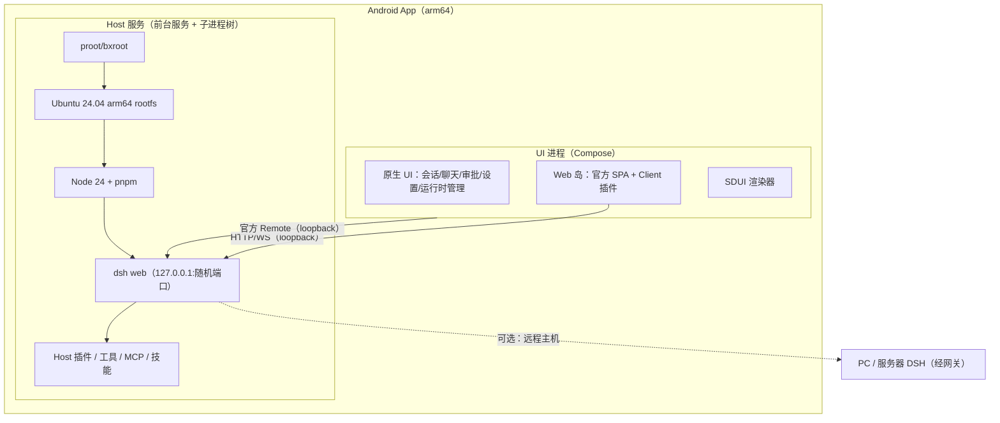

> **最终基线（v4.0）**：完整实现设计见 [DSH-手机端-最终设计-v4.0.md](DSH-手机端-最终设计-v4.0.md)。本文保留为专题设计/决策背景。

# DSH 手机端 · 详细设计修订 v3.0
## 完整 DSH 运行在手机上，远程只是其中一个功能

| 项 | 内容 |
|---|---|
| 版本 | v3.0（修订稿，替代 v2.0 的部署模型） |
| 日期 | 2026-10-17 |
| 依据 | v2.0 的客户端设计（协议转译 / 原生 UI / Web 岛 / SDUI）继续有效；本版把 Host 从「远端 PC」改为「设备本地」 |
| 一句话 | 这不是「DSH 客户端」，而是把整套 DSH 搬到手机上：本机跑 Agent、工具、插件；远程连接只是附加功能 |

> **v3.5 补充（2026-10-17）**：插件 UI 的 Native 适配层（Surface Adapter + Web 岛 + SDUI；现有插件入口 native 化、内容岛承载；未来插件声明 layout/surfaces）见 [`DSH-手机端-详细设计-v3.5-插件UI适配层.md`](DSH-手机端-详细设计-v3.5-插件UI适配层.md)。

> **v3.4 补充（2026-10-17）**：系统原生文件系统接入（工作区=手机真实目录、All files / SAF 三通道、路径映射、文件 UI、安全）见 [`DSH-手机端-详细设计-v3.4-系统文件系统接入.md`](DSH-手机端-详细设计-v3.4-系统文件系统接入.md)。目标：容器只做实现细节，手机文件是产品一等公民。

> **v3.3 补充（2026-10-17）**：本地 Linux 运行时与原生 App 的无缝化设计（状态机、后台保活、通知、文件、更新、错误、透明度）见 [`DSH-手机端-详细设计-v3.3-无缝化设计.md`](DSH-手机端-详细设计-v3.3-无缝化设计.md)。目标：让 Linux 只以「引擎状态」出现在产品里，而不是「App 里藏着另一个系统」。

> **v3.2 补充（2026-10-17）**：去 Linux 的可行性评估见 [`DSH-手机端-详细设计-v3.2-去Linux可行性.md`](DSH-手机端-详细设计-v3.2-去Linux可行性.md)。结论：可以换成 Android 上的 Node（bionic）去掉 rootfs，但插件兼容降级；原生重写 Agent 会丢掉 Host 插件生态。不存在「全原生 + 插件零改动」的路线。

> **v3.1 补充（2026-10-17）**：Agent 执行的原生边界与桥接设计见 [`DSH-手机端-详细设计-v3.1-Agent原生边界.md`](DSH-手机端-详细设计-v3.1-Agent原生边界.md)。核心结论：Agent Loop / LLM / 工具注册表 / Session 留在 Host；原生只做客户端呈现、设备能力（桥接为 Host 工具）、生命周期与调度触发、OS 安全增强。

> **与 v2.0 的关系**
> - 沿用：§4 API 转译、§5 原生核心、§6 Web 岛、§7 SDUI、§8 布局声明、§10 安全、§13–17 工程与测试。连接目标从 `host:port`（远端）变为 `127.0.0.1:port`（本机），协议层不变。
> - 替换：§3 部署架构、§9 传输与配对、§18 工期、§19 风险。远程模式降级为「一种 Host 类型」，复用 v2.0 §9 的网关/配对设计。
> - 新增：本文件 §4（本地 Host 运行时）、§6（完整功能矩阵与 Android 适配）、§7（插件兼容条件）。

---

## 0. 变更摘要

| 维度 | v2.0（旧假设） | v3.0（修正） |
|---|---|---|
| Host 位置 | PC 上跑 `dsh web` | **手机本地跑完整 DSH** |
| 远程 | 唯一形态 | **可选功能**：本机 + 远程主机同列 |
| 客户端角色 | 远程客户端 | **完整手机端**：既是 UI，也是 Host 宿主 |
| 必要组件 | 网关/配对/TLS | 本地运行时（Linux rootfs + Node + DSH）+ 可选远程网关 |
| 插件兼容 | Host 插件在 PC 跑 | Host 插件在手机 Linux 环境跑；Client 插件仍在 Web 岛 |
| 包体 | ~30 MB | **250–350 MB**（含 rootfs） |
| 工期 | 4.5–5 人月 | **约 7–9 人月**（单人），3 人并行约 4–5 个月 |

**为什么必须是 Linux 运行时**：DSH 是写给 glibc Linux 的（官方 Agent Harness），直接在 Android/bionic 上跑会撞上原生模块编译、`link(2)`/SELinux、沙箱、平台差异。要保持「插件零改动」，就必须给它一个真正的 Linux 用户空间。DSHA（MIT）已经证明这条路可行：Ubuntu 24.04 arm64 rootfs + Node + pnpm + dsh 打在一个 APK 里，273–345 MB，arm64，无需 root/Termux。

---

## 1. 产品形态

### 1.1 三种模式

| 模式 | Host | 说明 |
|---|---|---|
| **本地（默认）** | 手机内 Linux 运行时 | Agent、工具、插件、会话全部在本机；断网也能用本地模型以外的能力 |
| **远程（功能）** | PC / 服务器上的 DSH | 复用 v2.0 的网关/配对；适合重任务、大工作区 |
| **混合** | 本机 + 远程多主机 | 同一 UI，主机列表里同时出现「本机」与「远程」 |

远程不是架构分支，而是 `HostDescriptor { kind: local | remote }` 的两种取值。

### 1.2 「完整 DSH」的功能边界

| 能力 | 本地实现 | 说明 |
|---|---|---|
| Agent 循环 / 模型调用 | ✅ Host 内 | 与桌面同一套 |
| 工具（bash/fs/search/terminal/MCP/skills） | ✅ Linux 用户空间 | PTY、apt、原生模块可用 |
| 会话/工作区/历史 | ✅ | DSH 自己的数据目录 |
| Host 插件 | ✅（Linux/arm64 条件下） | 见 §7 |
| Client 插件 UI | ✅ Web 岛 | 原样加载官方 Web 客户端 |
| SDUI mobile UI | ✅ 可选 | 插件声明后原生渲染 |
| 远程访问 | ✅ | 作为另一种 Host |
| 定时任务/后台运行 | ⚠️ 受限 | Android 后台策略；需前台服务 + AlarmManager 设计 |
| 浏览器自动化/Office 转换/语音 | ⚠️ 视 arm64 依赖 | 见 §6 矩阵 |

---

## 2. 运行时的两条路线

| 路线 | 做法 | 插件兼容 | 包体 | 性能 | 结论 |
|---|---|---|---|---|---|
| **A. proot/bxroot + Ubuntu arm64**（推荐） | APK 内置 rootfs，proot 启动 Ubuntu，装 Node/pnpm/dsh | **高**（glibc、apt、原生模块可装） | 250–350 MB | 有 syscall 转发开销 | 能最大化「插件零改动」 |
| B. nodejs-mobile / bionic 直跑 | Android 上嵌入 Node，直接跑 DSH 包 | 低（原生模块、SELinux、平台假设） | 40–80 MB | 较好 | 只适合纯 JS 子集，不满足「完整 DSH」 |
| C. 原生重写 Agent | Kotlin 实现 agent loop/工具 | 0 | 小 | 好 | 不可行（等于重写 DSH 生态） |

**选 A。** 理由：你的硬需求是「完整 DSH + 插件不改」；只有 A 能给 Host 插件一个真实的 glibc Linux 环境。B 会退化成「只能跑一部分插件」，C 不成立。

> 参考实现：DSHA（MIT）已把 Ubuntu 24.04 arm64 rootfs、Node、pnpm、dsh 打包进 APK，并处理了 proot/bxroot、启动流水线、备份、插件安装、前台服务等问题。可以复用其架构与脚本（注意保留 MIT 许可与来源声明），但 UI 换成我们自己的原生 + Web 岛 + SDUI。

---

## 3. 总体架构



### 3.1 进程与职责

| 组件 | 进程 | 职责 |
|---|---|---|
| UI | 主进程 | Compose、协议客户端、通知、SDUI、Web 岛入口 |
| Web 岛 | `:island` 独立进程 | 官方 Web 客户端 + Client 插件 |
| Host 运行时 | 前台服务 + proot 子进程树 | rootfs、Node、dsh web、插件、工具执行 |
| 远程连接 | 主进程 | 可选的第二类 Host |

### 3.2 启动顺序

1. App 启动 → 读取上次 Host（默认本机）。
2. 若本机运行时未就绪：展示「准备环境」进度（首次解压/安装）。
3. 启动运行时服务 → 拉起 proot → 启动 `dsh web`。
4. 解析 stdout 的 launcher URL（含 token）→ 完成 token→cookie。
5. 健康检查通过 → UI 进入会话列表；Web 岛按需加载。
6. 远程 Host 作为可选连接，与本地互不影响。

---

## 4. 本地 Host 运行时详细设计

### 4.1 组成与目录

```
files/
├─ rootfs/                     # Ubuntu 24.04 arm64（解压后）
│  ├─ usr/bin/...              # apt、bash、coreutils、git…
│  ├─ root/.dsh/               # DSH_HOME：配置、会话、插件、凭据
│  └─ opt/dsh/                 # Node、pnpm、dsh 安装位置
├─ runtime/                    # 版本清单、补丁、校验和
├─ logs/                       # 运行时日志（可导出）
└─ backups/                    # 用户数据导出
```

- **rootfs 只读基线 + 用户数据分离**：升级 rootfs 不动 `.dsh`；升级失败可回滚。
- **受管组件**：rootfs、Node、pnpm、dsh、补丁链各自有版本号与校验和。

### 4.2 打包与首次安装

| 项 | 方案 |
|---|---|
| rootfs | gzip/zstd 压缩资产（约 180–290 MB），首次启动解压 |
| proot/bxroot | 作为 `jniLibs` 原生库分发（满足 exec 与 16 KB 页对齐） |
| Node/pnpm/dsh | 可预置或首次安装；预置更稳，体积更大 |
| 校验 | 每个资产 SHA-256；安装后自检；失败可重试/重装 |
| 16 KB 页 | 所有 ELF 必须 16 KB LOAD 对齐（DSHA 已踩坑）；发布前扫描 |
| 安装流水线 | 解压 → 基础工具 → Node → pnpm → dsh → 补丁 → 自检（可断点续装） |
| 首次耗时 | 中端机约 1–3 分钟；显示进度与可取消 |

### 4.3 启动与就绪

```text
proot -0 -r <rootfs> -b /proc -b /dev -b /sys -w /root \
  --link2symlink <rootfs>/usr/bin/env -i \
  HOME=/root PATH=... DSH_HOME=/root/.dsh \
  <rootfs>/opt/dsh/bin/dsh --profile web --no-open --port <随机端口>
```

- **端口**：随机空闲回环端口；只监听 `127.0.0.1`（不需要网关）。
- **token**：从 stdout 的 `dsh web: <url>?token=...` 解析；不落盘明文，存入加密存储。
- **就绪**：HTTP 探活 + 一次 `/` 请求 + 可选 WS 握手；超时 60s（首次启动更久）。
- **失败**：捕获 stdout/stderr 到日志；按错误码提示（rootfs 缺失/Node 缺失/端口占用/dsh 崩溃）。
- **重启**：进程退出 → 指数退避重启（1s/2s/5s/10s，上限 3 次）；连续失败进入「安全模式」（只提供诊断/重装/备份）。

### 4.4 进程管理与生命周期

- **前台服务**：Android 14+ 使用 `specialUse`（本地开发服务器类）或 `dataSync`（短任务）；通知常驻，展示 Agent 运行状态。
- **Wake lock**：仅在 Agent 有进行中任务时持有；空闲释放。
- **停止语义**：先 `SIGTERM` → 等待 5s → `SIGKILL`；确保 PTY/子进程被回收（参考 DSHA 的进程租约/身份校验，避免误杀）。
- **App 退到后台**：默认保持服务运行（Agent 可能在跑）；用户可设置「空闲 N 分钟后停止」。
- **系统回收**：`onTaskRemoved`/服务被杀 → 记录状态；下次启动恢复会话；不自动重放未完成工具调用。
- **多实例保护**：单例锁（文件锁/服务单例），防止重复启动两个 dsh web。

### 4.5 文件系统与 Android 存储

| 数据 | 位置 | 说明 |
|---|---|---|
| rootfs | App 私有目录 | 不暴露给用户 |
| DSH_HOME | rootfs 内 `/root/.dsh` | 会话/插件/凭据 |
| 工作区 | App 私有 `workspaces/` 或用户选择目录 | 通过 SAF 导入/导出 |
| 备份 | App 私有 `backups/` | 加密导出（可选） |

- **bind 挂载最小化**：只挂 `/proc`、`/dev`、`/sys` 与 App 私有目录；**不**挂整个 `/sdcard`。
- **SAF 桥**：用户选中的文件复制进工作区；结果文件通过 `ACTION_CREATE_DOCUMENT` 导出。P1 可做 `DocumentFile` 增量同步。
- **磁盘配额**：rootfs + 数据上限提示；低存储时阻止启动并提示清理。

### 4.6 更新与回滚

| 组件 | 更新方式 | 回滚 |
|---|---|---|
| App | APK 覆盖安装 | 保留上一版 APK |
| rootfs | 受管镜像（下载/内置），原子切换 | 保留上一代 rootfs |
| Node/pnpm/dsh | 版本化安装，先候选后切换 | 保留上一版 |
| 插件 | `dsh plugin add/rm`，事务化 | 安装日志 + 原件保留 |
| 用户数据 | 升级前快照（可导出） | 从快照恢复 |

原则：**升级不改用户数据目录；失败可回切；离线可用**。

### 4.7 资源与功耗

- **内存**：宿主 Node + dsh 常驻约 150–300 MB；Agent 任务高峰更高；前台服务 + OOM 保护。
- **CPU**：proot syscall 开销；安装/构建类任务明显；UI 侧避免与宿主抢核。
- **电量**：空闲时停止心跳/降频；任务中保持 wake lock；提供「任务结束自动停止」策略。
- **存储**：rootfs 解压后 1–2 GB；插件与工作区另计；提供清理入口。
- **温度**：长任务降级提示（可选）。

### 4.8 诊断与日志

- 采集：runtime stdout/stderr、dsh 日志、启动耗时、端口/token 状态、rootfs 校验、插件加载失败。
- 脱敏：去除 token、cookie、API key、消息正文。
- 导出：诊断包（zip）供用户分享；崩溃自动保存最近 N 天日志。
- 自检：环境完整性、ELF 对齐、Node 版本、dsh 版本、磁盘、权限。

---

## 5. 客户端如何连接本地 Host

### 5.1 Host 抽象

```kotlin
sealed interface HostDescriptor {
    val id: HostId
    data class Local(val runtime: RuntimeHandle) : HostDescriptor
    data class Remote(val baseUrl: String, val auth: RemoteAuth) : HostDescriptor
}
```

- 本地：`baseUrl = http://127.0.0.1:<port>`，token 来自运行时启动输出；cookie 由 `DshCookieJar` 保存。
- 远程：`https://<gateway>`，设备令牌 + 证书固定（v2.0 §9）。
- 两者在 `HostConnection`、`SessionRepository`、UI 层完全一致。

### 5.2 连接流程（本地）

1. 运行时服务就绪 → 返回 `{port, launcherUrl, token}`。
2. App 请求 launcher URL → 获得 cookie。
3. `HostConnection` 建立 WS → `$events ready`。
4. UI 加载会话列表；Web 岛按需加载 `http://127.0.0.1:<port>/`。

### 5.3 Web 岛注意事项

- 本地 http://127.0.0.1 需允许 cleartext（仅该域名）；不开放其他明文。
- WebView 与原生共享 cookie：优先让 WebView 自己完成 token 交换（加载 launcher URL）；或由原生化 `CookieManager` 注入。
- 本地模式下 Web 岛与 UI 同机，延迟可忽略。

---

## 6. 完整功能矩阵与 Android 适配

| 能力 | 本地可行性 | 适配/限制 |
|---|---|---|
| 会话/历史/工作区 | ✅ | 与桌面一致 |
| 工具：bash/fs/search/terminal | ✅ | Linux 用户空间；PTY 可用 |
| MCP / 技能 / 插件 | ✅ | Host 插件在 Linux 跑；见 §7 |
| 模型调用 | ✅ | 需要网络与 API key |
| 子代理 / 工作流 | ✅ | 同 Host |
| 终端 UI | ✅ | 原生渲染或 Web 岛 xterm |
| 文件浏览 | ⚠️ | 工作区在私有目录；外部文件走 SAF 导入导出 |
| 浏览器自动化 | ⚠️ | 依赖 arm64 Chromium/Playwright；需验证体积与驱动 |
| 语音输入 | ⚠️ | sherpa-onnx/arm64 或原生 ASR；可选 |
| Office → PDF | ⚠️ | LibreOffice arm64 可装但体积大；做成可选组件 |
| 定时任务 | ⚠️ | Android 后台限制；AlarmManager + 前台服务，不保证精确 |
| 通知 | ✅ | 本地事件直接发通知 |
| 远程访问 | ✅ | 可选 Host |

> Agent 执行本身**不原生化**：Agent Loop、Prompt、LLM 传输、工具注册表、Session、Compaction、MCP、Skills、Hooks、Subagent、权限策略都留在 Host（插件可观察面）。原生只做「客户端呈现 + 设备能力桥 + 生命周期/调度」四类，详见 v3.1。
| 多窗口/分屏 | ✅ | 系统能力 |
| 剪贴板/分享/相机 | ✅ | 原生桥接 |

> 「完整 DSH」不等于「桌面 DSH 的每个字节都可用」：**Agent 核心、工具、插件、会话是完整的**；桌面特有的系统集成（Windows 专属工具、原生目录选择器、Office 转换等）需要 Android 适配或标记不可用。这是平台差异，不是架构缺失。

---

## 7. 插件兼容

### 7.1 Host 插件

| 类型 | 兼容性 | 说明 |
|---|---|---|
| 纯 JS/Cordis 插件 | ✅ | 直接运行 |
| 含原生模块 | ⚠️ | 需要 arm64 glibc 构建；无预编译则需在 rootfs 内编译 |
| Linux 工具依赖（bash/git/python） | ✅ | rootfs 内可装 |
| 仅 Windows/macOS 的插件 | ❌ | 平台差异；提示不兼容 |
| 依赖桌面集成（打开 App、目录选择器） | ⚠️ | 需 Android 替代或降级 |
| 依赖 GPU/大内存 | ⚠️ | 视机型 |

### 7.2 Client 插件

- 原样跑在 Web 岛，**100% 兼容**（与 v2.0 一致）。
- 插件自定义 HTTP/WS 路由在本地同样可达。
- 桌面布局问题通过移动适配插件（`dsh-web-mobile` 或自研）解决。

### 7.3 SDUI

- 插件声明 `dsh.mobile` 后，原生渲染（v2.0 §7）。
- 未声明 → Web 岛，与现在一致。

### 7.4 插件安装与安全

- 安装走 DSH 官方 `dsh plugin`（rootfs 内），事务化 + 原件保留。
- 展示插件能力（fs/network/shell），高风险需确认。
- 插件代码在 proot 内以 App UID 运行——**proot 不是安全沙箱**，需在 UI 明示。

---

## 8. 远程模式（功能，而非架构）

- 完全复用 v2.0 §9：网关、配对、TLS、多主机。
- 与本地模式并列：主机列表 = 本机 + 远程。
- 远程模式下 App 退化为客户端，不需要本地运行时启动（省电）。
- 同一会话可以在「本机/远程」之间切换（不同 Host，数据不混）。

---

## 9. 安全

| 风险 | 说明 | 对策 |
|---|---|---|
| 本地 Agent 执行任意代码 | 工具有 shell 权限 | 以 App UID 运行；bind 范围最小；高危操作确认 |
| proot 不是沙箱 | 可读写 App 私有目录 | 不挂 `/sdcard`；敏感数据加密；明示风险 |
| API key | 存在 rootfs 内 | 设备加密 + App 私有；可选 Keystore 包装 |
| 本地 Web 服务 | 127.0.0.1 上的 token/cookie | 只绑回环；token 短生命周期；WebView 同源 |
| 远程模式 | 网关暴露 Host | v2.0 §10：设备令牌 + TLS 固定 + 默认不开公网 |
| 供应链 | rootfs/插件来源 | 固定版本、校验和、来源声明；插件审计 |
| 备份 | 数据导出 | 加密导出；用户主动 |

---

## 10. 性能与包体

| 指标 | 目标/预期 |
|---|---|
| APK | 250–350 MB（rootfs 压缩后为主） |
| 首次安装 | 1–3 分钟（解压 + 自检） |
| 冷启动到会话列表 | ≤ 4 s（运行时已就绪）；首次启动另计 |
| 运行时内存 | 150–300 MB 常驻（空闲） |
| 磁盘 | 解压后 1–2 GB + 数据 |
| 空闲耗电 | 可接受；提供「空闲停止」 |
| 远程模式 | 不启动本地运行时，接近普通客户端 |

> 包体是这条路线的硬成本。可优化：精简 rootfs、按需安装 Node/pnpm、首次联网下载环境（牺牲离线）、asset pack/分渠道分发。

---

## 11. 测试与设备矩阵

| 类别 | 内容 |
|---|---|
| 设备 | Android 11–17、4 KB/16 KB 页、主流 OEM、arm64 |
| 运行时 | 首次安装、断点续装、启动、停止、崩溃重启、升级/回滚、安全模式 |
| 功能 | Agent 端到端（含工具/审批/MCP/插件）、终端、文件导入导出 |
| Client 插件 | 5 类插件零改动 smoke |
| SDUI | 示例插件原生渲染 + fallback |
| 远程 | 配对、断线、多主机 |
| 性能 | 启动、内存、磁盘、耗电、温度 |
| 安全 | bind 范围、token 生命周期、Web 岛隔离、日志脱敏 |

**发布门禁**：至少 3 台不同 OEM 真机通过「安装 → 对话 → 工具 → 插件 → 重启恢复」；16 KB 设备单独验证。

---

## 12. WBS 与工期

| 阶段 | 周期 | 内容 | 出口 |
|---|---|---|---|
| R0 运行时 spike | 2–3 周 | proot + Ubuntu + Node + dsh 在真机跑通；UI 连 127.0.0.1 | 手机本地完成一次对话 |
| R1 运行时产品化 | 5–7 周 | 安装/校验/启动/停止/重启/前台服务/日志/备份 | 可稳定日用 |
| C1 协议与原生核心 | 10–12 周 | v2.0 §4–§5（API 转译、会话、聊天、审批） | 原生核心可用 |
| C2 Web 岛 + SDUI | 6–8 周 | v2.0 §6–§7 | 插件零改动 + 示例 SDUI |
| N1 原生桥 | 3–4 周 | Host 插件 + App BridgeServer + 协议 + 权限 + 审计（v3.1 §4） | 设备工具可被 Host 调用 |
| N2 设备工具集 | 3–4 周 | 相机/文件/分享/通知/剪贴板/设备信息/TTS/ASR（v3.1 §6） | 首批设备工具可用 |
| N3 原生调度 | 2 周 | AlarmManager/WorkManager + 开机重登记 + 幂等（v3.1 §5） | 定时任务可唤醒执行 |
| C3 远程模式 | 2–3 周 | v2.0 §9 网关/配对 | 本机+远程多主机 |
| C4 集成与发布 | 4–6 周 | 设备矩阵、性能、安全、发布 | 门禁全绿 |

- 单人串行约 **37–49 周（8.5–11 人月）**。
- 3 人并行（运行时 1 + 客户端 2）约 **5–6 个月**；N1–N3 可与 C1/C2 并行，净增约 6–8 周。
- 若复用 DSHA 的 MIT 运行时组件，R0/R1 可缩短 2–3 周。

---

## 13. 风险

| # | 风险 | 概率/影响 | 对策 |
|---|---|---|---|
| R1 | Android 限制（exec/SELinux/16 KB）导致运行时不可用 | 中/高 | R0 真机 spike；复用 DSHA 已解决问题；保留 bxroot 备选 |
| R2 | proot 性能与功耗 | 高/中 | 空闲停止、任务调度、bxroot 实验 |
| R3 | 原生模块 arm64 缺失 | 高/中 | rootfs 内编译；插件兼容清单 |
| R4 | 包体过大/分发受限 | 高/中 | 精简、按需下载、渠道分发 |
| R5 | 后台被杀/任务中断 | 高/中 | 前台服务、WakeLock、恢复策略 |
| R6 | 平台差异（桌面工具不可用） | 高/低 | 功能矩阵标注、替代实现 |
| R7 | 供应链/许可（Ubuntu GPL、DSHA MIT） | 中/中 | 保留来源声明与源码获取方式；法务确认 |
| R8 | 远程模式安全 | 中/高 | v2.0 §10 全部措施 |
| R9 | 双形态复杂度 | 中/中 | Host 抽象、共享协议层、单一 UI |
| R10 | 原生桥成为攻击面 | 中/高 | 能力白名单 + 用户授权 + 审计（v3.1 §4.3） |
| R11 | 调度受系统限制/被厂商杀 | 高/中 | 精确闹钟权限、前台服务、降级提示（v3.1 §5） |

---

## 14. 开放问题（进入 R0 前确认）

1. **运行时选型**：proot 自研 vs 复用 DSHA（MIT）代码；是否引入 bxroot。
2. **包体策略**：内置完整 rootfs（离线、350 MB）vs 首次联网下载（小、依赖网络）vs 混合。
3. **最低系统**：Android 11+ / arm64 是否可接受；16 KB 设备优先级。
4. **分发**：GitHub/官网 sideload，还是应用商店（需评估 Linux 运行时的政策与包体限制）。
5. **桌面专属功能**：浏览器自动化、Office 转换、语音是否进入首版，还是标记「后续/不可用」。
6. **完整 DSH 的定义**：Agent/工具/插件/会话必须 100%；其它桌面集成是否允许缺失。
7. **原生桥范围**：首版设备工具有哪些（文件/相机/分享/通知 vs 无障碍/截图）；桥传输选 Unix socket 还是 loopback（v3.1 §10）。

---

## 15. 与 v2.0 的章节映射

| v2.0 章节 | v3.0 处理 |
|---|---|
| §1–2 目标/需求 | 修订：本机为主，远程为功能 |
| §3 总体架构 | **替换**：见本文件 §3 |
| §4 API 转译 | **沿用**，连接目标改 loopback |
| §5 原生核心 | **沿用** |
| §6 Web 岛 | **沿用**，加载本机 SPA |
| §7 SDUI | **沿用** |
| §8 布局声明 | **沿用** |
| §9 传输/配对 | **改写**：本地无需网关；远程保留 |
| §10 安全 | **补充**：proot 边界、本地 Web 服务 |
| §11 存储 | **补充**：rootfs/运行时数据 |
| §12 流程 | **补充**：运行时启动/停止/恢复 |
| §13–17 工程 | **沿用**，CI 增加运行时构建/设备测试 |
| §18 WBS | **替换**：见本文件 §12 |
| §19 风险 | **替换**：见本文件 §13 |

---

> **结论**：你要的是「完整 DSH 手机端」，不是「DSH 远程客户端」。这要求把 Host 一起搬进手机：用 proot/bxroot + Ubuntu arm64 跑原生 DSH（插件零改动），用原生 Compose 做核心 UI，用 Web 岛承载 Client 插件，用 SDUI 让插件声明 mobile UI；远程连接只是 Host 列表里的另一项。代价是包体 250–350 MB、约 7–9 人月（单人）以及 Android 平台适配；收益是真正完整的 DSH，而不是任何形式的套壳。

