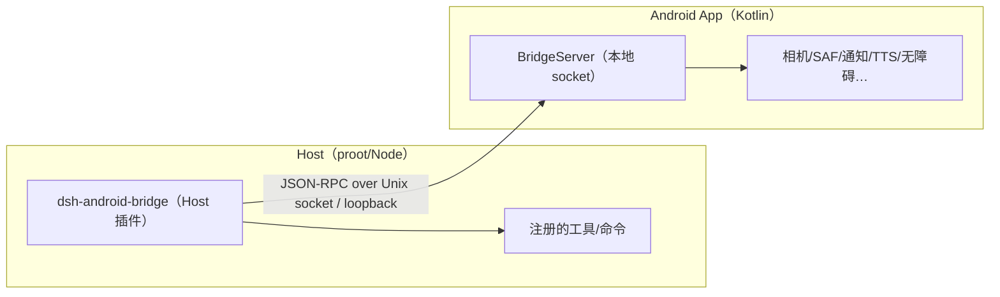
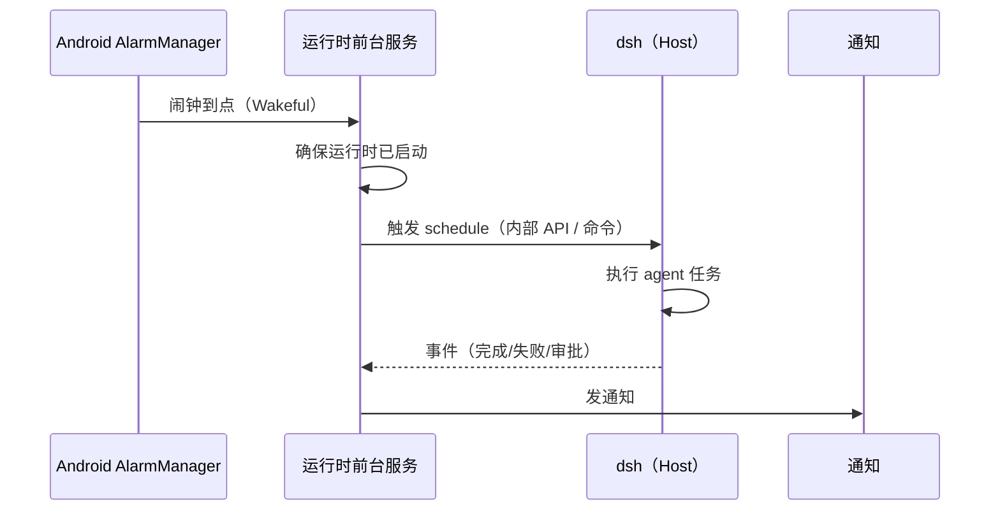

> **最终基线（v4.0）**：完整实现设计见 [DSH-手机端-最终设计-v4.0.md](DSH-手机端-最终设计-v4.0.md)。本文保留为专题设计/决策背景。

# v3.1 修订：Agent 执行中哪些部分可以 Native

| 项 | 内容 |
|---|---|
| 版本 | v3.1（v3.0 的补充章节，不改变 v3.0 的运行时选型） |
| 日期 | 2026-10-17 |
| 问题 | Agent 运行在手机上时，哪些部分可以改成原生实现，哪些必须留在 Host？ |
| 结论 | **判断标准不是「快不快」，而是「插件能不能看见」。** 插件可观察/可扩展的运行时必须留在 Host；原生只做四类：客户端呈现、设备能力、生命周期与调度触发、OS 安全增强。 |

> **v3.2 补充**：能否去掉 Linux、把运行时转译成原生，见 [`DSH-手机端-详细设计-v3.2-去Linux可行性.md`](DSH-手机端-详细设计-v3.2-去Linux可行性.md)。结论：插件是 JS 生态，转译运行时等于放弃插件；去 Linux 的现实折中是 Android Node（兼容降级）。

---

## 0. 三条判定规则

对 Agent 执行的每个组件，依次问：

1. **插件是否观察或扩展它？**（Cordis 事件、service、hook、工具注册表、prompt 段落……）
   - 是 → 不能原生化，否则插件生态断裂。
2. **它是不是 Linux 用户空间拿不到的设备能力？**（相机、传感器、SAF、通知、TTS/ASR、无障碍、AlarmManager……）
   - 是 → 原生实现，通过桥接暴露给 Host。
3. **它是不是纯客户端呈现或宿主生命周期？**
   - 是 → 原生（本来就应该原生）。

**一句话：原生只能活在「插件看不见的地方」，或者「插件看得见的扩展点后面」。**

---

## 1. 为什么 Agent Loop 不能原生化

DSH 的 Host 插件通过 Cordis 事件与服务挂进 Agent 生命周期。以下都是**插件可见面**，一旦用 Kotlin 重写 loop，这些钩子全部失效：

| 扩展点（示意） | 插件用来做什么 | 原生化的后果 |
|---|---|---|
| `agent/pre-step` | 改写/拒绝用户消息、注入上下文 | 插件失效 |
| `agent/request` / `prepareCall` | 改写模型请求、切换路由、加系统提示 | 插件失效 |
| `step/start` / 工具事件 | 观测每一步、工具调用与结果 | 观测/审计插件失效 |
| `tool/*` 注册与包装 | 自定义工具、权限、结果改写 | 工具生态断裂 |
| `session/*` 事件 | 会话投影、标题、统计、记忆 | 会话类插件失效 |
| `agent/*` waterfall | 审批、策略、注入 | 安全/策略插件失效 |

结论：**Agent Loop、Prompt 组装、LLM 传输、工具注册表、Session 格式、Compaction、MCP、Skills、Hooks、Subagent 编排、权限策略——全部留在 Host（Node/Cordis）。** 原生重写任何一个，都会以「插件不兼容」为代价，和你的硬约束冲突。

---

## 2. 组件矩阵

| # | 组件 | 插件可观察/可扩展 | 原生化结论 | 说明 |
|---|---|---|---|---|
| 1 | Agent Loop（步进、工具调度、取消） | 是（大量事件） | ❌ Host | 原生 = 重写 Harness |
| 2 | Prompt 组装 / System Prompt | 是（prompt 段落） | ❌ Host | 插件注入段落 |
| 3 | LLM 传输 / Provider 适配 | 是（provider 插件、request hook） | ❌ Host | 原生会绕过 provider 插件 |
| 4 | 重试 / 限流 / Token 计数 | 是（retry/usage 插件） | ❌ Host | 语义必须一致 |
| 5 | Compaction / 上下文压缩 | 是（compaction 插件） | ❌ Host | 策略可插拔 |
| 6 | 工具注册表 / 工具执行 | 是（工具插件、包装 hook） | ❌ Host | 设备能力走桥接工具 |
| 7 | 内置工具（bash/fs/search/terminal） | 是 | ❌ Host | 在 Linux 用户空间执行 |
| 8 | MCP Client / MCP 工具 | 是 | ❌ Host | 协议与生命周期在 Host |
| 9 | Skills / Commands | 是 | ❌ Host | 文件与提示词机制 |
| 10 | Hooks（Claude/Codex 兼容） | 是 | ❌ Host | 外部进程语义 |
| 11 | Subagent / Workflow / Jobs | 是 | ❌ Host | 编排与事件 |
| 12 | Session 持久化 / 投影 / 查询 | 是（投影、标题、统计） | ❌ Host（原生只做只读缓存） | 格式与迁移在 Host |
| 13 | 权限策略 / 审批执行 | 是（permission preset、approval） | ❌ Host（原生只做 UI 与通知） | 执行必须在 Host |
| 14 | 沙箱策略 | 是（sandbox policy） | ❌ Host（Android 可加 OS 层） | proot 不是沙箱 |
| 15 | 定时任务语义 | 是（schedule） | ❌ Host；**触发器**可原生 | 见 §5 |
| 16 | 消息/工具卡/审批/提问的呈现 | 否（客户端侧） | ✅ 原生 | 已在 v2.0 §5 |
| 17 | 通知、锁屏动作、深链 | 否（客户端侧） | ✅ 原生 | 已在 v2.0 §5.9 |
| 18 | 设备能力（相机/分享/文件/剪贴板/通知/TTS/ASR/传感器/无障碍） | 否（Host 拿不到） | ✅ 原生 + 桥接工具 | 见 §3.2、§4 |
| 19 | 宿主生命周期（启动/停止/更新/恢复） | 否 | ✅ 原生服务 | 见 v3.0 §4 |
| 20 | 调度触发（Alarm/WorkManager/前台服务唤醒） | 否 | ✅ 原生触发器 | 语义仍在 Host |
| 21 | OS 安全增强（权限、Keystore、生物识别、SAF 隔离） | 否 | ✅ 原生 | 见 §3.4 |
| 22 | 设备本地模型（llama.cpp 等） | 是（作为 LLM provider 插件） | ⚠️ 原生仅作为 provider 后端 | P2 可选；必须走 provider 插件 |

---

## 3. 可以原生的四类

### 3.1 客户端呈现（已完成规划）

消息流、Markdown、工具卡、diff、审批、提问、todo/plan、通知、设置、SDUI 渲染——v2.0 §5/§7 已设计为原生。这里不再重复。

### 3.2 设备能力：原生实现 + 桥接为 Host 工具

原则：**原生写实现，Host 写接口**。通过一个 Host 插件 `dsh-android-bridge` 把 Android 能力注册成工具/命令/服务，插件生态仍然只看到 Cordis API。

| 能力 | 原生实现 | 暴露给 Host 的形式 |
|---|---|---|
| 相机拍照 / 相册 | CameraX / PhotoPicker | `android_camera` 工具 |
| 文件选择 / 保存 | SAF | `android_pick_file` / `android_save_file` 工具 |
| 分享 | `ACTION_SEND` | `android_share` 工具 |
| 通知 | NotificationCompat | `android_notify` 工具 + 会话事件 |
| 剪贴板 | ClipboardManager | `android_clipboard` 工具 |
| 设备信息/电量/网络 | Android APIs | `android_device_info` 工具 |
| TTS | TextToSpeech | `android_tts` 工具 |
| ASR | SpeechRecognizer / 本地模型 | `android_asr` 工具（可选） |
| 无障碍自动化（点按/读屏） | AccessibilityService | `android_ui_*` 工具（高风险，需授权） |
| 截图 | MediaProjection | `android_screenshot` 工具（需授权） |
| 应用列表/启动 | PackageManager | `android_apps` 工具 |
| 传感器 | SensorManager | `android_sensors` 工具（按需） |
| 闹钟/日历 | AlarmManager / CalendarContract | 调度器原生侧，见 §5 |

要点：
- 工具名、参数、返回 schema 由 Host 插件声明；实现方是 App。
- 权限在 App 侧申请；Host 侧只看到「已授权/被拒绝」。
- 高风险能力（无障碍、截图、启动 App）默认关闭，需用户逐项授权。

### 3.3 生命周期与调度触发

- **生命周期**：启动/停止/重启/更新/备份/安全模式全部原生（v3.0 §4）。
- **调度触发**：Host 的 schedule 语义保留；原生用 `AlarmManager`/`WorkManager` 在到点时唤醒运行时，再通过内部 API 触发 Host 执行。见 §5。

### 3.4 OS 安全增强

- Android 权限、Keystore、生物识别、SAF 隔离、`FLAG_SECURE`、网络配置——原生做，Host 不感知。
- 注意：**proot 不是安全沙箱**；原生能做的是收窄 bind 范围、限制导出、审计桥调用，不能把 Host 变成安全边界。

---

## 4. 原生桥：`dsh-android-bridge`

### 4.1 拓扑



- **传输**：Unix domain socket（推荐，proot 与 App 共享文件系统）或 `127.0.0.1` 随机端口；仅本机。
- **协议**：JSON-RPC 2.0（与 DSH SDK 协议同风格），方法名 `android.<capability>.<action>`。
- **生命周期**：App 启动 BridgeServer；Host 插件启动时握手（版本、能力列表、权限状态）；运行时停止时断开。

### 4.2 协议

```jsonc
// 请求
{ "jsonrpc": "2.0", "id": "1", "method": "android.camera.capture",
  "params": { "quality": 85, "reason": "agent 需要查看设备" } }

// 响应
{ "jsonrpc": "2.0", "id": "1", "result": { "path": "/data/.../cap.jpg", "mime": "image/jpeg" } }

// 错误
{ "jsonrpc": "2.0", "id": "1", "error": { "code": 403, "message": "permission_denied" } }
```

规则：
- 每个方法有 **capability 声明**与**超时**；默认 30s，相机/文件可更长。
- 支持取消（`android.cancel` 或请求 id 取消）。
- 返回只放引用（路径/URI/内容哈希），大对象不塞 JSON。
- 版本协商：`android.hello {bridgeVersion, capabilities[]}`。

### 4.3 权限模型

| 层 | 内容 |
|---|---|
| Android 权限 | 相机/麦克风/通知/无障碍/媒体读取，运行时申请 |
| 桥 capability | Host 插件声明需要哪些方法；未声明不可调用 |
| 用户授权 | 高风险能力首次使用时弹原生确认（可记住/撤销） |
| 审计 | 每次调用记录：时间、方法、参数摘要、结果、耗时；本机可查 |

### 4.4 工具注册示例（Host 侧）

```js
// dsh-android-bridge 的 Host 半（示意）
export function apply(ctx) {
  ctx.tools.register({
    name: 'android_camera',
    description: '用手机相机拍照并把图片路径交给 agent',
    parameters: { type: 'object', properties: { reason: { type: 'string' } } },
    async execute(args, signal) {
      const r = await ctx.android.call('android.camera.capture', args, { signal })
      return { content: [{ type: 'image', path: r.path }] }
    }
  })
}
```

- 工具命名加 `android_` 前缀，避免与桌面工具冲突。
- 未授权时返回结构化错误，让模型知道「需要用户授权」而不是崩溃。
- 与 DSH 权限预设联动：高风险工具默认 ask。

### 4.5 失败与降级

| 情况 | 行为 |
|---|---|
| App 未运行/桥断开 | 工具返回 `bridge_unavailable`；提示启动 App |
| 用户拒绝权限 | 返回 `permission_denied`；模型可改用其他工具 |
| 超时/取消 | 标准错误；资源清理 |
| 运行时重启 | 桥重连；进行中的调用失败并标记 |

---

## 5. 原生调度器

Host 的 schedule 语义（cron/一次性）保留在 Host；**到点唤醒**由原生负责：



- 注册：Host 插件在创建/修改 schedule 时，通过桥把「下一次触发时间 + 任务 id」登记到原生。
- 幂等：以 `(scheduleId, scheduledAt)` 去重；设备重启后重新登记（`BOOT_COMPLETED`）。
- 限制：Doze/厂商省电会延迟；需要精确时申请 `SCHEDULE_EXACT_ALARM`（用户可拒）；拒绝时降级为「大致时间」并提示。
- 长任务：前台服务 + `specialUse`；系统强制停止后不保证续跑。

---

## 6. 原生能力映射（摘要）

| 需求 | 原生 API | Host 侧形态 |
|---|---|---|
| 拍照/选图 | CameraX / PhotoPicker | 工具 + 附件 |
| 文件读写 | SAF | 工具 + 工作区导入导出 |
| 分享结果 | `ACTION_SEND` | 工具 / 通知动作 |
| 通知/审批提醒 | NotificationCompat | 工具 + 事件订阅 |
| 语音输入 | SpeechRecognizer / 本地 ASR | 工具 / 命令 |
| 语音播报 | TextToSpeech | 工具 |
| 设备状态 | Build/电池/网络 | 工具 |
| 无障碍点按/读屏 | AccessibilityService | 工具（高风险） |
| 屏幕截图 | MediaProjection | 工具（高风险） |
| 定时唤醒 | AlarmManager/WorkManager | 调度触发器 |
| 启动/停止/更新运行时 | Service + 文件事务 | 运行时管理 UI |

---

## 7. 明确不建议原生的清单

- Agent Loop、Prompt 组装、LLM 传输、重试、Token 计数、Compaction；
- 工具注册表、工具执行、MCP、Skills、Commands、Hooks；
- Subagent/Workflow/Jobs 编排；
- Session 格式、投影、迁移、标题/统计；
- 权限策略与审批执行、沙箱策略。

原因统一：**这些是插件生态的扩展面**。原生化的收益（少量性能）远小于生态断裂的代价。

---

## 8. 原生化的收益评估

| 原生化对象 | 性能/体验收益 | 生态代价 | 结论 |
|---|---|---|---|
| 客户端呈现 | 高（流畅度、离线） | 无 | ✅ 做 |
| 设备能力工具 | 高（Host 根本做不到） | 无（走桥接） | ✅ 做 |
| 生命周期/调度触发 | 高（后台、通知） | 无 | ✅ 做 |
| 原生 ASR/TTS/相机 | 中高 | 无 | ✅ 做 |
| Agent Loop / LLM 传输 | 低（Host 内已够快） | 极高（插件断裂） | ❌ 不做 |
| 工具注册表/执行 | 低 | 极高 | ❌ 不做 |
| Session 存储 | 低 | 高（格式/迁移） | ❌ 不做（只做只读缓存） |
| 权限/审批执行 | 低 | 高 | ❌ 不做（只做 UI） |

结论：**能原生的部分主要是「Agent 之外」和「Agent 扩展点后面」；Agent 本身留在 Host。** 这不是妥协，而是保持插件生态完整的唯一方式。

---

## 9. 对工期与风险的影响

### 9.1 新增阶段

| 阶段 | 周期 | 内容 |
|---|---|---|
| N1 原生桥 | 3–4 周 | Host 插件 + App BridgeServer + 协议 + 权限 + 审计 |
| N2 设备工具集 | 3–4 周 | 相机/文件/分享/通知/剪贴板/设备信息/TTS/ASR |
| N3 原生调度 | 2 周 | AlarmManager/WorkManager、开机重登记、幂等、通知 |
| N4 高风险能力（可选） | 2–3 周 | 无障碍、截图、应用启动（默认关闭） |

- 与 C1/C2 可并行；净增约 **6–8 周**。
- 修订总工期：单人 **约 37–49 周（8.5–11 人月）**；3 人并行 **约 5–6 个月**。

### 9.2 新增风险

| # | 风险 | 对策 |
|---|---|---|
| N-R1 | proot 与 App 的 socket/文件互通 | R0 spike 验证 UDS 路径与权限 |
| N-R2 | 权限被拒导致工具不可用 | 结构化错误 + 引导授权 |
| N-R3 | 无障碍/截图合规与商店政策 | 默认关闭、逐项授权、明示用途 |
| N-R4 | 桥成为攻击面 | 能力白名单 + 用户确认 + 审计 + 不暴露任意 intent |
| N-R5 | 调度被系统限制 | 精确闹钟权限、降级提示、前台服务 |

---

## 10. 开放问题

1. 桥传输选 Unix socket 还是 loopback HTTP（proot 下的路径互通需 R0 验证）。
2. 设备工具有多少进首版：先做「文件/相机/分享/通知」，无障碍/截图放 N4。
3. 原生 ASR/TTS 是走 Host 插件（`tool`）还是直接作为命令（`/voice`）。
4. 原生调度是否需要「精确闹钟」权限，还是接受大致时间。
5. 是否提供设备本地模型（llama.cpp）作为 Host 的 LLM provider 插件（P2）。

---

> **总结**：Agent 的「大脑和手脚」留在 Host（否则插件生态断裂）；手机原生的价值在「眼睛和手」——呈现、设备能力、调度与生命周期。原生桥把 Android 能力变成 Host 插件看得见的工具，而不是把 Host 改写成原生。

