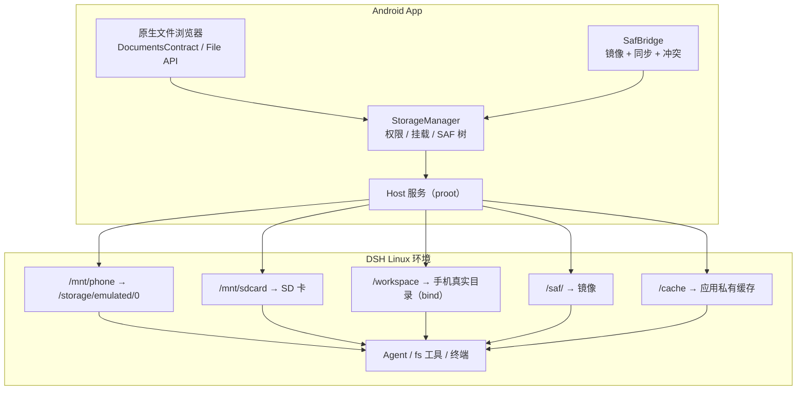

> **最终基线（v4.0）**：完整实现设计见 [DSH-手机端-最终设计-v4.0.md](DSH-手机端-最终设计-v4.0.md)。本文保留为专题设计/决策背景。

# v3.4 修订：接入系统原生文件系统（不能像虚拟容器）

| 项 | 内容 |
|---|---|
| 版本 | v3.4（v3.0 本地运行时的文件系统补充） |
| 日期 | 2026-10-17 |
| 问题 | Agent 跑在 Linux 里，怎么让它真正操作手机上的文件，而不是活在一个「虚拟容器」里？ |
| 结论 | **把「容器」降级为实现细节，把「手机文件」升级为产品一等公民。** 工作区默认就是手机真实目录；完整文件访问（All files）为主通道，SAF 为兜底；UI 永远展示 Android 的真实存储结构，Agent 使用的路径映射到真实目录。 |

---

## 0. 「像虚拟容器」的六个信号

| 信号 | 用户感受 |
|---|---|
| 文件管理器里只有「工作区」，看不到「下载/文档/图片」 | App 有自己的世界 |
| Agent 保存的文件在手机里找不到 | 产物被关在容器里 |
| 分享/打开文件要经过「导入」 | 多一步，像跨设备 |
| 路径显示 `/root/...`、`/data/...` | 看不懂 |
| 删除/覆盖没有系统确认，也没有回收站 | 不敢用 |
| 系统相册/下载器看不到 Agent 的产物 | 不像原生 App |

**目标：Agent 产物出现在用户预期的位置（下载/文档/图片），系统文件选择器、分享面板、相册、下载器都能直接用；UI 里不出现容器路径。**

---

## 1. Android 存储模型与硬限制

| 机制 | 能力 | 限制 |
|---|---|---|
| **应用私有目录** | 完整 POSIX 读写 | 用户不可见；卸载即删 |
| **共享存储** `/storage/emulated/0` | 下载/文档/图片/DCIM 等 | Android 10+ 分区存储；需 All files 或 SAF/MediaStore |
| **SAF（目录树）** | 用户授权任意目录/云盘 | `content://` URI，不是 POSIX 路径；无可靠变更通知 |
| **MediaStore** | 图片/视频/音频/下载 | 只适合媒体与 Downloads，不是通用文件系统 |
| **All files access** | 接近桌面的完整路径访问 | `MANAGE_EXTERNAL_STORAGE`；Play 政策限制；`Android/data|obb` 仍不可访问 |
| **FUSE（Android 11+）** | 共享存储的底层文件系统 | 不支持 Unix 权限/符号链接/xattr；`git`、`rsync`、打包工具可能异常 |

> 结论：**「原生文件系统」不是一个开关，而是「权限 + 路径 + 桥」的组合。** 想要 Agent 像桌面一样读写手机文件，最接近的是 All files access + bind mount；SAF 是兼容性兜底。

---

## 2. 工作区 = 手机上的真实目录

**修订：工作区默认就是用户选择的手机目录，而不是 App 私有沙箱。** 用户能在系统「文件」App 里看到它，Agent 直接在真实路径上读写；App 私有目录只作为「高性能模式」的备选。

| 模式 | 权限 | 工作区位置 | Agent 路径 | 说明 |
|---|---|---|---|---|
| **真实目录（默认）** | `MANAGE_EXTERNAL_STORAGE` | 用户选择，默认 `/storage/emulated/0/DSH` | `/workspace`（bind） | 系统文件 App 可见；推荐 |
| **SAF 镜像（受限）** | SAF 目录授权 | `<appfiles>/saf/<treeId>` | `/workspace`（镜像） | 无 All files 时兜底；标注「同步模式」 |
| **高性能工作区（可选）** | 无 | `<appfiles>/workspace` | `/workspace` | 构建/依赖密集；系统不可见 |
| **SD 卡工作区** | All files | `/storage/<UUID>/...` | `/workspace`（bind） | exFAT/FAT 限制更多 |

规则：

1. 首次启动让用户选工作区：默认 `内部存储/DSH`，或用 App 自带的目录选择器选任意手机目录。
2. 工作区通过 bind mount 映射到 Linux `/workspace`；DSH 的 workspace / cwd 即 `/workspace`。
3. UI 显示真实路径（`内部存储/DSH`），提供「在系统文件中打开」；不显示 `/mnt`、`/root`。
4. 没有 All files 时：只能用 SAF 镜像或高性能工作区，并在 UI 明确标注「同步模式 / 高性能模式」。
5. **FUSE 限制**：共享存储不支持符号链接/硬链接/Unix 权限，`git`、`pnpm`、`node_modules` 可能异常。缓解：依赖与构建缓存放 `/cache`（App 私有），通过环境变量重定向；检测到构建失败时提示切换「高性能工作区」。
6. 支持多个工作区：每个目录独立 bind 到 `/workspaces/<name>`，对应 DSH 的 Workspace 模型。

三条文件通道仍然保留（完整访问 / SAF / 媒体），但「工作区」默认走真实目录。

---

## 3. 架构



### 3.1 路径映射

| 用户看到 | Linux 内路径 | 说明 |
|---|---|---|
| 内部存储 | `/mnt/phone` | bind `/storage/emulated/0` |
| SD 卡 | `/mnt/sdcard` | bind `/storage/<UUID>` |
| 下载 | `/mnt/phone/Download` | 系统下载目录 |
| 文档 / 图片 / DCIM | `/mnt/phone/Documents` 等 | 同上 |
| 工作区 | `/workspace` | 用户选择的手机目录（默认 `内部存储/DSH`），bind |
| 高性能工作区 | `/workspace` | App 私有（可选模式），系统不可见 |
| 缓存 | `/cache` | App 私有：依赖、构建缓存、node_modules |
| SAF 目录 | `/saf/<treeId>` | 镜像根，按需同步 |
| 导入 | `/workspace/inbox` | 分享/选择文件入口 |

**UI 永不显示 `/mnt`、`/root`、`/data`**；只显示「内部存储 / 下载 / …」。终端用户可见这些路径，但终端属于高级入口。

### 3.2 启动时建立挂载

```text
proot -0 -r <rootfs> \
  -b /proc -b /dev -b /sys \
  -b /storage/emulated/0:/mnt/phone \
  -b /storage/XXXX-XXXX:/mnt/sdcard \
  -b <user-workspace>:/workspace \
  -b <appfiles>/cache:/cache \
  -b <appfiles>/saf:/saf \
  ...
```

- 工作区默认是手机真实目录（如 `/storage/emulated/0/DSH`），bind 到 `/workspace`。
- 高性能模式：`<user-workspace>` 换成 `<appfiles>/workspace`。
- 挂载点在 rootfs 内预先创建；无权限时跳过并记录。
- 每次启动校验：权限是否仍授予、SD 卡是否仍在、工作区是否存在、目录是否可写。
- 排除 `Android/data`、`Android/obb`（系统禁止）；文档与设置中说明。

---

## 4. 完整文件访问（A）细节

### 4.1 权限与引导

- Manifest：`MANAGE_EXTERNAL_STORAGE` + `READ/WRITE_EXTERNAL_STORAGE`（旧版本兼容）。
- 引导页说明：Agent 需要访问文件来读写项目；可跳过（降级 SAF）。
- 跳转：`Settings.ACTION_MANAGE_ALL_FILES_ACCESS_PERMISSION`。
- 随时可撤销；撤销后自动降级，不崩溃。

### 4.2 已知限制（必须告知与适配）

| 限制 | 影响 | 处理 |
|---|---|---|
| `Android/data`、`Android/obb` 不可访问 | 某些项目路径失败 | 文档说明；建议放 `/workspace` |
| FUSE 不支持符号链接/硬链接/Unix 权限 | `git`、`pnpm`、打包可能异常 | 依赖/构建缓存放 `/cache`；检测到失败时提示切换「高性能工作区」 |
| 大小写敏感性与桌面不同 | 少数工具行为差异 | 文档说明 |
| SD 卡/OTG 可能为 exFAT/FAT | 权限位、长文件名差异 | 测试；只做读写 |
| 媒体扫描延迟 | 相册不立即出现 | 写完后触发 `MediaScannerConnection` |

### 4.3 产物可见性

- Agent 产物默认在 `/workspace/output`，而 `/workspace` 就是手机上的真实目录（如 `内部存储/DSH/output`）——系统「文件」App 可直接看到，**不需要「导出到手机」这一步**。
- 如果工作区在高性能模式（App 私有）或 SAF 镜像模式，产物才需要「保存到手机」→ SAF 导出到下载/文档。
- 若用户指定输出目录在共享存储，直接写，并触发媒体扫描/下载通知。
- 通知文案：「已保存到 下载/report.pdf」，点击打开。

---

## 5. SAF 目录桥（B）细节

用于无法/不愿授予 All files 的场景（Play 分发、只授权某几个文件夹）。

### 5.1 授权与镜像

1. 用户 `ACTION_OPEN_DOCUMENT_TREE` 选择目录 → `takePersistableUriPermission`。
2. App 在 `<appfiles>/saf/<treeId>/` 建立镜像根。
3. 首次同步：元数据优先（名称/大小/时间），内容按需下载。
4. Agent 看到 `/saf/<treeId>/...` 的 POSIX 路径。

### 5.2 同步策略

| 方向 | 触发 | 策略 |
|---|---|---|
| SAF → 镜像 | 打开目录、前台定时扫描、ContentObserver | 增量（大小/时间）；大文件按需拉取 |
| 镜像 → SAF | Agent 写完（inotify/周期性） | 变更推送；失败重试；冲突保留双份 |
| 删除 | Agent 删除 | 移入 `.trash`，保留 30 天 |

- 冲突：双方都改 → 保留 `name (conflict).ext`，通知用户。
- 不做全盘镜像；按用户选的目录，单目录默认上限（如 2 GB/5 万文件）。
- 后台不同步（省电）；进入前台补同步。

### 5.3 与「原生感」的取舍

- SAF 桥是「导入导出」级体验，不适合作为构建/依赖目录；
- UI 上明确标注「已连接文件夹 · 自动同步」，避免用户以为所有文件都在。

---

## 6. 媒体与分享（C/D）

- 图片/视频：`READ_MEDIA_IMAGES/VIDEO` → 导入到 `/workspace/inbox`（或直接引用 URI）。
- 分享到 DSH：`ACTION_SEND` / `ACTION_SEND_MULTIPLE` → 复制到 inbox → 打开会话。
- 从 DSH 分享：FileProvider + `ACTION_SEND`；系统分享面板。
- 拍照/录像：CameraX → 存入 inbox，触发媒体扫描。
- 下载：`DownloadManager` 或 MediaStore.Downloads；通知带打开动作。

---

## 7. UI/UX：让「文件」像系统的一部分

### 7.1 文件页

- 入口：底部导航「文件」或会话内的「文件」。
- 根：内部存储 / 下载 / 文档 / 图片 / 视频 / SD 卡 / 工作区（`内部存储/DSH`）/ 已授权文件夹。
- 列表：图标、名称、大小、修改时间；面包屑；搜索；排序；多选。
- 操作：打开、预览、分享、复制到工作区、在 DSH 中打开、删除（回收站）、重命名。
- 路径显示：`内部存储 / Download / report.pdf`，不是 `/mnt/phone/...`。

### 7.2 系统集成

- 分享面板接收文件到 DSH；
- 「打开方式」用系统 Intent；
- 通知与下载器一致；
- 可选：把工作区注册为 `DocumentsProvider`，让系统「文件」App 也能浏览（P1）。

### 7.3 设置

- 「文件访问」：完整访问 / 已授权文件夹 / 仅工作区；
- 显示挂载状态、权限状态、SD 卡状态；
- 回收站与清理；
- 「Agent 可写范围」：工作区 / 全部（需确认）。

---

## 8. 安全

| 风险 | 对策 |
|---|---|
| Agent 误删/覆盖用户文件 | 写操作前确认（可配置）；回收站；关键目录只读 |
| All files 权限过大 | 首次说明；可撤销；审计文件操作 |
| Agent 访问隐私目录 | 默认限制在工作区 + 用户选定目录；越界需确认 |
| SAF 同步泄露 | 只同步用户选中的目录；本地镜像加密（P1） |
| 分享/Intent 注入 | MIME 与 URI 校验；FileProvider 精确授权 |
| 恶意插件读写文件 | 插件权限提示；文件操作审计；沙箱策略 |

原则：**权限给到「够用」，不是「全部」；越界操作必须可见、可撤销。**

---

## 9. 性能与可靠性

- 共享存储走 FUSE：大文件顺序读写可接受；小文件/大量元数据慢。依赖与构建缓存放 `/cache`；工作区在共享存储时对 `git`/`pnpm` 做兼容检测，失败则提示高性能模式。
- SAF 镜像：增量同步、按需内容、并发限流；避免前台卡顿。
- 媒体缩略图：系统的 `ThumbnailUtils` / Glide。
- 断网/拔卡：降级提示，不崩溃；挂载失效后自动重试。
- 存储不足：提前阻止写操作，提示清理。
- 权限撤销：运行时检测，自动降级到工作区。

---

## 10. 测试矩阵

| 类别 | 用例 |
|---|---|
| Android 版本 | 10/11/12/13/14/15 的分区存储与权限差异 |
| 存储 | 内部共享存储、SD 卡、OTG、exFAT/FAT |
| 权限 | 授予/拒绝/撤销 All files；SAF 树持久授权 |
| 文件 | 大文件、Unicode、特殊字符、并发读写、符号链接 |
| 工具 | git/pnpm/rsync 在共享存储 vs 工作区的行为 |
| SAF | 本地目录、Google Drive、OneDrive、只读提供方 |
| 分享/打开 | 系统分享面板、下载器、相册扫描 |
| 异常 | 拔卡、存储满、权限撤销、镜像冲突 |

---

## 11. 反模式

- ❌ 文件页只显示「工作区」，没有手机存储。
- ❌ UI 显示 `/root/...`、`/mnt/...`、`/data/...`。
- ❌ 要求用户先把文件「导入」才能给 Agent 用（除非权限受限）。
- ❌ 默认镜像整个 `/sdcard`（慢、占空间）。
- ❌ 把构建目录放在共享存储（FUSE 符号链接问题）。
- ❌ 不处理 `Android/data` 不可访问。
- ❌ 删除没有回收站/确认。
- ❌ 产物只存在容器里，系统相册/下载看不到。

---

## 12. 分阶段落地

| 阶段 | 内容 | 周期 |
|---|---|---|
| F1 | 权限引导 + bind 挂载 + 原生文件页（内部存储/下载/文档） | 3–4 周 |
| F2 | 工作区选择（真实目录）+ 导入/导出 + 分享/拍照/下载 | 2–3 周 |
| F3 | SAF 目录桥（镜像/同步/冲突/回收站） | 4–6 周 |
| F4 | 媒体/相册/OTG/DocumentsProvider（可选） | 2–3 周 |

- 与 v3.3 无缝化、v3.0 运行时并行；净增约 **8–12 周**。
- 修订总工期：单人 **约 10–13 人月**；3 人并行 **约 6–7 个月**。

---

## 13. 开放问题

1. 分发渠道：若上架 Play，All files 权限是否可用（政策风险）→ 是否以 SAF 为主。
2. 默认工作区目录用 `内部存储/DSH`，还是首次启动强制用户自选？
3. 是否允许把工作区放在 SD 卡（exFAT 限制更多，但用户可能坚持）。
4. 构建失败时是否自动提示/切换高性能工作区，还是只给建议。
5. 是否需要把工作区注册为 `DocumentsProvider`（系统文件 App 可见）。
6. Agent 写共享存储是否需要逐次确认，还是按「允许目录」一次性授权。
7. SAF 镜像的容量上限与清理策略。

---

> **一句话**：不要给用户一个「容器里的文件系统」，要给用户一部「能跑 Agent 的手机」。做法是：权限分层（All files / SAF / 工作区）、路径映射到真实目录、UI 用 Android 的存储语言、产物出现在下载/文档/相册里、越界操作可见可撤销。

